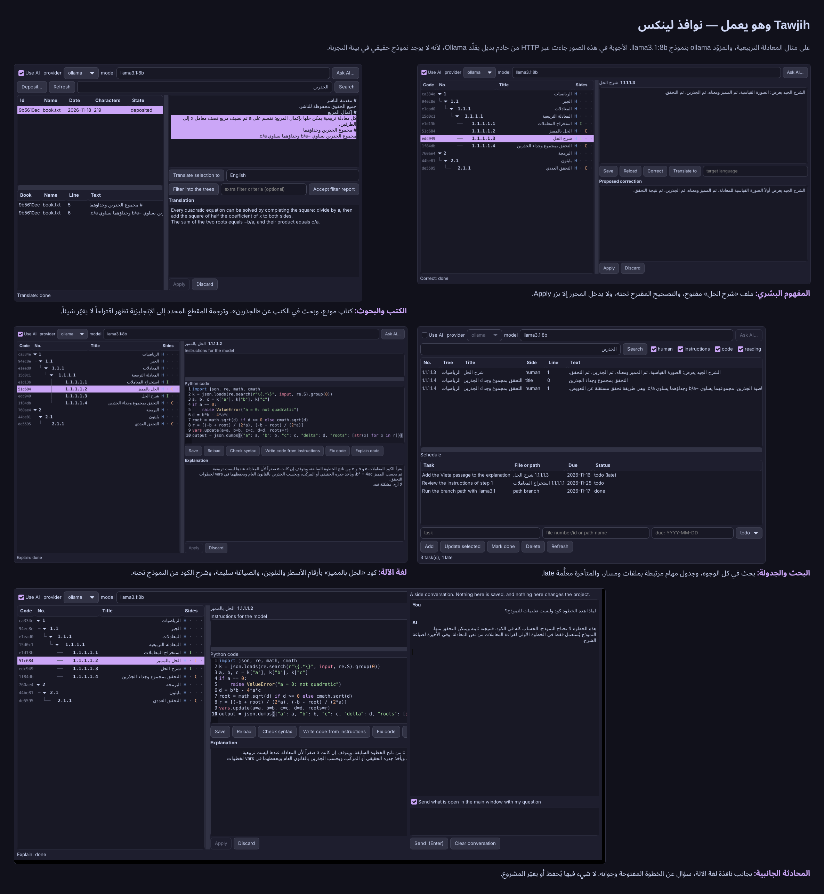

<div dir="rtl">

# tawjih — توجيه أوامر الآلة

طريقة شخصية قائمة على الملفات لتوجيه نموذج لغوي. المعرفة تُحفظ في أشجار من
ملفات صغيرة، ولكل ملف ثلاثة وجوه، و«المسار» يصل ملفات ببعضها لتصبح خطوات
ينفذها النموذج والكود واحدة بعد الأخرى.

بايثون بلا مكتبات خارجية: الملف `tawjih.py` والحزمة `tawjihlib/` بجانبه،
يعمل من الترمنال على لينكس وويندوز.

> **الحالة: 0.10.0 تجريبية.** الاختبارات تنجح على لينكس وويندوز. لم يُستعمل
> معه مزوّد ذكاء اصطناعي حقيقي بعد، ونوافذ لينكس لم يجرّبها مستخدم. انظر قسم
> «ما تم التحقق منه».


## صور البرنامج وهو يعمل

مسار المثال يعمل في الترمنال، ثم يُعاد مع `--resume`:


نوافذ لينكس الأربع والمحادثة الجانبية:



في هذه الصور جاءت أجوبة النموذج عبر HTTP من خادم بديل يقلّد Ollama، وكل ما
عداها مخرجات البرنامج الفعلية.

## الفكرة

| الوجه | محتواه | متى يُستعمل |
|---|---|---|
| **المفهوم التعبيري البشري** | شرحك للموضوع | عند بناء الملف |
| **لغة الآلة** | تعليمات للنموذج، وكود بايثون اختياري | عند البناء، و**عند تشغيل المسار** |
| **القراءة** | مقاطع مفلترة من الكتب والأبحاث المودعة مع مصدرها | عند بناء الملف |

الأشجار حتى ستة مستويات: عام ← قسم ← فصل ← موضوع ← فرع ← جزء. لكل ملف
تعريفة ثابتة مثل `e1d13b` ورقم موضعي مثل `1.1.1.1.1`، والأوامر تقبل أيهما.

المرحلتان مفصولتان عمداً:

- **وقت البناء** (`open` و`edit`): أنت، وبمساعدة مزوّد ذكاء اصطناعي إن شئت،
  تحوّل وجه القراءة إلى مفهوم بشري، والمفهوم إلى لغة آلة.
- **وقت التشغيل** (`run`): تُرسل لغة الآلة وحدها. النموذج يرى تعليمات الخطوة
  والطلب الأصلي وناتج الخطوة السابقة فقط، فيجب أن تكتفي التعليمات بنفسها.

## بداية سريعة

```
python tawjih.py -p examples/quadratic trees
python tawjih.py -p examples/quadratic produce branch --plan
python tawjih.py -p examples/quadratic produce branch --input "2x² − 4x = 6" --allow-code --backend manual
```

الوضع `manual` يعرض كل طلب وينتظر أن تلصق الجواب (أنهِه بسطر فيه نقطة فقط)،
فالمثال لا يحتاج حساباً. جواب الخطوة الأولى: `{"a": 2, "b": -4, "c": -6}`.

مشروعك أنت:

```
python tawjih.py init
python tawjih.py new "الرياضيات"
python tawjih.py new "الجبر" --parent 1 --open
python tawjih.py tree
python tawjih.py produce myprod 1.1 TO 2.3 AND 1.2 TO 1.4 --input "..." --backend ollama
```

## الإنتاج عبر الأشجار

1. `trees` يعرض الأشجار المتاحة.
2. اختر الملفات من أي شجرة، بالتعريفة أو بالرقم.
3. اربطها بالكلمات بعد `produce NAME`، فيُحفظ المسار بذلك الاسم ويُعاد
   تشغيله بـ `produce NAME`.
4. يُستخرج وجه لغة الآلة من كل ملف (انظر [SPEC.md](SPEC.md)).
5. كل ملف يُنفَّذ بعد الملفات التي تغذّيه ويستلم نواتجها.
6. النتيجة والسجل الكامل في `runs/`، وتوثيق العملية (الأشجار، الروابط، بصمة
   لغة الآلة لكل خطوة، وما نُفّذ وما تُخطّي) في `history/`.

| تكتب | المعنى |
|---|---|
| `A TO B` | ناتج A يدخل إلى B |
| `A TO B AND C` | يدخل إلى B و C معاً (تفرّع) |
| `B AND C TO D` | D يستلم الناتجين معاً (جمع) |
| `A TO B IF كلمة` | إذا كان ناتج A كائن JSON فيه مفتاح بهذا الاسم: فقط إذا كانت قيمته صحيحة أو غير فارغة؛ وإلا فقط إذا احتوى الناتج الكلمة. و`IF NOT` للعكس |
| `A AMONG B C D` | ناتج A يسمّي واحداً منها، فيُنفَّذ هو وحده |
| `A TO D THROUGH B C` | A ثم B ثم C ثم D |

العبارات تتسلسل (`A TO B AND C TO D`)، ويُفصل بين عبارتين بـ `,` أو `/`
(استعمل `/` في PowerShell). وتُقبل الكلمات العربية: إلى، و، إذا، ليس، بين،
عبر. والملفات المكتوبة بلا كلمات ربط تسلسل بسيط.

```
produce review 1.1 TO 1.2 IF خطأ / 1.1 TO 1.3 IF NOT خطأ / 1.2 AND 1.3 TO 2.1
```

`produce --plan` يعرض كل خطوة وحجمها بالأحرف وما يغذّيها دون تشغيل.

الخطوة التي لا تعيد ناتجاً توقف الإنتاج. بعد الفشل أعد الأمر نفسه مع
`--resume`: الخطوات التي لم يتغير طلبها ولا مزوّدها ولا نموذجها تأخذ جوابها
من `cache/` ولا يُستدعى النموذج لها ثانية. وإذا كان الجواب المحفوظ نفسه هو
السبب (أجاب النموذج نثراً والخطوة التالية تنتظر JSON) فرسالة الخطأ تسمّي
الخطوة التي تُسأل من جديد: `--resume --redo REF`. `--no-cache` لا يحفظ
أجوبة، و`cache` يعرض المحفوظ و`cache --clear` يمسحه. و`--model NAME` يختار
النموذج لأمر واحد. ولا يبدأ الإنتاج إذا
كانت خطوة بلا لغة آلة، أو فيها كود ولم تُضف `--allow-code`.

## العقود والنموذج والقِدَم

يمكن أن يحمل رأس الملف ثلاثة أسطر اختيارية، تُضبط بالأمر
`contract REF --expects SPEC --produces SPEC --model NAME` (و`none` تمسح
أحدها، وبلا خيارات يعرضها):

```
model: llama3.1:8b        النموذج الذي تستعمله هذه الخطوة
expects: json(a, b, c)    ما يجب أن يكون عليه مدخلها
produces: json(roots)     ما يجب أن يكون عليه ناتجها
```

العقد هو `json` أو `json(مفتاح، ...)` أو `text`. يُقبل جواب JSON إذا جاء داخل
سياج كود أو حوله جملة، كما تكتب النماذج غالباً، ويمرّ إلى الخطوة التالية
JSON مجرداً. الجواب المخالف للعقد يوقف التشغيل ولا يُحفظ في المخزن، ورسالة
الخطأ تسمّي الخطوة التي تُسأل من جديد. و`check` يقارن عقود الملفات الموصولة
قبل أي تشغيل، ويعدّ العقد غير المعروف (خطأ إملائي) خطأً.

نموذج الخطوة هو `--model` إن أُعطي، وإلا `model` في رأس الملف، وإلا
`TAWJIH_MODEL`.

عند إعادة بناء لغة الآلة (عبر `open` أو `edit` أو نوافذ لينكس) يسجّل البرنامج
حالة المفهوم البشري ووجه القراءة. فإن تغيّر أحدهما بعد ذلك صار الملف
**قديماً**: علامة `!` في `tree`، وتحذير في `check` و`produce`، وفي `graph`.
وإذا راجعت ملفاً قديماً ووجدت لغة الآلة ما زالت مناسبة فـ`confirm REF` يسجل ذلك،
وكذلك `edit` إذا طُلب منه إعادة البناء فرجع الوجه دون تغيير.

`IF` مع JSON: إذا كان ناتج الخطوة كائن JSON فإن `IF is_group` تفحص قيمة المفتاح
`is_group` (صحيحة، غير صفر، غير فارغة؛ والنصوص `"false"` و`"no"` و`"لا"` تُعدّ
خطأ)، لا ظهور حروفه في مكان ما من النص. ويضيف
`check` و`generate` ملاحظة إذا لم تكن كلمة `IF` من المفاتيح التي يعد بها
`produces` في الملف المصدر.

## الشبكة: رسم المسارات وتوليدها

`graph` يرسم الأشجار أو مساراً:

```
python tawjih.py graph -o trees.md                       # الأشجار
python tawjih.py graph --path branch -o branch.md        # مسار واحد
python tawjih.py graph --path branch --format dot -o branch.dot
```

ملف `.md` فيه مخطط Mermaid يعرضه GitHub صورةً، و`--format mermaid` يعطي
المخطط وحده، و`--format dot` يعطي Graphviz. في المسار تُجمع الملفات بحسب
أشجارها، وتُكتب شروط `IF` على الأسهم، وخيارات `AMONG` متقطعة، والتسليم بين
الأشجار سهم سميك، والملفات القديمة معلَّمة.

`generate` يقترح مساراً ولا ينفّذ شيئاً:

```
python tawjih.py generate solve2 --start 1.1.1.1.1 --end 1.1.1.1.3
python tawjih.py generate review --goal "تحقق من الحل واشرحه" --backend ollama
python tawjih.py generate review --accept
```

مع `--start` و`--end` يجد أقصر سلسلة ملفات يناسب `produces` كلٍّ منها
`expects` الذي بعده، بلا نموذج. ومع `--goal` يقرأ النموذج لغة المسار
وملفاتك وعقودها ويجيب بالعبارات. وفي الحالتين يُكتب الاقتراح في
`paths/NAME.proposed` مع كل مشكلة فيه (ملف غير موجود، حلقة، ملف بلا لغة آلة،
تعارض عقود). اقرأه وعدّله إن شئت، ثم `--accept` يحفظه مساراً بعد فحصه مرة
أخرى. و`--scope REF` يقصر الملفات على فرع واحد.

## الكتب ومصادرها

يقرأ `deposit` الكتاب من مصدره، فتبقى بنيته ورياضياته سليمة. ويرفض PDF لأنه
يحفظ مواضع الحروف في الصفحة فقط، فتتشوه الأسس والأسهم والكسور (يصير
`271³²¹` «271321»).

| المصدر | ما يفعله الإيداع |
|---|---|
| `.txt` | يبقى كما هو، وأسطر `#` عناوين |
| `.md` | عناوين `#` والعناوين المسطّرة، وتُحمى أسطر `#` داخل كتل الكود |
| `.tex` | يُقرأ على مراحل: يُحمى الكود أولاً (`verbatim` و`lstlisting` و`minted` و`\verb`) فلا يقصّ مثالُ وثيقةٍ داخل النص الكتاب، ويُقرأ `\input` و`\include` ما لم يكونا في تعليق، وتُوسَّع أوامر الوثيقة نفسها (`\newcommand` و`\def` و`\DeclareMathOperator` و`\newtheorem`)، وتُحمى الرياضيات وتبقى LaTeX، ثم تصير `\part` إلى `\subparagraph` عناوين، وتُوسم بيئات النظريات، والقوائم أسطر `- `، وتبقى الحواشي في مكانها، والإحالات `[ref: …]` و`[cite: …]`، والحروف المشكّلة والخاصة نصاً، وتُترك الصور |
| `.html` | `<h1>` إلى `<h6>` عناوين، وتُترك السكربتات والأنماط والتنقل، وMathML يُستبدل بنص TeX |
| `.xml` و`.ptx` | PreTeXt: الفصول والأقسام عناوين، ويُقرأ `xi:include`، و`<m>` و`<md>` تصير `$…$` و`$$…$$`، والنظريات والأمثلة والأشكال تأخذ أرقام الكتاب (Example 3.8) والإحالات تشير إليها، وتُترك خلايا Sage والفهرس والصور. وأي XML آخر: نصه |

`deposit BOOK --part 3 --part 4` يُبقي هذين الفصلين فقط (برقمهما أو عنوانهما).
أودع الكتاب كاملاً بهذه الطريقة لا ملف فصل وحده، حتى يبقى الترقيم ترقيم الكتاب.
كثير من الكتب المفتوحة (PreTeXt، وLaTeX على arXiv) تنشر مصدرها، فابحث عنه قبل PDF.

## الأوامر

| الأمر | الوظيفة |
|---|---|
| `init` | إنشاء مشروع في المجلد الحالي |
| `new` | إنشاء ملف، ومع `--open` تُفتح محرراته |
| `open` | فتح محرر لكل وجه والحفظ عند الإغلاق |
| `tree` | عرض الأشجار، والحروف `H I C R` تبيّن الوجوه المملوءة، و`!` لغة آلة قديمة |
| `search` | البحث في العناوين والوجوه، في كل الأشجار أو فرع واحد، و`--rank` و`--semantic` و`--tag`؛ وبقية أوامر 0.7 في [إدارة المشروع](#إدارة-المشروع) |
| `show` / `read` | عرض ملف / عرض وجه القراءة |
| `link` | تسجيل رابط بين أي ملفين |
| `contract` | عرض عقود ملف ونموذجه وإعادة المحاولة والبديل والموافقة، أو ضبطها |
| `redact` / `stats` | إخفاء البيانات الخاصة قبل استدعاء النموذج / كلفة التشغيلات؛ انظر [الفشل والموافقة والخصوصية والكلفة](#الفشل-والموافقة-والخصوصية-والكلفة) |
| `check` | فحص الآباء والمستويات والحلقات والروابط والمسارات والكود والعقود والقِدَم |
| `trees` | عرض الأشجار المتاحة |
| `graph` | رسم الأشجار أو مسار (Mermaid أو Markdown أو Graphviz)، والصيغة تتبع امتداد `-o` ما لم تُحدَّد |
| `generate` | اقتراح مسار من العقود أو من هدف بنموذج، و`--accept` لحفظه |
| `tangle` | تصدير الكود دوالَّ بايثون، دالة لكل خطوة |
| `lock` و`alias` و`review` و`stage` و`mount` و`sandbox` و`trace` و`release` و`snapshot` و`seal` و`verify` و`inherit` و`template` و`scaffold` و`gc` و`compact` و`format` و`archive` و`glossary` و`doctor` و`repair` و`schedule` و`trigger` و`pause` و`resume` و`cancel` | انظر «الحوكمة» (0.10) |
| `cache` | عرض أجوبة النموذج المحفوظة أو مسحها |
| `produce` | الإنتاج عبر الأشجار: اختيار وترتيب وفحص وتنفيذ وحفظ وتوثيق |
| `path` | تعريف مسار أو عرضه |
| `run` | تشغيل مسار محفوظ |
| `edit` | يطلب من النموذج إعادة كتابة وجه، ويعرض الفرق ويسأل قبل الحفظ |
| `deposit` / `library` | إيداع كتاب (نص، Markdown، LaTeX، HTML، XML/PreTeXt)، و`--part` لفصول بعينها / عرض الكتب المودعة |
| `confirm` | تسجيل أن لغة الآلة ما زالت توافق المفهوم البشري ووجه القراءة (يزيل علامة القِدَم) |
| `filter` | النموذج يقرر لكل مقطع: يُحفظ أم لا، ولأي ملف. يكتب تقريراً فقط |
| `accept` | إضافة المقاطع المقبولة إلى وجه القراءة في ملفاتها |
| `import` | تقسيم نص على عناوين `#` إلى ملفات فرعية بلا نموذج |

## إدارة المشروع

منذ 0.7 في توجيه أوامر لإعادة تنظيم الأشجار، وقراءة النسخ المحفوظة من الملفات،
ومعرفة ما لم يكتمل، وإخراج المعرفة من المشروع.

**إعادة الهيكلة.** المسارات تسمّي الملفات بمعرّفاتها، فنقل الملفات لا يكسر
مساراً؛ تتغير أرقام المواضع فقط.

| الأمر | ما يفعله |
|---|---|
| `move REF --to REF` (`mv`) | ينقل ملفاً وفرعه، وتتغير المستويات معه؛ `--root` يجعله شجرة جديدة؛ و`--position` و`--before` و`--after` تحدد موضعه |
| `rename REF TITLE` | يغيّر العنوان، والملف الذي يختاره بـ`AMONG` ويذكره في تعليماته يأخذ العنوان الجديد |
| `copy REF --to REF [--branch]` (`cp`) | ينسخ الأوجه والعقود والنموذج والوسوم، والروابط داخل الفرع المنسوخ تشير إلى النسخ |
| `rm REF [--branch] [--unlink] --yes` | يرفض ما دام مسار محفوظ يستعمل الملف، ودون `--yes` يعرض فقط، وتبقى نسخة في `history/` |
| `split REF --passages 3-5 --title T` | ينقل مقاطع من وجه القراءة إلى ملف جديد بعده (ودون `--passages` يعرضها) |
| `merge A B [--keep]` | يضيف وجهَي الإنسان والقراءة من B إلى A، وتنتقل الروابط إلى A، ويُحذف B ما لم يُذكر `--keep` |

**النسخ.** كل أمر يغيّر ملفاً يحفظ نسخته السابقة في `history/`.

| الأمر | ما يفعله |
|---|---|
| `log REF` | النسخ المحفوظة، الأحدث أولاً (1)، وما تغيّر بعد كل منها |
| `diff REF [--version K] [--side S]` | الفروق بين نسخة محفوظة والملف الحالي |
| `revert REF [--version K] [--side S] [--header]` | يعيد أوجهاً من نسخة (بعد حفظ الحالية)، ويعيد ملفاً محذوفاً، ووجه الآلة يعود مع بصمة المصادر التي بُني منها |

**الحالة.**

| الأمر | ما يفعله |
|---|---|
| `status [--branch REF]` | ما لم يكتمل فقط: القديم، وخطوات المسارات بلا وجه آلة، ووجه آلة بلا عقود، ووجه إنسان فارغ، وتعديلات خارج توجيه، وتعديلات متروكة في `work/` |
| `tag REF WORD...` / `untag` / `tag` | وسوم عبر الأشجار؛ `tag` وحده يعرضها، و`search --tag` يصفّي بها |
| `sync [--confirm-machine] [--clean-work] [--watch S]` | يجد الملفات المعدّلة خارج توجيه (في محرر آخر أو عبر git) منذ آخر مزامنة ويذكر أوجهها، ووجه الآلة المعاد بناؤه يدوياً يمكن تسجيله مبنياً |
| `refs REF` | الروابط الداخلة والخارجة، وكل مسار يستعمل الملف وجيرانه فيه، واختيارات `AMONG`، والوسوم المشتركة، ووجوه الآلة التي تذكر عنوانه |
| `clean [--runs DAYS] --yes` | يزيل التعديلات المتروكة في `work/` وسجلات التشغيل القديمة والروابط المكسورة، ويذكر ما لا يستطيع إصلاحه |
| `audit [REF \| --path NAME]` | يقرأ أوجه الكود بحثاً عما يمس النظام (تشغيل برامج، حذف ملفات أو كتابتها، الشبكة، تشغيل نص كوداً)، و`produce` و`run` يطبعان تحذيراته قبل تشغيل الكود. فحص لما يقوله الكود، لا عزل |

**البحث والإخراج والخدمات.**

| الأمر | ما يفعله |
|---|---|
| `search QUERY --rank` | يرتّب العناوين والفقرات ومقاطع القراءة حسب الصلة (BM25) بأي من الكلمات |
| `index --backend ollama [--model M]` ثم `search QUERY --semantic` | بحث بالمعنى عبر نموذج تضمين (الافتراضي `nomic-embed-text`)، ولا يُعاد تضمين إلا ما تغيّر |
| `export [--branch REF] [-o book.html] [--machine] [--no-reading]` | الأشجار كتاباً واحداً بـMarkdown أو HTML مع مقاطع القراءة ومصادرها، وفي HTML تُعرض الصيغ بـMathJax المحمّل من الشبكة (`--no-mathjax` لصفحة بلا اتصال) |
| `pack --branch REF \| --path NAME -o F.zip` / `unpack F.zip [--parent REF] [--new-ids]` | ينقل فرعاً ومساراته إلى مشروع آخر، والمعرّفات المتكررة تُرفض ما لم يُذكر `--new-ids` |
| `ingest FILE [--deposit]` | يحوّل `.docx` (عناوين وقوائم وجداول، والصيغ نصاً يُراجَع) و`.epub` إلى Markdown، و`.pdf` عبر `pdftotext` إن وُجد مع تحذير |
| `serve [--port P] [--backend B] [--allow-code]` | يتيح المسارات المحفوظة عبر HTTP على هذا الجهاز: `GET /paths`، و`POST /paths/NAME` بـ`{"input": "..."}` والرمز المطبوع؛ تشغيل واحد في كل مرة |
| `eval NAME [--cases F]` | يشغّل مساراً على حالات معروفة الإجابة (`paths/NAME.cases.jsonl`) ويذكر كم نجح، ويخرج بـ1 إن فشلت حالة |
| `dataset -o F.jsonl [--source eval\|runs\|steps]` | يكتب أزواج سؤال وجواب بصيغة المحادثة لأدوات الضبط الدقيق مثل Unsloth وaxolotl. توجيه لا يدرّب نماذج؛ راجع الأزواج قبل التدريب |

بـ`eval` يمكن اختبار الفرضية المركزية للطريقة: اكتب الأسئلة والإجابات المتوقعة،
ثم شغّل الحالات نفسها بمسار وبسؤال النموذج مباشرة.

## الفشل والموافقة والخصوصية والكلفة

**إعادة المحاولة.** `contract REF --retries 2` (أو `--retries N` عند التشغيل)
يسأل النموذج مرة أخرى، حتى N مرات، إذا كان جوابه فارغاً أو يخرق عقد `produces`.
الطلب الجديد يكرر الأمر ويذكر سبب رفض الجواب، ولا يُحفظ في المخزن إلا الجواب
الذي نجح، تحت الأمر الأصلي.

**البديل.** `contract REF --fallback OTHER` يسمّي ملفاً يعمل وجه آلته، على
المدخل نفسه، إذا فشلت الخطوة لأي سبب (الكود، أو استدعاء النموذج، أو العقد).
ناتجه يحل محل ناتج الخطوة، فلا يتغير باقي المسار. و`check` ينبّه إلى بديل
مفقود، أو بلا وجه آلة، أو يُخرج ما لا تعد به الخطوة.

**الموافقة.** `contract REF --approve after` (أو `before` أو `both`) يجعل
إنساناً يوافق على الخطوة: قبل تشغيلها، أو بعده، أو كليهما. وبعد الخطوة يستطيع
كتابة ناتج بديل (`e`). و`--approve ask` يسأل في الطرفية (وهو الافتراضي فيها)،
و`auto` يوافق على كل شيء، و`deny` يتوقف عند أول خطوة تحتاج موافقة (الافتراضي في
غير الطرفية، ودائماً في `eval` و`serve` ما لم يُحدَّد).

**الإخفاء.** `redact --init` ينشئ `redact.txt`. ومن بعدها كل نص يُرسل إلى نموذج
(في `produce` و`run` و`edit` و`filter` و`generate` و`eval` و`serve`) تُستبدل
فيه عناوين البريد، وأرقام الهواتف، وأرقام البطاقات التي تجتاز فحص Luhn، وأرقام
الآيبان، وأرقام الهوية ذات العشر خانات، وعناوين IP، وكلماتك وأسماؤك (سطر لكل
واحد، أو `re:` ثم تعبير نمطي) بعلامات مثل `[EMAIL_1]`، وتُعاد في الجواب.
و`redact "نص"` يريك ما سيُخفى. الأنماط لا تلتقط إلا ما تصفه: الاسم الذي لم
تذكره يُرسل كما هو.

**الكلفة.** كل تشغيل يسجّل، لكل خطوة وللمجموع، عدد الرموز الذي يعلنه المزوّد،
ووقت انتظار النموذج، وعدد الاستدعاءات وإعادات المحاولة والبدائل والعناصر
المخفية. و`stats [--path NAME] [--days N]` يجمعها لكل مسار مع آخر تقييم، ومع
`prices.json` (`{"MODEL": {"input": 3.0, "output": 15.0}}` لكل مليون رمز) يحسب
الكلفة. لا أسعار مدمجة في توجيه لأنها تتغير.

**المحوّلات.** `ingest FILE --with auto` يستعمل أفضل محوّل مثبت: لـPDF
Docling ثم Marker ثم pdftotext؛ ولملف Word فيه صيغ Pandoc (فتصير الصيغ LaTeX)
وإلا القارئ المدمج؛ ولـEPUB ‏Pandoc ثم القارئ المدمج. و`--with` يختار واحداً.

## الأمثلة وبيانات التدريب والتقييم

يمكن أن يحمل الملف وجهاً خامساً اختيارياً، `=== examples ===`: أسئلة محلولة
بإجاباتها. لا يُرسل عند تشغيل المسار، مثل وجهي الإنسان والقراءة، وهو مادة حالات
التقييم وبيانات التدريب.

```
=== examples ===
س: حل المعادلة 2س + 4 = 10
ج: نطرح 4 من الطرفين فيصير 2س = 6، إذن س = 3.
E: س = 3
خطأ: س = 7
```

`Q:` أو `س:` تبدأ مثالاً، و`A:` أو `ج:` جواب صحيح، و`E:` نص قصير يجب أن يحويه
كل جواب صحيح (وعدة نصوص تُفصل بـ`;`)، و`BAD:` أو `خطأ:` جواب خاطئ شائع. وقسم
`=== anti_examples ===` يُقرأ في الوجه نفسه. و`edit --side examples` يجعل
نموذجاً يكتبها من وجهي الإنسان والقراءة، فتُعلَّم قديمة إذا تغيّرا (`status`
و`confirm --examples`). و`check` ينبّه إلى الكتل غير المقروءة، والسؤال نفسه في
ملف تدريب وملف تقييم، والسؤال نفسه بإجابتين مختلفتين.

وسطران في الرأس يُضبطان بـ`contract`: `split: train | eval | ignore` (الافتراضي
train) يحدد أين تذهب أمثلة الملف، فلا تصل أسئلة التقييم إلى بيانات التدريب؛ و
`weight: 2` يزيد وزنها.

| الأمر | ما يفعله |
|---|---|
| `dataset --source examples -o train.jsonl [--split S] [--with-rules] [--repeat-by-weight] [--dpo pairs.jsonl]` | يجمع أمثلة ملفات `train` (أو غيرها) في JSONL بصيغة المحادثة أو prompt/completion؛ و`--with-rules` يضع تعليمات الملف قبل السؤال؛ و`--dpo` يكتب أزواج `{prompt, chosen, rejected}` من أسطر `BAD:`. ولكل مجموعة بيانات ملف `FILE.manifest.json` فيه بصمة SHA-256 لكل ملف جاءت منه |
| `eval init NAME` | ملف حالات بقالب |
| `eval extract NAME [--split eval]` | حالات من أمثلة ملفات `eval`: يصير `E:` النص المتوقع، ودونه يحكم في الحالة نموذج |
| `eval synthesize NAME --backend B [--count N]` | نموذج يقترح حالات صعبة من وجوه الإنسان والأمثلة (لا من ملفات `eval`) في ملف للمراجعة؛ و`--accept` يضيفها |
| `eval NAME [--judge MODEL] [--fail-fast]` | يشغّل الحالات؛ وحالات `match: judge` يحكم فيها نموذج؛ و`--fail-fast` يتوقف عند أول فشل ويعرضه |
| `eval NAME --direct` | الحالات نفسها تُرسل إلى النموذج مباشرة دون المسار |
| `eval compare NAME [A B]` | تقييمان حالةً حالة، والافتراضي المسار مقابل سؤال النموذج مباشرة |
| `eval baseline NAME --save` / `eval diff NAME [--baseline]` | نتيجة مرجعية؛ وكل `eval` بعدها يذكر الحالات التي نجحت فيها وتفشل الآن (ويخرج بـ1)؛ و`diff` يعرض ما تغيّر |
| `eval blame NAME [--case C]` | لكل حالة فاشلة خطوات تشغيلها: أيها فشل، أو أين ظهر النص المتوقع ثم ضاع |
| `eval promote NAME --to REF` | الحالات الفاشلة تصير أمثلة في ملف تدريب، والناتج الخاطئ `BAD:`؛ وتخرج من ملف الحالات لأن الحالة التي دُرّب عليها لم تعد تختبر |
| `eval report NAME [-o eval.md]` | الدقة والوقت والرموز والحالات الفاشلة، والنموذج المباشر والنتيجة المرجعية إن وُجدا |

`eval compare` هو اختبار الطريقة: إذا لم يتفوق المسار على سؤال النموذج مباشرة
في حالات تهمك، فجهد بنائه لم يُثمر. وحالات قليلة لا تحسم شيئاً، والنموذج الحَكَم
له انحيازاته.

## الحوكمة: الأقفال والمراجعة والإصدارات والجدولة

منذ 0.10 يمكن حماية المشروع وحفظه عبر الزمن.

| الأمر | عمله |
|---|---|
| `lock REF... [--branch]` (`freeze`) / `unlock` | الملف المقفل لا تتغير وجوهه ولا عنوانه ولا عقوده ولا روابطه، ولا يُحذف ولا يُؤرشف، حتى يُفتح قفله؛ ويبقى نقله ممكناً |
| `alias REF NAME...` / `unalias` / `alias` | أسماء أخرى للملف تُستعمل حيث يُطلب REF (`show quad`، `path p quad TO ...`) |
| `review [REF...] [--branch]` / `review --ok REF...` | الملفات التي لم يراجعها إنسان، أو تغيرت بعد مراجعتها؛ و`--ok` يسجل المراجعة (بصمة المحتوى والتاريخ) |
| `edit ... --stage` / `stage [REF] [--show \| --apply \| --drop]` | يُحفظ اقتراح النموذج في `stage/` بدل حفظه في الملف؛ و`--apply` يحفظه كما يفعل `edit`، إلا إذا تغير الوجه في الأثناء |
| `mount FOLDER [--name N]` / `unmount N` | ملفات مشروع آخر للقراءة فقط، تُستعمل في مسارات هذا المشروع، وتُرقّم أشجارها بعد أشجاره. ولا يُفك تركيب يستعمله مسار |
| `sandbox REF --input TEXT [--memory MB]` | تشغيل كود ملف واحد في العزل (انظر «تحذير الكود») |
| `contract REF --each yes\|KEY` | «لكل» FOR EACH: تعمل الخطوة مرة لكل عنصر في قائمة JSON (المدخل نفسه أو القائمة تحت المفتاح)، وتمرر `{"items": [...]}` |
| `trace --impact REF` | ما يبلغه التعديل: الملفات تحته، والروابط إليه، والمسارات والخطوات بعده في كل منها، وحالات التقييم، وخطوط الأساس، وملفات `AMONG` التي تختاره، ومن يستعمله بديلاً، ومجموعات البيانات والإصدارات التي تضمه |
| `trace --output FILE` | من أين جاء سجل تشغيل أو سجله النصي أو نتيجته أو بيان مجموعة بيانات: الخطوات، وهل تغيرت لغة الآلة فيها بعده، والكتب في وجوه القراءة |
| `trace --cost [--path P]` | جدول `stats` نفسه |
| `release create NAME [--note T]` / `list` / `verify NAME` / `diff A [B]` / `rollback NAME --yes` | ملف zip فيه `files/` و`paths/` (مع الحالات وخطوط الأساس) و`redact.txt` و`prices.json` و`mounts.json`، مع بصمة SHA-256 لكل ملف وللكل. `diff` يقارن إصدارين أو إصداراً بالمشروع، و`rollback` يحفظ الحالة الحالية إصداراً أولاً، ويرفض تغيير ملفات مقفلة بلا `--force` |
| `snapshot [--note T]` | إصدار يُسمّى بالوقت |
| `seal [--sign]` / `verify` | `seal.json` فيه بصمة كل ملف، و`verify` يسرد ما تغير (حالة خروج 1). و`--sign` يوقّعه بـ GnuPG إن كان `gpg` مثبتاً، فيفحص `verify` التوقيع |
| `inherit REF [--fields model,tags,...] [--overwrite]` | يعطي الملفات تحت REF نموذجه أو وسومه أو split أو weight أو عقوده أو إعادة المحاولة أو الموافقة، حيث لا قيمة لها فقط، إلا مع `--overwrite`؛ والوسوم تُضاف |
| `template save NAME REF [--branch]` / `list` / `rm NAME`؛ `scaffold NAME [--parent REF] [--title T]` | حفظ ملف أو فرع قالباً في `templates/`، وإنشاء ملفات جديدة منه |
| `gc [--keep N] [--days D] [--cache-days D] [--yes]` | حذف النسخ القديمة من `history/` (تبقى أحدث N لكل ملف، وآخر نسخة لملف محذوف دائماً) والأجوبة المحفوظة القديمة؛ بلا `--yes` يعدّ فقط |
| `compact` | ترقيم الإخوة 1، 2، ... وإعادة كتابة كل ملف بالصيغة القياسية |
| `format [--check] [--branch REF]` (`lint`) | المسافات في آخر الأسطر، وتتابع الأسطر الفارغة، والوسوم المكررة؛ و`--check` يبلّغ فقط (حالة خروج 1) |
| `archive REF --yes` / `archive --list` / `archive --restore ID` | نقل فرع من الأشجار إلى `archive/` حيث لا يقرؤه شيء، وإعادته. ولا يُؤرشف فرع يستعمله مسار أو يرتبط به ملف من خارجه |
| `glossary [--conflicts] [-o FILE]` | المصطلحات التي تعرّفها الوجوه البشرية، بصيغة `**مصطلح**` أو سطر `مصطلح: تعريف`؛ و`--conflicts` المصطلحات المعرّفة بأكثر من معنى. هو تقدير تقريبي: السطر القصير بنقطتين يُعدّ تعريفاً |
| `doctor` / `repair` | فحص المشروع دون الثقة به: ملفات لا تُقرأ، تعريفات لا تطابق أسماء الملفات، آباء مفقودون، دورات، روابط مكسورة، مسارات تذكر ملفات مفقودة، و`state.json` أو الفهرس أو الأجوبة المحفوظة إذا لم تُقرأ. و`repair` ينقل ما لا يُقرأ إلى `quarantine/`، ويحذف الروابط المكسورة والأجوبة التالفة، ويجعل الملف اليتيم جذر شجرة |
| `schedule NAME --path P --every 6h\|--at HH:MM [--input T] [--backend B]` / `schedule` | تشغيل مسار في أوقات محددة |
| `trigger NAME --path P --on-change REF,REF` | تشغيل مسار عند تغير تلك الملفات |
| `pause` / `resume` / `cancel NAME` | إيقاف جدولة أو مشغّل أو إعادته أو حذفه |
| `schedule --run-due` | يشغّل ما حان وقته. Tawjih ليس خدمة تعمل دائماً: استدعه من cron أو من «جدولة المهام» في ويندوز كل بضع دقائق (يطبع `schedule` السطر المطلوب). والتشغيل المجدول يرفض خطوات الموافقة |

## نوافذ سطح المكتب، لمستخدمي لينكس

**لمستخدمي لينكس فقط.** `linux/tawjih_desk.py` يفتح أربع نوافذ مستقلة على
المشروع: الكتب والبحوث، المفهوم البشري، لغة الآلة، والبحث مع جدول المهام.
ولكل نافذة محادثة جانبية مع الذكاء الاصطناعي لا تغيّر المشروع. يعمل على
GTK 3 أو Tkinter بواجهة إنجليزية ومساعدة اختيارية من الذكاء الاصطناعي.
وكل ما عدا ذلك في هذا المستودع يعمل على لينكس وويندوز. التفاصيل في
[linux/README.md](linux/README.md).

## المحررات

- ويندوز: Notepad، نافذة لكل وجه.
- لينكس: nano ثم vim داخل الترمنال، ومع vim تظهر الوجوه متجاورة.
- VS Code: `--editor vscode`. لغة الآلة تُفتح ملفين، `instructions.md`
  و`code.py`، بجانب `human.md`، فيعمل دعم بايثون و Markdown. أغلق النافذة
  للحفظ. و`--split` يفعل المثل مع أي محرر.
- غير ذلك: `--editor` أو المتغير `TAWJIH_EDITOR`.

لغة الآلة مستند واحد: التعليمات فوق سطر `=== code ===` والكود تحته. محرر
القراءة يُفتح فقط إذا كان في الملف مقاطع، أو مع `--reading`.

## المزوّدون

| `--backend` | يتصل بـ | المتغيرات |
|---|---|---|
| `dry` (الافتراضي) | لا شيء، يعرض ما سيُرسل | — |
| `manual` | تلصق الجواب بنفسك | — |
| `ollama` | خادم Ollama محلي | `OLLAMA_HOST` اختياري |
| `openai` | أي مزوّد متوافق مع صيغة OpenAI | `TAWJIH_BASE_URL` و`TAWJIH_API_KEY` |
| `anthropic` | Anthropic | `ANTHROPIC_API_KEY` |

اسم النموذج بالخيار `--model NAME` أو في `TAWJIH_MODEL`. المفاتيح تُقرأ من متغيرات البيئة ولا تُكتب
على القرص.

## تحذير الكود

الكود في لغة الآلة يُنفَّذ **بكامل صلاحيات حسابك**، ولا يعمل إلا مع
`--allow-code`. ومع `--sandbox` (في `run` و`produce` و`eval` و`serve`) تعمل
كل خطوة كود في عملية بايثون منفصلة، بمجلد عمل مؤقت وبيئة فارغة، ومع حدود على
الذاكرة (512 ميغابايت) ووقت المعالج وحجم الملفات على لينكس وماك. هذا يمنع
الخطأ من ملء الذاكرة أو القرص، لكنه لا يقطع الشبكة ولا الملفات خارج ذلك
المجلد: هو سياج لا سجن. لا تشغّل مساراً فيه كود لم تقرأه، ومنه ما كتبه النموذج
عبر `edit`. وتُوقف خطوة الكود إذا تجاوزت 60 ثانية (`--code-timeout ثوانٍ`،
و`0` بلا حد). يُفحص الحد بين أسطر بايثون، فيوقف حلقة لا تنتهي لا استدعاءً
طويلاً واحداً داخل كود C، ويبطئ حلقات بايثون الخالصة عدة مرات ما دام مفعلاً.
هو حماية من الأخطاء، لا عزل.

## الحدود

- الفروع تُنفَّذ واحداً بعد الآخر لا في وقت واحد، ولا حلقات؛ و«لكل»
  (`contract --each`) يشغّل خطوة واحدة على عناصر قائمة واحداً بعد الآخر. إعادة المحاولة
  تسأل النموذج مجدداً فقط إذا خرق جوابه العقد، والإنتاج الفاشل يُعاد مع `--resume`.
- الإخفاء لا يلتقط إلا ما تصفه أنماطه وقائمتك.
- `schedule` لا يشغّل شيئاً وحده: يحتاج مجدول النظام ليستدعي
  `schedule --run-due`. والقفل والختم والمراجعة تحمي من الأخطاء التي تمر عبر
  Tawjih، لا ممن يعدّل الملفات يدوياً (يُظهر `verify` و`sync` ذلك بعده).
- البرنامج هو `tawjih.py` مع الحزمة `tawjihlib/`، فانسخهما معاً.
- الجواب المحفوظ يُعاد كما هو. النموذج يجيب بشكل مختلف كل مرة، فـ`--resume`
  يثبّت أول جواب حتى يتغير الطلب.
- `IF` تفحص قيمة مفتاح في ناتج JSON أو وجود كلمة في النص، و`AMONG` تبحث عن رقم المرشح أو تعريفته
  أو عنوانه فيه. كلاهما يعتمد على أن يصوغ النموذج جوابه كما تطلب التعليمات.
- للروابط أثر فقط في الكود الذي يستدعي `linked()`.
- تُقرأ الكتب من نص أو Markdown أو LaTeX أو HTML أو XML (PreTeXt)، ويحوّل
  `ingest` ملفات Word وEPUB وPDF (عبر `pdftotext`) إلى Markdown أولاً. قارئا
  LaTeX وHTML يعالجان الصيغ الشائعة، لا كل حزمة أو تخطيط صفحة، وصيغ Word تخرج
  نصاً عادياً.
- `search --semantic` بقدر جودة نموذج التضمين، و`--rank` يطابق الكلمات لا
  المعاني.
- `serve` يشغّل مساراً واحداً في كل مرة ولا حسابات فيه: من يملك الرمز يشغّل
  المسارات المعروضة بمزوّدك، ومع `--allow-code` يشغّل كودها.
- الفلترة طلب للنموذج عن كل مقطع، وتنسخ المقطع حرفياً بلا تلخيص.
- القِدَم يُسجَّل عند كتابة لغة الآلة عبر `open` أو `edit` أو نوافذ لينكس،
  وبعد تعديل الملفات يدوياً شغّل `sync`.
- `generate --start/--end` يجد سلاسل مستقيمة فقط، وعبر ملفات تعلن العقدين.
  واقتراح النموذج بقدر جودة النموذج: يُفحص ولا يُصدَّق.
- `tangle` يصدّر الكود فقط، والوحدة المصدَّرة لا تشغّل المسار.
- المزوّد الخارجي يستلم ما ترسله: مع `edit` وجوه الملف ومفاهيم آبائه، ومع
  `filter` مقاطع الكتاب وعناوين الشجرة.

## ما تم التحقق منه

تم بالاختبارات (`python -m unittest discover -s tests -v`) على لينكس
وبايثون 3.12: صيغة الملف، الأشجار والترقيم، فحص البنية، تشغيل المسارات والإنتاج عبر الأشجار
بالتفرّع والجمع و`IF` و`AMONG` و`THROUGH` (ومنه أن المفهوم البشري ووجه القراءة لا يصلان للنموذج)، `edit`، سلسلة
الإيداع والفلترة والقبول، و`open` بمحرر بديل مبرمج، والعقود، واختيار النموذج،
والقِدَم، و`steps` و`linked`، و`tangle` و`graph` و`generate`، ومنذ 0.7 كل
أوامر [إدارة المشروع](#إدارة-المشروع)، مع استدعاء `serve` فعلياً عبر HTTP
واستبدال مزوّد التضمين ببديل للاختبار، ومنذ 0.8 إعادة المحاولة والبديل
والموافقة والإخفاء (ومنه استدعاءات نوافذ لينكس) والكلفة و`stats`، مع استبدال
Docling وMarker وPandoc بسكربتات بديلة، ومنذ 0.10 كل أوامر «الحوكمة» (والعزل
مختبر على لينكس فقط، والتوقيع بـ GnuPG غير مختبر)، وجُرّب Pandoc نفسه على ملف Word حقيقي فيه صيغ. ورُسمت مخططات
`graph` فعلياً بأداة Mermaid وبـ Graphviz.

الاختبارات نفسها تنجح على ويندوز ولينكس وبايثون 3.11 و3.13 في GitHub Actions
عند كل رفع. ونوافذ لينكس شُغّلت بسكربت على شاشة افتراضية، والتفاصيل في
[linux/README.md](linux/README.md).

لم يتم بعد: المحررات والنوافذ بيد مستخدم حقيقي، والمزوّدون الحقيقيون.

## الترخيص

Copyright (c) 2026 Mohammed Khalid Almodiny

مرخّص برخصة [المشاع الإبداعي: نَسب المصنَّف، غير تجاري، الترخيص بالمثل 4.0
دولي](LICENSE) (CC BY-NC-SA 4.0): يحق لك الاستعمال والمشاركة والتعديل لأغراض
غير تجارية، بشرط ذكر صاحب العمل ونشر تعديلاتك بالرخصة نفسها. الاستعمال
التجاري يحتاج إذناً مستقلاً من صاحب الحقوق.

</div>
