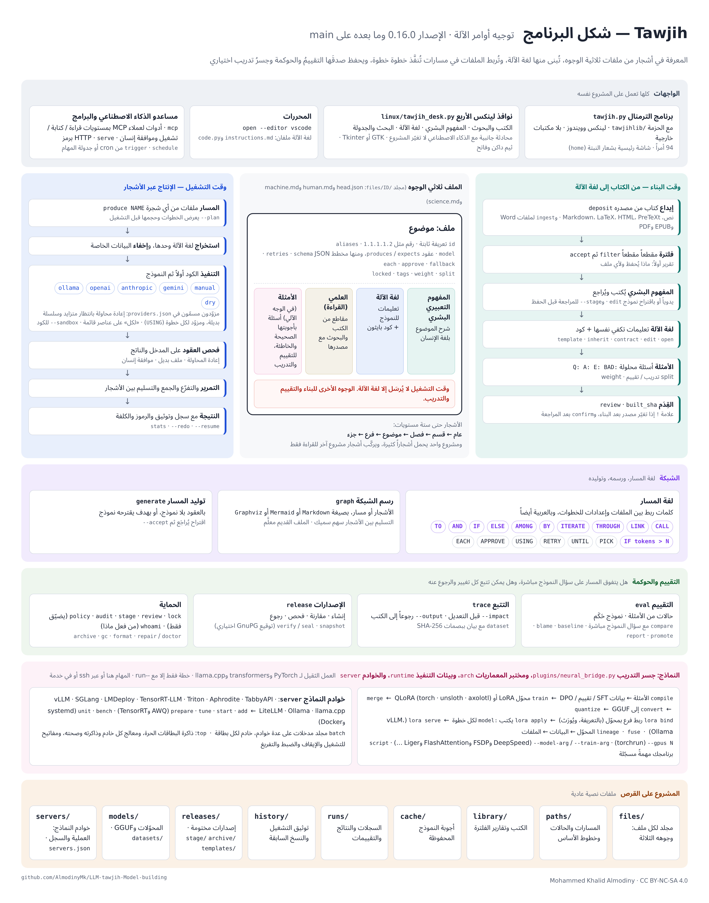
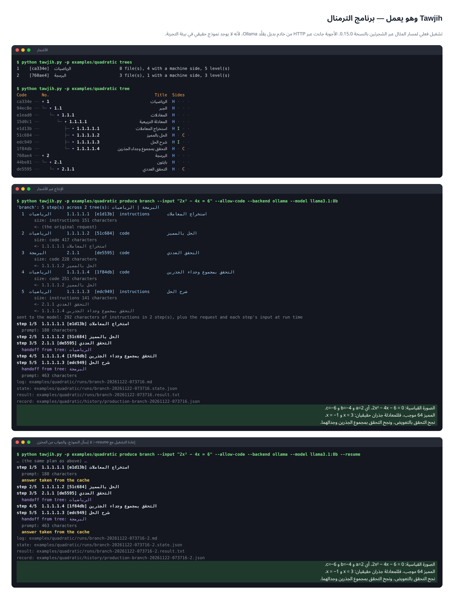

<div dir="rtl">

# tawjih — توجيه أوامر الآلة

طريقة شخصية قائمة على الملفات لتوجيه نموذج لغوي. المعرفة تُحفظ في أشجار من
ملفات صغيرة، ولكل ملف ثلاثة وجوه، و«المسار» يصل ملفات ببعضها لتصبح خطوات
ينفذها النموذج والكود واحدة بعد الأخرى.

ملف بايثون واحد بلا مكتبات خارجية، يعمل من الترمنال على لينكس وويندوز.

> **الحالة: 0.6.1 تجريبية.** الاختبارات تنجح على لينكس وويندوز. لم يُستعمل
> معه مزوّد ذكاء اصطناعي حقيقي بعد، ونوافذ لينكس لم يجرّبها مستخدم. انظر قسم
> «ما تم التحقق منه».



## صور البرنامج وهو يعمل

مسار المثال يعمل في الترمنال، ثم يُعاد مع `--resume`:



نوافذ لينكس الأربع والمحادثة الجانبية:


في هذه الصور جاءت أجوبة النموذج عبر HTTP من خادم بديل يقلّد Ollama، وكل ما
عداها مخرجات البرنامج الفعلية.

## الفكرة

| الوجه | محتواه | متى يُستعمل |
|---|---|---|
| **المفهوم التعبيري البشري** | شرحك للموضوع | عند بناء الملف |
| **لغة الآلة** | تعليمات للنموذج، وكود بايثون اختياري | عند البناء، و**عند تشغيل المسار** |
| **القراءة** | مقاطع مفلترة من الكتب والأبحاث المودعة مع مصدرها | عند بناء الملف |

الأشجار حتى ستة مستويات: عام ← قسم ← فصل ← موضوع ← فرع ← جزء. لكل ملف
تعريفة ثابتة مثل `e1d13b` ورقم موضعي مثل `1.1.1.1.1`، والأوامر تقبل أيهما.

المرحلتان مفصولتان عمداً:

- **وقت البناء** (`open` و`edit`): أنت، وبمساعدة مزوّد ذكاء اصطناعي إن شئت،
  تحوّل وجه القراءة إلى مفهوم بشري، والمفهوم إلى لغة آلة.
- **وقت التشغيل** (`run`): تُرسل لغة الآلة وحدها. النموذج يرى تعليمات الخطوة
  والطلب الأصلي وناتج الخطوة السابقة فقط، فيجب أن تكتفي التعليمات بنفسها.

## بداية سريعة

```
python tawjih.py -p examples/quadratic trees
python tawjih.py -p examples/quadratic produce branch --plan
python tawjih.py -p examples/quadratic produce branch --input "2x² − 4x = 6" --allow-code --backend manual
```

الوضع `manual` يعرض كل طلب وينتظر أن تلصق الجواب (أنهِه بسطر فيه نقطة فقط)،
فالمثال لا يحتاج حساباً. جواب الخطوة الأولى: `{"a": 2, "b": -4, "c": -6}`.

مشروعك أنت:

```
python tawjih.py init
python tawjih.py new "الرياضيات"
python tawjih.py new "الجبر" --parent 1 --open
python tawjih.py tree
python tawjih.py produce myprod 1.1 TO 2.3 AND 1.2 TO 1.4 --input "..." --backend ollama
```

## الإنتاج عبر الأشجار

1. `trees` يعرض الأشجار المتاحة.
2. اختر الملفات من أي شجرة، بالتعريفة أو بالرقم.
3. اربطها بالكلمات بعد `produce NAME`، فيُحفظ المسار بذلك الاسم ويُعاد
   تشغيله بـ `produce NAME`.
4. يُستخرج وجه لغة الآلة من كل ملف (انظر [SPEC.md](SPEC.md)).
5. كل ملف يُنفَّذ بعد الملفات التي تغذّيه ويستلم نواتجها.
6. النتيجة والسجل الكامل في `runs/`، وتوثيق العملية (الأشجار، الروابط، بصمة
   لغة الآلة لكل خطوة، وما نُفّذ وما تُخطّي) في `history/`.

| تكتب | المعنى |
|---|---|
| `A TO B` | ناتج A يدخل إلى B |
| `A TO B AND C` | يدخل إلى B و C معاً (تفرّع) |
| `B AND C TO D` | D يستلم الناتجين معاً (جمع) |
| `A TO B IF كلمة` | إذا كان ناتج A كائن JSON فيه مفتاح بهذا الاسم: فقط إذا كانت قيمته صحيحة أو غير فارغة؛ وإلا فقط إذا احتوى الناتج الكلمة. و`IF NOT` للعكس |
| `A AMONG B C D` | ناتج A يسمّي واحداً منها، فيُنفَّذ هو وحده |
| `A TO D THROUGH B C` | A ثم B ثم C ثم D |

العبارات تتسلسل (`A TO B AND C TO D`)، ويُفصل بين عبارتين بـ `,` أو `/`
(استعمل `/` في PowerShell). وتُقبل الكلمات العربية: إلى، و، إذا، ليس، بين،
عبر. والملفات المكتوبة بلا كلمات ربط تسلسل بسيط.

```
produce review 1.1 TO 1.2 IF خطأ / 1.1 TO 1.3 IF NOT خطأ / 1.2 AND 1.3 TO 2.1
```

`produce --plan` يعرض كل خطوة وحجمها بالأحرف وما يغذّيها دون تشغيل.

الخطوة التي لا تعيد ناتجاً توقف الإنتاج. بعد الفشل أعد الأمر نفسه مع
`--resume`: الخطوات التي لم يتغير طلبها ولا مزوّدها ولا نموذجها تأخذ جوابها
من `cache/` ولا يُستدعى النموذج لها ثانية. وإذا كان الجواب المحفوظ نفسه هو
السبب (أجاب النموذج نثراً والخطوة التالية تنتظر JSON) فرسالة الخطأ تسمّي
الخطوة التي تُسأل من جديد: `--resume --redo REF`. `--no-cache` لا يحفظ
أجوبة، و`cache` يعرض المحفوظ و`cache --clear` يمسحه. و`--model NAME` يختار
النموذج لأمر واحد. ولا يبدأ الإنتاج إذا
كانت خطوة بلا لغة آلة، أو فيها كود ولم تُضف `--allow-code`.

## العقود والنموذج والقِدَم

يمكن أن يحمل رأس الملف ثلاثة أسطر اختيارية، تُضبط بالأمر
`contract REF --expects SPEC --produces SPEC --model NAME` (و`none` تمسح
أحدها، وبلا خيارات يعرضها):

```
model: llama3.1:8b        النموذج الذي تستعمله هذه الخطوة
expects: json(a, b, c)    ما يجب أن يكون عليه مدخلها
produces: json(roots)     ما يجب أن يكون عليه ناتجها
```

العقد هو `json` أو `json(مفتاح، ...)` أو `text`. يُقبل جواب JSON إذا جاء داخل
سياج كود أو حوله جملة، كما تكتب النماذج غالباً، ويمرّ إلى الخطوة التالية
JSON مجرداً. الجواب المخالف للعقد يوقف التشغيل ولا يُحفظ في المخزن، ورسالة
الخطأ تسمّي الخطوة التي تُسأل من جديد. و`check` يقارن عقود الملفات الموصولة
قبل أي تشغيل، ويعدّ العقد غير المعروف (خطأ إملائي) خطأً.

نموذج الخطوة هو `--model` إن أُعطي، وإلا `model` في رأس الملف، وإلا
`TAWJIH_MODEL`.

عند إعادة بناء لغة الآلة (عبر `open` أو `edit` أو نوافذ لينكس) يسجّل البرنامج
حالة المفهوم البشري ووجه القراءة. فإن تغيّر أحدهما بعد ذلك صار الملف
**قديماً**: علامة `!` في `tree`، وتحذير في `check` و`produce`، وفي `graph`.
وإذا راجعت ملفاً قديماً ووجدت لغة الآلة ما زالت مناسبة فـ`confirm REF` يسجل ذلك،
وكذلك `edit` إذا طُلب منه إعادة البناء فرجع الوجه دون تغيير.

`IF` مع JSON: إذا كان ناتج الخطوة كائن JSON فإن `IF is_group` تفحص قيمة المفتاح
`is_group` (صحيحة، غير صفر، غير فارغة؛ والنصوص `"false"` و`"no"` و`"لا"` تُعدّ
خطأ)، لا ظهور حروفه في مكان ما من النص. ويضيف
`check` و`generate` ملاحظة إذا لم تكن كلمة `IF` من المفاتيح التي يعد بها
`produces` في الملف المصدر.

## الشبكة: رسم المسارات وتوليدها

`graph` يرسم الأشجار أو مساراً:

```
python tawjih.py graph -o trees.md                       # الأشجار
python tawjih.py graph --path branch -o branch.md        # مسار واحد
python tawjih.py graph --path branch --format dot -o branch.dot
```

ملف `.md` فيه مخطط Mermaid يعرضه GitHub صورةً، و`--format mermaid` يعطي
المخطط وحده، و`--format dot` يعطي Graphviz. في المسار تُجمع الملفات بحسب
أشجارها، وتُكتب شروط `IF` على الأسهم، وخيارات `AMONG` متقطعة، والتسليم بين
الأشجار سهم سميك، والملفات القديمة معلَّمة.

`generate` يقترح مساراً ولا ينفّذ شيئاً:

```
python tawjih.py generate solve2 --start 1.1.1.1.1 --end 1.1.1.1.3
python tawjih.py generate review --goal "تحقق من الحل واشرحه" --backend ollama
python tawjih.py generate review --accept
```

مع `--start` و`--end` يجد أقصر سلسلة ملفات يناسب `produces` كلٍّ منها
`expects` الذي بعده، بلا نموذج. ومع `--goal` يقرأ النموذج لغة المسار
وملفاتك وعقودها ويجيب بالعبارات. وفي الحالتين يُكتب الاقتراح في
`paths/NAME.proposed` مع كل مشكلة فيه (ملف غير موجود، حلقة، ملف بلا لغة آلة،
تعارض عقود). اقرأه وعدّله إن شئت، ثم `--accept` يحفظه مساراً بعد فحصه مرة
أخرى. و`--scope REF` يقصر الملفات على فرع واحد.

## الكتب ومصادرها

يقرأ `deposit` الكتاب من مصدره، فتبقى بنيته ورياضياته سليمة. ويرفض PDF لأنه
يحفظ مواضع الحروف في الصفحة فقط، فتتشوه الأسس والأسهم والكسور (يصير
`271³²¹` «271321»).

| المصدر | ما يفعله الإيداع |
|---|---|
| `.txt` | يبقى كما هو، وأسطر `#` عناوين |
| `.md` | عناوين `#` والعناوين المسطّرة، وتُحمى أسطر `#` داخل كتل الكود |
| `.tex` | `\part` إلى `\subsubsection` عناوين، ويُقرأ `\input` و`\include`، وتُوسم بيئات النظريات، والقوائم أسطر `- `، والرياضيات تبقى LaTeX، وتُترك الصور والتعليقات |
| `.html` | `<h1>` إلى `<h6>` عناوين، وتُترك السكربتات والأنماط والتنقل، وMathML يُستبدل بنص TeX |
| `.xml` و`.ptx` | PreTeXt: الفصول والأقسام عناوين، ويُقرأ `xi:include`، و`<m>` و`<md>` تصير `$…$` و`$$…$$`، والنظريات والأمثلة والأشكال تأخذ أرقام الكتاب (Example 3.8) والإحالات تشير إليها، وتُترك خلايا Sage والفهرس والصور. وأي XML آخر: نصه |

`deposit BOOK --part 3 --part 4` يُبقي هذين الفصلين فقط (برقمهما أو عنوانهما).
أودع الكتاب كاملاً بهذه الطريقة لا ملف فصل وحده، حتى يبقى الترقيم ترقيم الكتاب.
كثير من الكتب المفتوحة (PreTeXt، وLaTeX على arXiv) تنشر مصدرها، فابحث عنه قبل PDF.

## الأوامر

| الأمر | الوظيفة |
|---|---|
| `init` | إنشاء مشروع في المجلد الحالي |
| `new` | إنشاء ملف، ومع `--open` تُفتح محرراته |
| `open` | فتح محرر لكل وجه والحفظ عند الإغلاق |
| `tree` | عرض الأشجار، والحروف `H I C R` تبيّن الوجوه المملوءة، و`!` لغة آلة قديمة |
| `search` | البحث في العناوين والوجوه، في كل الأشجار أو فرع واحد |
| `show` / `read` | عرض ملف / عرض وجه القراءة |
| `link` | تسجيل رابط بين أي ملفين |
| `contract` | عرض عقود ملف ونموذجه أو ضبطها |
| `check` | فحص الآباء والمستويات والحلقات والروابط والمسارات والكود والعقود والقِدَم |
| `trees` | عرض الأشجار المتاحة |
| `graph` | رسم الأشجار أو مسار (Mermaid أو Markdown أو Graphviz)، والصيغة تتبع امتداد `-o` ما لم تُحدَّد |
| `generate` | اقتراح مسار من العقود أو من هدف بنموذج، و`--accept` لحفظه |
| `tangle` | تصدير الكود دوالَّ بايثون، دالة لكل خطوة |
| `cache` | عرض أجوبة النموذج المحفوظة أو مسحها |
| `produce` | الإنتاج عبر الأشجار: اختيار وترتيب وفحص وتنفيذ وحفظ وتوثيق |
| `path` | تعريف مسار أو عرضه |
| `run` | تشغيل مسار محفوظ |
| `edit` | يطلب من النموذج إعادة كتابة وجه، ويعرض الفرق ويسأل قبل الحفظ |
| `deposit` / `library` | إيداع كتاب (نص، Markdown، LaTeX، HTML، XML/PreTeXt)، و`--part` لفصول بعينها / عرض الكتب المودعة |
| `confirm` | تسجيل أن لغة الآلة ما زالت توافق المفهوم البشري ووجه القراءة (يزيل علامة القِدَم) |
| `filter` | النموذج يقرر لكل مقطع: يُحفظ أم لا، ولأي ملف. يكتب تقريراً فقط |
| `accept` | إضافة المقاطع المقبولة إلى وجه القراءة في ملفاتها |
| `import` | تقسيم نص على عناوين `#` إلى ملفات فرعية بلا نموذج |

## نوافذ سطح المكتب، لمستخدمي لينكس

**لمستخدمي لينكس فقط.** `linux/tawjih_desk.py` يفتح أربع نوافذ مستقلة على
المشروع: الكتب والبحوث، المفهوم البشري، لغة الآلة، والبحث مع جدول المهام.
ولكل نافذة محادثة جانبية مع الذكاء الاصطناعي لا تغيّر المشروع. يعمل على
GTK 3 أو Tkinter بواجهة إنجليزية ومساعدة اختيارية من الذكاء الاصطناعي.
وكل ما عدا ذلك في هذا المستودع يعمل على لينكس وويندوز. التفاصيل في
[linux/README.md](linux/README.md).

## المحررات

- ويندوز: Notepad، نافذة لكل وجه.
- لينكس: nano ثم vim داخل الترمنال، ومع vim تظهر الوجوه متجاورة.
- VS Code: `--editor vscode`. لغة الآلة تُفتح ملفين، `instructions.md`
  و`code.py`، بجانب `human.md`، فيعمل دعم بايثون و Markdown. أغلق النافذة
  للحفظ. و`--split` يفعل المثل مع أي محرر.
- غير ذلك: `--editor` أو المتغير `TAWJIH_EDITOR`.

لغة الآلة مستند واحد: التعليمات فوق سطر `=== code ===` والكود تحته. محرر
القراءة يُفتح فقط إذا كان في الملف مقاطع، أو مع `--reading`.

## المزوّدون

| `--backend` | يتصل بـ | المتغيرات |
|---|---|---|
| `dry` (الافتراضي) | لا شيء، يعرض ما سيُرسل | — |
| `manual` | تلصق الجواب بنفسك | — |
| `ollama` | خادم Ollama محلي | `OLLAMA_HOST` اختياري |
| `openai` | أي مزوّد متوافق مع صيغة OpenAI | `TAWJIH_BASE_URL` و`TAWJIH_API_KEY` |
| `anthropic` | Anthropic | `ANTHROPIC_API_KEY` |

اسم النموذج بالخيار `--model NAME` أو في `TAWJIH_MODEL`. المفاتيح تُقرأ من متغيرات البيئة ولا تُكتب
على القرص.

## تحذير الكود

الكود في لغة الآلة يُنفَّذ **بلا أي عزل وبكامل صلاحيات حسابك**، ولا يعمل إلا
مع `--allow-code`. لا تشغّل مساراً فيه كود لم تقرأه، ومنه ما كتبه النموذج
عبر `edit`. وتُوقف خطوة الكود إذا تجاوزت 60 ثانية (`--code-timeout ثوانٍ`،
و`0` بلا حد). يُفحص الحد بين أسطر بايثون، فيوقف حلقة لا تنتهي لا استدعاءً
طويلاً واحداً داخل كود C، ويبطئ حلقات بايثون الخالصة عدة مرات ما دام مفعلاً.
هو حماية من الأخطاء، لا عزل.

## الحدود

- الفروع تُنفَّذ واحداً بعد الآخر لا في وقت واحد. لا تكرار ولا إعادة
  محاولة تلقائية، والإنتاج الفاشل يُعاد مع `--resume`.
- الجواب المحفوظ يُعاد كما هو. النموذج يجيب بشكل مختلف كل مرة، فـ`--resume`
  يثبّت أول جواب حتى يتغير الطلب.
- `IF` تفحص قيمة مفتاح في ناتج JSON أو وجود كلمة في النص، و`AMONG` تبحث عن رقم المرشح أو تعريفته
  أو عنوانه فيه. كلاهما يعتمد على أن يصوغ النموذج جوابه كما تطلب التعليمات.
- للروابط أثر فقط في الكود الذي يستدعي `linked()`.
- تُقرأ الكتب من نص أو Markdown أو LaTeX أو HTML أو XML (PreTeXt)، ويُرفض PDF
  وWord. قارئا LaTeX وHTML يعالجان الصيغ الشائعة، لا كل حزمة أو تخطيط صفحة.
- الفلترة طلب للنموذج عن كل مقطع، وتنسخ المقطع حرفياً بلا تلخيص.
- القِدَم يُسجَّل فقط عند كتابة لغة الآلة عبر `open` أو `edit` أو نوافذ لينكس،
  لا عند تعديل الملف يدوياً.
- `generate --start/--end` يجد سلاسل مستقيمة فقط، وعبر ملفات تعلن العقدين.
  واقتراح النموذج بقدر جودة النموذج: يُفحص ولا يُصدَّق.
- `tangle` يصدّر الكود فقط، والوحدة المصدَّرة لا تشغّل المسار.
- المزوّد الخارجي يستلم ما ترسله: مع `edit` وجوه الملف ومفاهيم آبائه، ومع
  `filter` مقاطع الكتاب وعناوين الشجرة.

## ما تم التحقق منه

تم بالاختبارات (`python -m unittest discover -s tests -v`) على لينكس
وبايثون 3.12: صيغة الملف، الأشجار والترقيم، فحص البنية، تشغيل المسارات والإنتاج عبر الأشجار
بالتفرّع والجمع و`IF` و`AMONG` و`THROUGH` (ومنه أن المفهوم البشري ووجه القراءة لا يصلان للنموذج)، `edit`، سلسلة
الإيداع والفلترة والقبول، و`open` بمحرر بديل مبرمج، والعقود، واختيار النموذج،
والقِدَم، و`steps` و`linked`، و`tangle` و`graph` و`generate`. ورُسمت مخططات
`graph` فعلياً بأداة Mermaid وبـ Graphviz.

الاختبارات نفسها تنجح على ويندوز ولينكس وبايثون 3.11 و3.13 في GitHub Actions
عند كل رفع. ونوافذ لينكس شُغّلت بسكربت على شاشة افتراضية، والتفاصيل في
[linux/README.md](linux/README.md).

لم يتم بعد: المحررات والنوافذ بيد مستخدم حقيقي، والمزوّدون الحقيقيون.

## الترخيص

Copyright (c) 2026 Mohammed Khalid Almodiny

مرخّص برخصة [المشاع الإبداعي: نَسب المصنَّف، غير تجاري، الترخيص بالمثل 4.0
دولي](LICENSE) (CC BY-NC-SA 4.0): يحق لك الاستعمال والمشاركة والتعديل لأغراض
غير تجارية، بشرط ذكر صاحب العمل ونشر تعديلاتك بالرخصة نفسها. الاستعمال
التجاري يحتاج إذناً مستقلاً من صاحب الحقوق.

</div>
