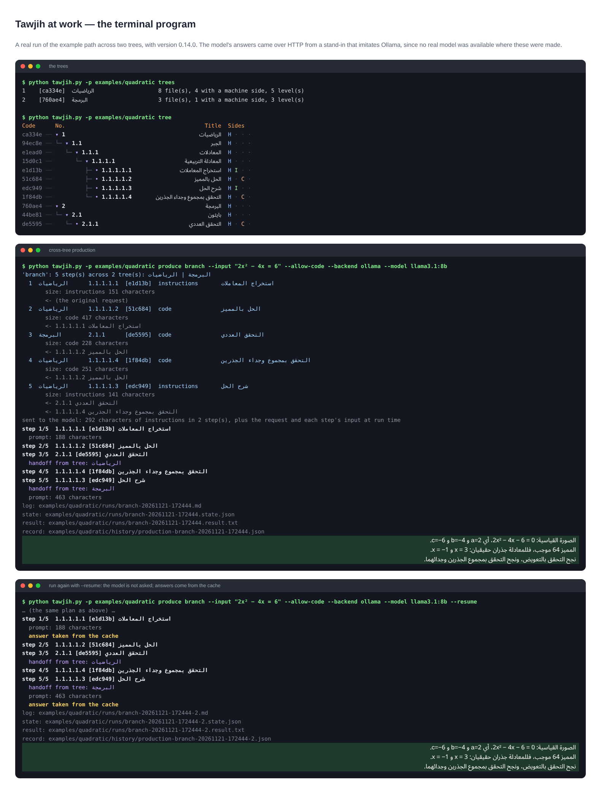
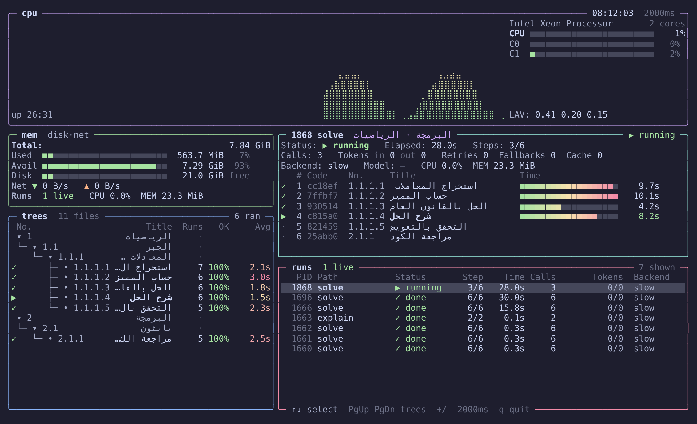

<!-- ALL-CONTRIBUTORS-BADGE:START - Do not remove or modify this section -->
[](#contributors-)
<!-- ALL-CONTRIBUTORS-BADGE:END -->

# tawjih — توجيه أوامر الآلة

[](https://github.com/AlmodinyMk/LLM-tawjih-Model-building/actions/workflows/tests.yml) [](https://pypi.org/project/tawjih/) [](https://scorecard.dev/viewer/?uri=github.com/AlmodinyMk/LLM-tawjih-Model-building)

**Direct a language model through small text files that you write and
review yourself, join them into paths, and know where every answer came
from.**

Runs on your computer with Ollama, or with any OpenAI-compatible or
Anthropic provider. Python, standard library only; Linux and Windows.
[العربية](README.ar.md)

> **Status: 0.16.0, experimental.** The test suite passes on Linux and Windows.
> No real AI provider has been used with it yet, and the Linux desktop
> windows have not been used by a person; see
> [What is and is not verified](#what-is-and-is-not-verified).


## What it gives you

- **Directing in plain text, reviewed before it runs.** What the model is
  told lives in text files you read, compare and keep in git: no prompts
  hidden in code, nothing rewritten behind your back. Writing them by hand
  is the point; it is how engineers keep control of what a model is asked.
  Code steps run only when you allow them, and can run in a sandbox.
- **Answers you can trace.** Every run is saved with each step's prompt
  and answer, and its cost in the run's record. `trace` shows which files an output came from, and
  `--resume` replays a run from the cache without asking the model again.
  Records also say who ran, approved and reviewed: everyone gets a
  permanent id the first time (`whoami`).
- **Checked handoffs.** A contract (JSON keys, or a JSON Schema) checks
  each step's output before the next step sees it; with `--retries`, the
  model is asked again when it does not fit.
- **Knowledge that grows in trees.** Small files in up to six levels, each
  with a human side, a machine side and a reading side that keeps its
  sources. A path can take steps from several trees.
- **Your models, your limits.** Local or remote providers with retries and
  fallbacks; a project policy that can only restrict (no code, this
  computer only, always sandboxed); redaction before anything is sent.
- **Arabic and English.** The path language, the management statements and
  the files themselves work in both.
- **Assistants under your control.** `tawjih mcp` lets an AI assistant read
  the project, propose changes and run paths, with a person approving every
  write and run; a long run can be durable, so it survives a disconnect and
  is never started twice.

**Who it is for:** engineers and researchers who direct a model through
reviewed text, keep their knowledge organised, and need to check where a
result came from. **Who it is not for:** a quick chatbot, or building an
application in code, where a code-first framework fits better.

## Quick start

```
pip install tawjih
tawjih                 # who you are (the first time), then the home screen
tawjih home start      # your first project, step by step
```

The first command on a terminal asks your name (and, if you like, an email
or an ORCID) before it runs; see [Who did it](#who-did-it-whoami).

The example project, a quadratic equation solved across two trees, is in
this repository. Clone it and run the example without any account:

```
git clone https://github.com/AlmodinyMk/LLM-tawjih-Model-building
cd LLM-tawjih-Model-building
python tawjih.py -p examples/quadratic tree
python tawjih.py -p examples/quadratic produce branch --plan
python tawjih.py -p examples/quadratic produce branch --input "2x² − 4x = 6" --allow-code --backend manual
```

`--backend manual` prints each prompt and waits for you to paste an answer
(finish with a line containing only `.`). For step 1 answer
`{"a": 2, "b": -4, "c": -6}`. With Ollama installed, use
`--backend ollama --model llama3.2` instead.

Your own project:

```
tawjih init
tawjih new "Mathematics"
tawjih new "Algebra" --parent 1 --open
tawjih tree
tawjih produce myprod 1.1 TO 1.2 --input "..." --backend ollama --model llama3.2
```

Use `-p FOLDER` before the command to work on a project elsewhere.

## Measure it on your own computer

Does the path beat the model asked directly? The example project carries
20 test cases (quadratic equations in Arabic and English, some rearranged),
so you can measure it with any model you have:

```
ollama pull qwen2.5:3b
python tawjih.py -p examples/quadratic eval branch --backend ollama --model qwen2.5:3b --allow-code
python tawjih.py -p examples/quadratic eval branch --direct --backend ollama --model qwen2.5:3b
python tawjih.py -p examples/quadratic eval compare branch
python tawjih.py -p examples/quadratic eval report branch -o eval.md
```

The first run sends each case through the path; the second sends the same
question straight to the model; `compare` lists them case by case, and
`report` adds time and tokens. No measured result with a real model is
published here yet.

## What it works with

Tawjih itself uses only Python's standard library. Every library and tool
below is installed separately, where you need it. Tawjih talks to it over
HTTP, runs it, or writes the script or command line that runs it. None of
them is bundled, and none is needed for the rest of Tawjih to work.

| Area | Works with | How | Checked |
|---|---|---|---|
| Models (providers) | Ollama · Anthropic · Google Gemini · OpenAI and any OpenAI-compatible server: vLLM, SGLang, LMDeploy, TensorRT-LLM (`trtllm-serve`), Aphrodite, TabbyAPI (ExLlamaV2), llama.cpp (`llama-server`), LiteLLM | HTTP with `--backend` or [`providers.json`](#ai-providers); a different provider for each step with `USING`; any server setting with `--option` | stand-in servers that answer in each format; live tests with `TAWJIH_LIVE_TESTS=1` |
| Serving models | those engines and Triton; systemd and Docker to run them with the computer; `nvidia-smi` for GPUs | [`tawjih server`](#model-servers-tawjih-server) writes the command line, runs it, reads health, models and metrics; `batch` shares inputs among servers | a stand-in server, not the engines |
| Training | PyTorch, transformers, PEFT (LoRA and 16 other methods), TRL (SFT, DPO), datasets, accelerate, bitsandbytes (QLoRA), Unsloth, axolotl; through `--train-arg`, `--model-arg` and `--gpus`: DeepSpeed, FSDP, FlashAttention, Liger kernels, torchrun, TensorBoard, Weights & Biases, MLflow; any PyTorch, TRL or JAX code with `script` | [`neural_bridge.py`](#training-adapters-the-neural-bridge) writes the training script and runs it with the Python you name, here or on a runtime | the scripts and commands, without a GPU; see its section |
| Model files | llama.cpp (`convert_hf_to_gguf.py`, `llama-quantize`), GGUF; Hugging Face Hub (`huggingface_hub`); vLLM in Docker for serverless GPUs | `convert`, `quantize`, `push`, `pipeline`, `lora serve --serverless` | stand-in tools and a stand-in Hub |
| Architectures | PyTorch and transformers (Llama, Mixtral, GPT-2 configurations) | [`arch export`](#the-architecture-lab) writes `config.json`; `arch build` builds the model | real models built on a CPU |
| Where jobs run | this computer; another one over `ssh` and `scp` (rented GPUs from RunPod, Vast.ai, Lambda ...); any queue or service through `command` runtimes | [runtimes](#runtimes-where-jobs-run): a job folder sent, followed and collected | an ssh server on this computer; a stand-in service |
| Documents | LaTeX, Markdown, HTML, PreTeXt, text (built in); Word and EPUB (built in, or Pandoc); PDF through Docling, Marker or `pdftotext` | `deposit`, `ingest` | stand-ins for Docling and Marker; Pandoc on a real file |
| Search | BM25 (built in); embeddings from Ollama or an OpenAI-compatible server | `search`, `index` | a stand-in embedding server |
| Traces | Langfuse; any OpenTelemetry collector | `--trace` sends each run as a trace | Langfuse's SDK payload, a real OpenTelemetry Collector |
| AI assistants | Claude Desktop and any MCP client | [`tawjih mcp`](#ai-assistants-the-mcp-server) | the official MCP Python SDK as the client |
| Editors and windows | Notepad, nano, vim, VS Code or any editor; GTK 3 or Tkinter on Linux | [`open`](#editors), the Linux windows | a scripted editor; windows driven on a virtual display |
| Diagrams | Mermaid, Graphviz | `graph` writes their source | rendered with both |

**Gemini.** Make a key in Google AI Studio and put it in `GEMINI_API_KEY`
(or `GOOGLE_API_KEY`). The key goes in the request's header, never in its
address:

```
tawjih.py provider add gem --kind gemini --model gemini-2.5-flash
tawjih.py provider set gem --option 'generationConfig={"temperature": 0.2}'
tawjih.py run mypath --input "..." --backend gem
```

Its answer leaves out the model's thinking parts. The record notes the
`modelVersion` Google reports, and counts thinking tokens with the output.
A prompt that Google blocks fails the step with the reason. Gemini's
OpenAI-compatible address works with `--kind openai` too.

## Building a whole model stack: the nine layers

With Tawjih, the libraries it works with, and an AI assistant, one person
can build, test and evaluate every layer of a language-model stack. The way
differs by layer. Some layers have commands of their own in Tawjih. For
others the code is written (by you or the assistant) and Tawjih runs it as
a job with `script` and keeps its record: the program's SHA-256, its
settings, its results and who ran it.

| Layer | Build | Test | Evaluate |
|---|---|---|---|
| 1. Data | `ingest`, `deposit`, `compile` (SFT and DPO data, each with the files it came from) | `compile` refuses a question that is in both the training and the evaluation data | `lora lineage`: what each adapter was trained on, and what changed since |
| 1. Tokenizer | `script` with the `tokenizers` library, written by you or the assistant | inside the script | inside the script (tokens per Arabic word, say); the result is kept with the job |
| 2. GPU kernels | `script` with Triton, or CUDA through PyTorch, written by the assistant | inside the script, against PyTorch's own operation | speed inside the script; Tawjih keeps the program's hash, its settings and who ran it |
| 3. Attention | `arch create`, `arch derive` (MHA, GQA, MQA, RoPE); new kinds through `script` | `arch validate`, `arch build` (a real forward and backward pass) | `arch show`, `arch rank --by kv` (KV memory) and `--by speed` |
| 4. Backbone | `arch create`, `derive`, `mutate`, `set` (layers, feed-forward, MoE, norms) | `arch build`: the model is built and its parameter count checked | `arch rank`, `arch diff`, and the statistics of each version in its lineage tree |
| 5. Distribution | `train --gpus N` with DeepSpeed and FSDP; servers with `--tp` and `--pp` | the run itself, with its record and the job's | `server bench` (tokens a second, time per request), `top` |
| 6. Training | `train`: 17 PEFT methods, SFT and DPO, QLoRA; pretraining from scratch through `script` | the data checked before training, `--train-arg` strict, an evaluation file during training | `eval` on the path, `eval --repeat` (pass rate), `compare` and `report` between two models or two versions |
| 7. KV cache | `--kv-cache fp8`, `int8`, `q8_0` ...; prefix caching through `--pass` | `server status`, the log | `arch show` (its size per token); `server bench` with and without `--vary`, to measure the cache |
| 8. Inference engine | `server add`, `tune`, `prepare` (AWQ, TensorRT) for ten engines | `status`, `metrics`, `logs`, `top` | `server bench --from-file` (your real file as the prompt), a record kept for each measure |
| 9. Agent harness | paths in Arabic and English, size conditions, a provider per step, `batch` | `check`, contracts, retries, approval | `eval` of the path against `eval --direct` of the model alone: does the method actually help? |

**The AI assistant's part.**

- Through the [MCP server](#ai-assistants-the-mcp-server), Claude Desktop
  or any MCP client runs paths and reads records and evaluation results.
- The assistant writes what has no ready command: kernel scripts, a
  tokenizer, pretraining code.
- `edit --ask` asks it for a file's instructions or code.

The assistant gets no extra power. The project's policy limits what it may
do (code, network, the least human approval), and everything it runs is
recorded under your identity.

### The libraries, by layer

● built in: a Tawjih command does it, with its own settings.
◐ through arguments: Tawjih runs the library, and the library's own
options pass as they are (`--train-arg`, `--model-arg`, `--pass`, `--option`).
○ through `script`: your own code, or the assistant's, run as a recorded job.

| Layer | Library or tool | How |
|---|---|---|
| 1. Data | LaTeX, Markdown, HTML, PreTeXt, plain text (`deposit`); Word and EPUB (built-in reader) | ● |
| | Pandoc, Docling, Marker, `pdftotext` (`ingest`) | ● (the program you install) |
| | JSONL training data, SFT and DPO (`compile`); Hugging Face `datasets` in training | ● |
| 1. Tokenizer | the base model's tokenizer through transformers | ● |
| | Hugging Face `tokenizers`, SentencePiece | ○ |
| 2. GPU kernels | FlashAttention (`--model-arg attn_implementation=flash_attention_2`), Liger Kernel (`--train-arg use_liger_kernel=true`), xformers (used by Unsloth) | ◐ |
| | Triton, CUDA C++ through PyTorch (`torch.utils.cpp_extension`) | ○ |
| 3. Attention | transformers: MHA, GQA, MQA, RoPE, learned positions (`arch`) | ● |
| | PyTorch, for an attention of your own | ○ |
| 4. Backbone | PyTorch and transformers: Llama, Mixtral (MoE), GPT-2 configurations (`arch export`, `arch build`) | ● |
| | other architectures; JAX and Flax | ○ |
| 5. Distribution | torchrun (`--gpus N`) | ● |
| | DeepSpeed ZeRO, FSDP through accelerate (`--train-arg`) | ◐ |
| | tensor and pipeline parallel in vLLM, SGLang, TensorRT-LLM, Aphrodite, LMDeploy (`server --tp --pp`) | ● |
| | Megatron-LM, TorchTitan | ○ |
| 6. Training | PyTorch, transformers, PEFT (LoRA and 16 other methods), TRL (SFT, DPO), bitsandbytes (QLoRA), Unsloth, axolotl (`train`) | ● |
| | every TRL and `TrainingArguments` field; TensorBoard, Weights & Biases, MLflow (`report_to`) | ◐ |
| | TRL's other trainers (GRPO, KTO, ORPO), full fine-tuning, pretraining | ○ |
| | llama.cpp (`convert_hf_to_gguf.py`, `llama-quantize`), GGUF; Hugging Face Hub (`push`) | ● |
| 7. KV cache | its size per token (`arch show`) | ● |
| | fp8 in vLLM, SGLang, Aphrodite; int8 and int4 in LMDeploy; q8_0 and q4_0 in llama.cpp and Ollama (`--kv-cache`); SGLang's flush (`top`, key `f`) | ● |
| | prefix caching and every other cache option (`--pass`) | ◐ |
| 8. Inference engine | vLLM, SGLang, LMDeploy, TensorRT-LLM, Triton, Aphrodite, TabbyAPI, LiteLLM, Ollama, llama.cpp (`server`) | ● |
| | AWQ through LMDeploy, `trtllm-build` (`server prepare`); systemd and Docker (`server unit`) | ● |
| | every engine argument (`--pass`); any other engine (`--engine custom`) | ◐ |
| 9. Agent harness | Tawjih itself: paths, contracts, approval, records, `batch` | ● |
| | providers: Ollama, OpenAI and any compatible server, Anthropic, Google Gemini | ● |
| | MCP clients (Claude Desktop and others); Langfuse and OpenTelemetry (`--trace`); BM25 and embeddings (`search`) | ● |

**Limits, plainly.**

- For layers 1 (the tokenizer), 2, new kinds of attention, and pretraining
  in layer 6, Tawjih only runs and records. All the intelligence is in the
  code the assistant or you write, and the evaluation happens inside that
  code, not through a Tawjih command.
- The backbone is limited to the Llama, Mixtral and GPT-2 families; others
  go through `script`.
- Inside a path, the model does not pick its tools freely. The path sets
  the steps, the tools (code steps) and the branches, and the model can
  only choose among set branches (`AMONG`). An assistant can drive Tawjih
  from outside through MCP.
- None of this chain has run yet on a real GPU. `arch build` was run on a
  CPU, and training and the servers were tested with stand-ins (see
  [What is verified](#what-is-and-is-not-verified)). The first measure on a
  computer with a GPU is what turns these commands from possible into
  proven.

## Contents

[Screenshots](#screenshots) ·
[The idea](#the-idea) ·
[Cross-tree production](#cross-tree-production) ·
[Contracts](#contracts-models-and-staleness) ·
[Commands](#commands) ·
[AI providers](#ai-providers) ·
[The project's policy](#the-projects-policy) ·
[Failures, approval, privacy and cost](#failures-approval-privacy-and-cost) ·
[Evaluation](#examples-training-data-and-evaluation) ·
[MCP server](#ai-assistants-the-mcp-server) ·
[Governance](#governance-locks-reviews-releases-schedules) ·
[Training](#training-adapters-the-neural-bridge) ·
[Architecture lab](#the-architecture-lab) ·
[Watching runs](#watching-runs-tawjih-top) ·
[Langfuse](#traces-langfuse-and-opentelemetry) ·
[Runtimes](#runtimes-where-jobs-run) ·
[Model servers](#model-servers-tawjih-server) ·
[What it works with](#what-it-works-with) ·
[The nine layers](#building-a-whole-model-stack-the-nine-layers) ·
[Linux windows](#desktop-windows-for-linux-users) ·
[Limitations](#limitations) ·
[What is verified](#what-is-and-is-not-verified) ·
[License](#license)

## Screenshots

The example path run in the terminal, then run again with `--resume`:



The four Linux windows and a side conversation:


In these screenshots the model's answers came over HTTP from a stand-in that
imitates Ollama; everything else is the program's real output.

## The idea


Every file has three faces, each kept in its own file on disk, all three
under the file's one code (such as `e1d13b`), number (such as `1.1.7`) and
title; they differ only by type:

| Face (type) | On disk | Holds | Used when |
|---|---|---|---|
| **human** (بشري) | `files/e1d13b/human.md` | the expressive human concept of the subject | building the file |
| **machine** (آلي) | `files/e1d13b/machine.md` | instructions for the model, and optional Python code | building, and **running a path** |
| **science** (علمي) | `files/e1d13b/science.md` | the reading side: passages filtered from deposited books and research, with their source | building the file |

`show 1.1.7` prints the three under the one title; `show e1d13b --type
machine` or `open 1.1.7 --type human` takes one face only.

A fifth, optional side holds worked examples, for evaluation and training
(see [Examples](#examples-training-data-and-evaluation)); it is never sent
when a path runs either.

Files form trees with up to six levels: general → section → chapter → topic →
branch → part. Every file has a stable id (`e1d13b`) and a positional number
(`1.1.1.1.1`); commands accept either.

Two phases are kept apart on purpose:

- **Build time** (`open`, `edit`): you, optionally helped by an AI provider,
  turn the reading side into the human concept and the human concept into
  machine language.
- **Run time** (`run`): only the machine side is sent. The model sees the
  step's instructions, the original request and the previous step's output,
  and nothing else. Instructions therefore have to be self-contained.

## Cross-tree production

1. `trees` lists the available trees.
2. Pick files from any trees, by id or number.
3. Connect them with words after `produce NAME`. The path is saved under
   that name and runs again with `produce NAME`.
4. The machine side of each file is extracted (see [SPEC.md](SPEC.md)).
5. Each file runs after the files that feed it and receives their outputs.
6. The result and full log go to `runs/`; a record of the operation (trees,
   connections, the digest of each machine side used, which steps ran or
   were skipped) goes to `history/`.

| Write | Meaning |
|---|---|
| `A TO B` | A's output goes to B |
| `A TO B AND C` | ... to both B and C (branching) |
| `B AND C TO D` | D receives both outputs (joining) |
| `A TO B IF word` | when A's output is JSON with that key: only when its value is true or non-empty; otherwise only when the output contains the word. `IF NOT word` for the opposite |
| `A TO B IF key = value` | when A's output is JSON whose `key` equals `value` (`true`, `false`, `null` and numbers compare as JSON; anything else as text). No JSON, or no such key: false |
| `A AMONG B C D` | A's output names one of them; only that one runs |
| `A AMONG B C D BY key` | A's output is JSON, and the value of `key` names the one that runs, exactly (its number, id, title or alias) |
| `A TO D THROUGH B C` | A → B → C → D |
| `A TO B IF word ELSE C` | B when the word holds, otherwise C (the same as adding `A TO C IF NOT word`) |
| `A LINK B` | B runs after A but does not receive its output (it receives the original request) |
| `A PASS B` | the same as `A TO B` |
| `A TO EACH B` | B runs once per item of the JSON list it receives (as `contract --each yes`, in this path only) |
| `A TO APPROVE B` | a person approves B's input before it runs (as `approve: before`, in this path only) |
| `A TO CALL other TO B` | the saved path `other` is spliced in: A feeds its first files, its last files feed B. It is read every time, so a change to it reaches every path that calls it |
| `B USING model` | B uses that model in this path (`--model` still wins) |
| `B RETRY 3 UNTIL word` | B is run again, told why, until its output meets the word (as for `IF`), at most 3 more times; `UNTIL NOT word` for the opposite. `RETRY n` alone sets the retries for a broken contract. `UNTIL key = value` waits for that value in a JSON output |
| `A PICK key TO B` | only the value of `key` in A's JSON output is passed on |
| `..., ITERATE 5 UNTIL status = pass` | a statement of its own: the whole path runs again on its own result, at most 5 rounds, until the result meets the condition (a word, `NOT` word, or `key = value`, as for `IF`). Without `UNTIL`, exactly 5 rounds |

`EACH` and `APPROVE` come before a file; `USING`, `RETRY`, `UNTIL` and
`PICK` after it, and belong to that file in that path only. Statements chain
(`A TO B AND C TO D`), and several are separated by `,` or `/` (use `/` in
PowerShell). Arabic words work too: إلى، مرر، و، إذا، ليس، وإلا، بين، عبر،
ارتبط، لكل، اعتمد، نفذ، بواسطة، أعد، حتى، انتق، حسب; and `؛` or `،` separate
statements. Files written with no connecting word are a plain sequence.
`ITERATE` (كرر) starts a statement of its own. `PARALLEL` and `CACHE` are
refused with a reason: branches joined by `AND` are independent, and run
at the same time with `--max-workers N`; every answer is already kept for
`--resume`.

```
produce review 1.1 TO 1.2 IF error / 1.1 TO 1.3 IF NOT error / 1.2 AND 1.3 TO 2.1
```

`produce --plan` shows each step, its size in characters and what feeds it,
without running.

A step that returns nothing stops the production. After a failure, run the
same command with `--resume`: steps whose prompt, provider and model are
unchanged take their answer from `cache/` and the model is not called again
for them. When a kept answer is itself the cause (a model replied in prose
where the next step expected JSON), the error names the step to ask again:
`--resume --redo REF`. `--no-cache` keeps no answers, `cache` shows what is
kept and `cache --clear` empties it. `--model NAME` chooses the model for
one command.
`produce` will not start if a step has an empty machine side, or has code
and `--allow-code` is missing.

**At the same time.** `run` and `produce` take `--max-workers N`: steps
whose inputs are ready run at the same time, up to N, so the four branches
of `A TO B AND C AND D AND E` wait for one model call instead of four.
Steps that run code, or that ask a person on the terminal, still run one by
one, and the log keeps the plan's order. The default is 1: one step after
another, as before.

**When a branch fails.** By default the first failure stops the run.
`--on-failure continue` leaves a failed step out (when it has no
`fallback:` file), skips the steps that needed its output, finishes the
rest, and marks the record `partial` with the failed steps.

**Again and again.** `ITERATE n UNTIL cond` in a path, or `--iterate N
--until COND` on the command line, runs the whole path up to n times, each
round on the result of the round before (the original request stays in
every prompt), and stops when the result meets the condition; if it never
does, the command fails after the last round. `EACH` (items of a list) and
`RETRY ... UNTIL` (one step tried again) keep their meanings.

## Contracts, models and staleness

A file's header may carry three optional lines, set with
`contract REF --expects SPEC --produces SPEC --model NAME` (`none` clears
one; without options it shows them):

```
model: llama3.1:8b        the model this step uses
expects: json(a, b, c)    what its input must be
produces: json(roots)     what its output must be
```

A contract is `json`, `json(key, ...)`, `schema(NAME)` or `text`. A JSON answer is accepted
when it is wrapped in a code fence or has a sentence around it, as models
often write; the bare JSON is what goes to the next step. An answer that
breaks the contract stops the run, is not kept in the cache, and the error
names the step to ask again. `check` compares the contracts of connected
files before anything runs, and reports an unknown contract (a typo) as an
error.

`schema(NAME)` checks the JSON against `schemas/NAME.json`, a JSON Schema.
`contract REF --produces-schema FILE` (or `--expects-schema`) checks the
file, copies it to `schemas/` and sets the contract. Only part of JSON Schema
is supported: `type`, `properties`, `required`, `additionalProperties`,
`items`, `enum`, `const`, the number and length limits, `pattern`,
`uniqueItems`, and the property counts. A schema using anything else
(`oneOf`, `$ref`, `if` ...) is refused rather than half-checked. Connected
files are compared through the keys a schema requires.

The model of a step is `--model` if given, else the path's `USING`, else
the file's `model`, else `TAWJIH_MODEL`.

When you rebuild a machine side (with `open`, `edit` or the Linux windows)
the program records the state of the human and reading sides. If either
changes afterwards, the file is marked **stale**: `!` in `tree`, a warning in
`check` and `produce`, and in `graph`. If you review a stale file and its
machine side still fits, `confirm REF` records that; an `edit` asked to
rebuild a side that comes back unchanged records it too.

`IF` and JSON: when a step's output is a JSON object, `IF is_group` tests the
value of the key `is_group` (true, non-zero, non-empty; the strings
`false`, `no`, `0`, `none`, `null`, `لا` and `خطأ` count as false), not whether the
letters appear somewhere in the text. `check` and `generate` add a note when
an `IF` word is not one of the keys the source file promises in `produces`.

## The network: drawing and generating paths

`graph` draws your trees or a path:

```
python tawjih.py graph -o trees.md                       # the trees
python tawjih.py graph --path branch -o branch.md        # one path
python tawjih.py graph --path branch --format dot -o branch.dot
```

The `.md` file holds a Mermaid diagram that GitHub shows as a picture;
`--format mermaid` gives the diagram alone and `--format dot` gives Graphviz.
In a path, files are grouped by tree, `IF` conditions label the arrows,
`AMONG` choices are dashed, `LINK`s dotted, handoffs between trees are
thick, and stale files are marked.

`generate` proposes a path, and runs nothing:

```
python tawjih.py -p examples/quadratic generate solve2 --start 1.1.1.1.1 --end 1.1.1.1.2
python tawjih.py generate review --goal "check and explain a solution" --backend ollama
python tawjih.py generate review --accept
```

With `--start` and `--end` it finds the shortest chain of files whose
`produces` fits the next one's `expects`, without a model. With `--goal` a
model reads the path language, your files and their contracts, and replies
with statements. Either way the proposal goes to `paths/NAME.proposed` with
any problem listed in it (unknown file, loop, a file without a machine side,
a contract mismatch). Read it, edit it if you like, and `--accept` saves it
as a path after checking it again. `--scope REF` limits the files to one
branch.

## Books and their sources

`deposit` reads a book from its source, which keeps its structure and its
mathematics. PDF is refused: it records where letters sit on a page, so
exponents, arrows and fractions come out broken (`271³²¹` becomes `271321`).

| Source | What deposit does |
|---|---|
| `.txt` | kept as it is; `#` lines are headings |
| `.md` | `#` and underlined headings; `#` lines inside code blocks are protected |
| `.tex` | read in stages: code (`verbatim`, `lstlisting`, `minted`, `\verb`) is protected first, so an example document inside the text does not cut it short; `\input` and `\include` are read in unless commented out; the document's own `\newcommand`, `\def`, `\DeclareMathOperator` and `\newtheorem` are expanded; mathematics is protected and kept as LaTeX; then `\part` … `\subparagraph` become headings, theorem-like environments are labelled, lists become `- ` lines, footnotes stay in place, references become `[ref: …]` and `[cite: …]`, accents and special characters become text; pictures are left out |
| `.html` | `<h1>`–`<h6>` become headings; scripts, styles and navigation are left out; MathML is replaced by its TeX |
| `.xml`, `.ptx` | PreTeXt: chapters and sections become headings, `xi:include` files are read in, `<m>` and `<md>` become `$…$` and `$$…$$`, theorems, examples and figures get the book's numbers (Example 3.8) and references point to them; Sage cells, index entries and pictures are left out. Other XML: its text |

`deposit BOOK --part 3 --part 4` keeps only those chapters (by number or
title). Deposit the whole book this way rather than a single chapter file,
so the numbering is the book's own. Many open textbooks (PreTeXt, LaTeX on
arXiv) publish their source; look for it before using a PDF.

## The home screen

`tawjih.py` alone, or `tawjih.py home`, shows the sprout logo, the project
in this folder at a glance (files, paths, the default provider, the
policy) and the main commands as cards. `tawjih.py home TOPIC` explains one
topic: start, files, paths, contracts, providers, safety, mcp, training.
Colours appear on terminals that show them (Windows Terminal, most Linux
and macOS terminals); `NO_COLOR` turns them off. The screen is in English,
because terminals do not lay out right-to-left text reliably.


## Watching runs: `tawjih top`

`tawjih top` (also `monitor`, and in Arabic `مراقبة`) is a live board in
the manner of btop: the computer's performance beside the runs of paths
over the files of the trees.

- **cpu**: a graph of the last minutes, each core, the load average.
- **mem · disk · net**: memory, the free space of the project's disk, the
  network, and the CPU and memory of the runs going now. With `nvidia-smi`,
  each GPU's free memory as a bar, red under `--min-free` MiB (8000 by
  default), and which GPUs `--gpus auto` could take now.
- **trees**: every file on its tree lines, with how often it ran, how
  often it succeeded and how long it takes on average; ▶ marks a file
  running now.
- **the chosen run**: its status, time, calls, tokens, retries,
  fallbacks and model, and each step with the time it took as a bar; the
  step running now is ▶ and its time keeps counting.
- **runs**: the runs going now, the runtime jobs (with the percentage
  their log shows), the project's [model servers](#model-servers-tawjih-server)
  (port, uptime, health, and the CPU and memory of its processes), then the
  finished runs.
- **the chosen server**: its status, process, uptime, engine, port, GPUs,
  health, model, tuned settings, the CPU, memory (RAM) and GPU memory taken
  by it and the processes it started, its command line, and the end of
  its log.

Up and down choose a row, PgUp and PgDn move the trees, + and - change the
refresh time, L switches between English and Arabic (`--arabic` starts in
Arabic), q quits. On a server:

| Key | Does |
|---|---|
| `s` | start it |
| `x`, `r` | stop it, restart it (press twice) |
| `t` | tune it: type `KEY=VALUE ...` on the last line, as `server tune` |
| `f` | empty its KV cache (SGLang's `/flush_cache`) |
| `d` | show the `batch` command for the running servers that are providers |

Each of these is noted in `history/servers-DATE.jsonl` with who did it,
and its result shows at the foot of the board. `top --once` prints one
frame, and `top --json` gives the same facts to a script.

A run writes `history/live/PID-….json` as each step starts and ends and
removes it when it ends; a run whose process has gone shows as stopped.
The record in `history/` now also keeps each step's time. CPU, memory and
network are read from the system on Linux, and CPU and memory on Windows;
on macOS the CPU comes from the load average and memory is not shown.
In Arabic the two columns change sides; whether the letters also run
right to left is the terminal's own choice.



## Commands

| Command | Purpose |
|---|---|
| `home [TOPIC]` | the home screen (also `tawjih.py` alone), or an explanation of one topic |
| `init` | create a project in the current folder |
| `new TITLE [--parent REF] [--level L] [--open]` | create a file |
| `open REF [--type TYPE] [--editor CMD] [--reading]` | open one editor per side, or only the faces given with `--type` (human, machine, science; بشري، آلي، علمي); save on close |
| `migrate [--yes]` | turn files made before 0.15 (one `ID.md` each) into folders of faces |
| `tree [REF]` | show the trees, or one branch, in columns: Code (the stable id), No. (the number on lines `├─ └─ │` joining it to its parent; `▾` has files under it), Title, and Sides (`H I C R` for the sides with content, `·` for an empty one); `!` marks a stale machine side. In a terminal that shows colours, each side letter has its own (`NO_COLOR` turns them off) |
| `search QUERY [--branch REF] [--side S] [--tag T] [--rank \| --semantic]` | search titles and sides; see [Managing a project](#managing-a-project) for the other commands added in 0.7 |
| `show REF [--type TYPE] [--raw]` / `read REF [--all]` | print a file's three faces under its code, number and title, or only the faces given / print its reading side |
| `link SRC DST [--type T]` | record a link between any two files |
| `contract REF [--expects S \| --expects-schema FILE] [--produces S \| --produces-schema FILE] [--model M] [--retries N] [--fallback REF] [--approve WHEN] [--split S] [--weight W] [--each yes\|KEY]` | show or set a file's contracts, model, retries, fallback, approval, split, weight and FOR EACH |
| `redact [TEXT] [--init]` / `stats` | private data hidden before model calls / what runs cost; see [Failures, approval, privacy and cost](#failures-approval-privacy-and-cost) |
| `check [--branch REF]` | validate parents, levels, cycles, links, paths, code syntax, contracts, staleness |
| `trees` | list the available trees |
| `cache [--clear]` | show or empty the kept model answers |
| `produce NAME [WORDS ...] [--plan] --input TEXT [--backend B] [--allow-code] [--code-timeout S]` | cross-tree production: select, order, validate, run, save, document |
| `path NAME [WORDS ...]` | define a path without running it, or show a saved one |
| `run NAME --input TEXT [--backend B] [--allow-code] [--max-workers N] [--on-failure continue] [--iterate N --until C]` | run a saved path; steps at the same time, going on past a failed branch, and rounds (see [Cross-tree production](#cross-tree-production)) |
| `edit REF --side S --ask TEXT [--source FILE] [--backend B]` | have a model rewrite one side; shows a diff and asks before saving |
| `deposit FILE [--part N\|TITLE]` / `library` | add a book (text, Markdown, LaTeX, HTML, XML/PreTeXt) to the library / list books |
| `confirm REF ...` | record that a machine side still fits its human and reading sides (clears the stale mark) |
| `filter BOOK [--parent REF] [--ask TEXT] [--backend B]` | have a model decide, passage by passage, what to keep and for which file; writes a report only |
| `accept BOOK` | append the kept passages to the reading side of their files |
| `import FILE --parent REF` | split a text on `#` headings into child files, without a model |
| `graph [--path NAME] [--branch REF] [--format md\|mermaid\|dot] [-o FILE]` | draw the trees or a path; the format follows the `-o` extension (`.mmd`, `.dot`, `.gv`) unless given |
| `generate NAME (--start REF --end REF \| --goal TEXT --backend B) [--scope REF]` | propose a path; `generate NAME --accept [--replace]` saves it |
| `tangle [--branch REF \| --path NAME] [-o FILE]` | export the code sides as Python functions, one per step |
| `mcp [--allow-write] [--allow-run --backend B [--model M]] [--allow-code] [--human-approval always\|run\|never]` | an MCP server for AI assistants on this project (see [AI assistants](#ai-assistants-the-mcp-server)) |
| `provider list\|add\|set\|policy\|rm\|default\|fallback\|test [NAME] ...` | named providers (`set` changes one that exists), retries and fallback chains; see [AI providers](#ai-providers) |
| `runtime list\|add\|rm\|default\|check\|jobs\|status\|logs\|cancel\|collect` | where long jobs run, and the project's jobs; see [Runtimes](#runtimes-where-jobs-run) |
| `arch create\|derive\|list\|show\|validate\|set\|diff\|components\|mutate\|export\|build\|rank` | language-model architectures as three-faced files; see [The architecture lab](#the-architecture-lab) |
| `policy show\|set\|reset` | the project's own limits, which only restrict; see [The project's policy](#the-projects-policy) |
| `approve [ID ...] [--yes \| --no]` | requests from the assistant waiting for a person: list, read, run or decline |
| `whoami [set --name N [--email E] [--id ID] [--record name\|id\|email\|none] \| clear]` | who you are in records: runs, approvals, reviews, evaluations and jobs note it; see [Who did it](#who-did-it-whoami) |
| `do STATEMENTS [--file F] [--run] [--yes]` | management statements in English or Arabic, translated into commands (see [Management statements](#management-statements-do)) |
| `lock`, `alias`, `review`, `stage`, `mount`, `sandbox`, `trace`, `release`, `snapshot`, `seal`, `verify`, `inherit`, `template`, `scaffold`, `gc`, `compact`, `format`, `archive`, `glossary`, `doctor`, `repair`, `schedule`, `trigger`, `pause`, `resume`, `cancel` | see [Governance](#governance-locks-reviews-releases-schedules) (0.10) |

## Managing a project

Since 0.7 Tawjih has commands to reorganise trees, read the saved versions
of files, see what is unfinished, and take knowledge out of a project.

**Restructuring.** Paths name files by their id, so moving files never
breaks a path; only the positional numbers change.

| Command | Does |
|---|---|
| `move REF --to REF` (`mv`) | moves a file and its branch; levels shift with it; `--root` makes a new tree; `--position`, `--before`, `--after` place it |
| `rename REF TITLE` | changes the title; a file that chooses it with `AMONG` and names it in its instructions gets the new title |
| `copy REF --to REF [--branch]` (`cp`) | copies sides, contracts, model and tags; links inside a copied branch point to the copies |
| `rm REF [--branch] [--unlink] --yes` | refuses while a saved path uses the file; without `--yes` it only lists; a copy stays in `history/` |
| `split REF --passages 3-5 --title T` | moves reading passages into a new file placed after it (without `--passages` it lists them) |
| `merge A B [--keep]` | appends B's human and reading sides to A; links to B come to A; B is removed unless `--keep` |

**Versions.** Every command that changes a file keeps the previous version
in `history/`.

| Command | Does |
|---|---|
| `log REF` | the saved versions, newest first (1), and what changed after each |
| `diff REF [--version K] [--side S]` | a unified diff of a saved version against the current file |
| `revert REF [--version K] [--side S] [--header]` | brings back sides of a version (the current one is saved first); brings back a removed file; a reverted machine side comes back with the digest of the sources it was built from |

**State.**

| Command | Does |
|---|---|
| `status [--branch REF]` | only what is unfinished: stale files, path steps without a machine side, machine sides without contracts, empty human sides, edits made outside Tawjih, edits left in `work/` |
| `tag REF WORD...` / `untag` / `tag` | labels across trees; `tag` alone lists them; `search --tag` filters by one |
| `sync [--confirm-machine] [--clean-work] [--watch S]` | finds files edited outside Tawjih (in another editor, by git) since the last sync and reports which sides; a machine side rebuilt by hand can be recorded as built |
| `refs REF` | links in and out, every path that uses the file with its neighbours, `AMONG` choices, shared tags, machine sides that mention its title |
| `clean [--runs DAYS] --yes` | removes unfinished edits in `work/` and old run records, removes broken links; reports paths and files it cannot fix |
| `audit [REF \| --path NAME]` | reads the code sides for what touches the system (running programs, deleting or writing files, the network, running text as code); `produce` and `run` print its warnings before running code. A check of what the code says, not a sandbox |

**Search, outputs and services.**

| Command | Does |
|---|---|
| `search QUERY --rank` | ranks titles, paragraphs and reading passages by relevance (BM25), any of the words |
| `index --backend ollama [--model M]` then `search QUERY --semantic` | search by meaning with an embedding model (default `nomic-embed-text`); only changed pieces are embedded again |
| `export [--branch REF] [-o book.html] [--machine] [--no-reading]` | the trees as one book in Markdown or HTML, with the reading passages and their sources; HTML shows formulas with MathJax, loaded from the web (`--no-mathjax` for an offline page) |
| `pack --branch REF \| --path NAME -o F.zip` / `unpack F.zip [--parent REF] [--new-ids]` | moves a branch with its paths to another project; clashing ids are refused unless `--new-ids` |
| `ingest FILE [--deposit]` | turns `.docx` (headings, lists, tables; formulas as plain text to check) and `.epub` into Markdown; `.pdf` through `pdftotext` when installed, with a warning |
| `serve [--port P] [--backend B] [--allow-code]` | offers saved paths over HTTP on this computer: `GET /paths`, `POST /paths/NAME` with `{"input": "..."}` and the printed token; one run at a time |
| `eval NAME [--cases F]` | runs a path on cases with known answers (`paths/NAME.cases.jsonl`: `{"input": ..., "expect": ..., "match": contains \| not-contains \| equals \| regex \| json}`) and reports how many pass; exits with 1 if any fails |
| `dataset -o F.jsonl [--source eval\|runs\|steps]` | writes question-answer pairs in the chat format (or prompt/completion) for fine-tuning tools such as Unsloth or axolotl. Tawjih does not train models; read the pairs before training |

`eval` is how the central claim of the method can be tested: write the
questions and the answers you expect, then run the same cases with a path
and with a model asked directly.

## Failures, approval, privacy and cost

**Retries.** `contract REF --retries 2` (or `--retries N` on the command
line) asks the model again, up to N times, when its answer is empty or
breaks the file's `produces` contract. The new request repeats the prompt
and says why the answer was rejected. Only an answer that passes is kept in
the cache, under the original prompt.

**Fallback.** `contract REF --fallback OTHER` names a file whose machine
side runs, on the same input, when this step fails for any reason (code,
model call, contract). Its output takes the step's place, so the rest of the
path does not change. `check` reports a fallback that is missing, has no
machine side, or produces something the step does not promise.

**Approval.** `contract REF --approve after` (or `before`, `both`) makes a
person approve the step: before it runs, after it, or both. After a step the
person may also type a replacement output (`e`). `--approve ask` asks on the
terminal (the default there), `auto` approves everything, `deny` stops at
the first step that needs approval (the default elsewhere, and always for
`eval` and `serve` unless given).

**Redaction.** `redact --init` creates `redact.txt`. From then on every
text sent to a model (by `produce`, `run`, `edit`, `filter`, `generate`,
`eval`, `serve`) has e-mail addresses, phone numbers, card numbers that
pass the Luhn check, IBANs, ten-digit national ids, IP addresses, and your
own words and names (one per line, or `re:` a regular expression) replaced
by placeholders such as `[EMAIL_1]`; the placeholders in the answer are put
back. `redact "some text"` shows what would be hidden. Patterns only catch
what they describe: a name you did not list is sent as it is.

**Cost.** Each run records, per step and in total, the tokens the provider
reports, the time spent waiting for the model, model calls, retries,
fallbacks and redacted items. `stats [--path NAME] [--days N]` adds them up
per path with the latest evaluation; with `prices.json`
(`{"MODEL": {"input": 3.0, "output": 15.0}}`, per million tokens) it gives
a cost. Tawjih has no built-in prices: they change.

**Converters.** `ingest FILE --with auto` uses the best converter installed:
for PDF Docling, then Marker, then pdftotext; for a Word file with formulas
Pandoc (formulas become LaTeX), otherwise the built-in reader; for EPUB
Pandoc, then the built-in reader. `--with` chooses one.

## Examples, training data and evaluation

A file may carry a fifth, optional side, `=== examples ===`: worked
questions with their answers. Like the human and reading sides, it is never
sent when a path runs. It feeds evaluation cases and training data.

```
=== examples ===
Q: Solve 2x + 4 = 10
A: Subtract 4 from both sides: 2x = 6, so x = 3.
E: x = 3
BAD: x = 7
```

`Q:` (or `س:`) starts an example, `A:` (`ج:`) is a correct answer, `E:` a
short text any correct answer must contain (several separated by `;`), and
`BAD:` (`خطأ:`) a typical wrong answer. A section `=== anti_examples ===`
is read into the same side. `edit --side examples` lets a model write them
from the human and reading sides; they are then marked old when those
sides change (`status`, `confirm --examples`). `check` reports unreadable
blocks, the same question in a training and an evaluation file, and the
same question with different answers.

Two header lines, set with `contract`: `split: train | eval | ignore`
(default train) decides where a file's examples go, so evaluation questions
never reach training data; `weight: 2` makes them count more, and
`weight: 0` keeps them out of training data.

| Command | Does |
|---|---|
| `dataset --source examples -o train.jsonl [--split S] [--with-rules] [--repeat-by-weight] [--dpo pairs.jsonl]` | compiles the examples of the `train` files (or another split) into chat or prompt/completion JSONL; `--with-rules` puts the file's instructions before the question; `--dpo` writes `{prompt, chosen, rejected}` pairs from `BAD:` lines. Every dataset gets `FILE.manifest.json` with the SHA-256 of each file it came from |
| `eval init NAME` | a cases file with a template |
| `eval extract NAME [--split eval]` | cases from the examples of `eval` files: `E:` becomes the expected text; without it the case is graded by a judge |
| `eval synthesize NAME --backend B [--count N]` | a model proposes hard cases from the human sides and examples (never from `eval` files) into a file to review; `--accept` adds them |
| `eval NAME [--judge MODEL] [--fail-fast]` | runs the cases; `match: judge` cases are graded by a model; `--fail-fast` stops at the first failure and shows it |
| `eval NAME --direct` | the same cases sent straight to the model, without the path |
| `eval NAME --repeat N [--min-pass K]` | each case run N times, asking the model each time; a case passes when at least K of N runs pass (default all N). For a live check of a model that does not always answer the same, run on a schedule rather than on every change |
| `eval compare NAME [A B]` | two evaluations case by case, by default the path against the model asked directly |
| `eval baseline NAME --save` / `eval diff NAME [--baseline]` | a reference result; every later `eval` reports cases that passed then and fail now (exit status 1); `diff` lists cases that changed |
| `eval blame NAME [--case C]` | for each failed case, the steps of its run: which failed, or where the expected text appeared and was lost |
| `eval promote NAME --to REF` | failed cases become examples of a training file, with the wrong output as `BAD:`; they leave the cases file, since a case trained on no longer tests |
| `eval report NAME [-o eval.md]` | accuracy, time, tokens, failed cases, and the direct model and the baseline when they exist |

`eval compare` is the test of the method: if the path does not beat the
model asked directly on cases that matter to you, the work of building it
did not pay. A handful of cases decides nothing, and a judge model has its
own biases.

## Management statements: `do`

Several file operations can be written as statements, in English or
Arabic, and run in order. `do` translates each one into the program's own
command and shows the list; nothing runs without `--run`.

```
python tawjih.py do 'أنشئ "تحليل النص" تحت 1.1 / عدّل 1.1.1 جانب آلي "اكتب تعليمات قصيرة" / مسار p 1.1 إلى 1.1.1'
python tawjih.py do --file ops.txt --run
```

| Statement | Command |
|---|---|
| `CREATE "title" [UNDER ref] [FROM template]` (أنشئ، تحت، من) | `new`, or `scaffold` from a template |
| `EDIT ref SIDE side [USING provider\|model] request...` (عدّل، جانب، بواسطة) | `edit`, staged for review unless `--yes`. Sides: HUMAN (بشري), MACHINE (آلي), CODE (كود), READING (قرائي), EXAMPLES (أمثلة) |
| `MOVE ref UNDER ref` / `COPY ref UNDER ref` (انقل، انسخ، تحت أو في) | `move` / `copy` |
| `MERGE b INTO a` (ادمج، في) | `merge a b`: b's human and reading sides go to a, and b is removed |
| `DELETE ref` (احذف) | `rm` |
| `CHECK [ref]` (افحص) | `check` |
| `GC` (نظّف) | `gc` |
| `PATH name statements` (مسار) | `path`: the rest is the path language, with `,` between its statements |

Statements are separated by a new line, `/`, `;` or `؛`; a line starting
with `#` is a comment. Every statement is checked before any runs, and the
first failure stops the rest. `DELETE`, `GC` and `MERGE` remove nothing
without `--yes`. Numbers are read when each statement runs, so after a
`MOVE` they may name other files: in scripts, use ids or aliases. These
words are not words of the path language, so في and من stay free there.

## AI assistants: the MCP server

`mcp` lets an AI assistant that speaks the Model Context Protocol (Claude
Desktop, Claude Code and others) work on one project through tools.

```
claude mcp add tawjih -- python /path/to/tawjih.py -p /path/to/project mcp --allow-write
```

or, in a client's configuration file:

```
{"mcpServers": {"tawjih": {"command": "python",
  "args": ["/path/to/tawjih.py", "-p", "/path/to/project", "mcp"]}}}
```

| Level | Tools |
|---|---|
| reading (always) | `tawjih_tree`, `tawjih_show`, `tawjih_search`, `tawjih_paths`, `tawjih_plan`, `tawjih_check`, `tawjih_status`, `tawjih_impact`, `tawjih_staged`, `tawjih_language` |
| `--allow-write` | `tawjih_new`, `tawjih_contract`, `tawjih_link`, `tawjih_move`, `tawjih_define_path` (replaces a path only with `replace=true`), and `tawjih_propose`: the new text of a side, kept in `stage/` until a person runs `stage --show` and `stage --apply` |
| `--allow-run` | `tawjih_run` and `tawjih_eval`, with the provider and model given at start (`--backend`, `--model`); code steps only with `--allow-code`, and then always in the sandbox. `tawjih_run_status` reads a durable run and `tawjih_run_cancel` stops one |

**Durable runs.** `tawjih_run` with a `key` (an idempotency key the
assistant chooses) makes the run durable. It runs in a process of its own,
so it goes on if the client or the server ends; its id can be read as soon
as it is given; `tawjih_run_status` reads its state (`working`,
`completed`, `failed`) and output without starting or changing anything.
The answer comes within `wait` seconds (default 30), or as the id. The same
key with the same path, input, provider and model returns the same run and
starts nothing, even from a new connection and without asking a person
again; the same key with anything else is an idempotency conflict and
starts nothing. `tawjih_run_cancel` stops a run that is still working;
an ended run stays as it ended. A run expires after `--run-ttl` hours
(default 24): a working one is stopped and marked failed, an ended one is
removed and its key can be used again. These tools answer in JSON:
`{"run": {"id", "status", "output", "expires", "poll_seconds", ...}}`, or
`{"error": {"code", "message"}}` with the codes `idempotency_conflict`,
`invalid_request` and `not_found`. Without a key, `tawjih_run` works as
before: it answers when the run ends. The answer cache does not do this:
it keeps model answers, but cannot tell whether a code step has already
run.

**A person approves.** By default (`--human-approval always`) every write
and every run waits for a person. When the client supports MCP elicitation,
the person sees the request in the client's own dialog and answers yes or
no. Otherwise the tool answers `PENDING` with a request id, and the person
reads and decides in a terminal:

```
python tawjih.py approve                 # what is waiting
python tawjih.py approve r20261120-141744-4998          # read it
python tawjih.py approve r20261120-141744-4998 --yes    # run it (or --no)
```

The request shows what will change; for a run, also the provider and
model, how many steps and characters will be sent (roughly how many
tokens), how many model calls, and whether code runs. The assistant reads
the outcome with `tawjih_request`. A request that would fail anyway (an
unknown file, a path with code when code is not allowed) is refused at once,
without asking. Proposals for sides need no approval here, since a person
applies them. `--human-approval run` asks only for runs, `never` for
nothing (the server then warns at start).

What it does for safety:

- **Files and trees.** One project, fixed at start; no tool takes a folder
  or a file name, so nothing outside the project can be named. Files are
  named by id, number or alias, checked against a pattern (no `..`, `/`
  or leading `-`). No tool removes a file, applies a proposal, unlocks,
  rolls back, or changes `redact.txt`; locked and mounted files stay as they
  are. Sides change only through proposals that a person applies.
- **Connections.** No network port: the client starts the server and talks
  through its standard input and output. Runs reach only the provider
  chosen at start, through redaction as usual; the client cannot choose
  another provider or model, or turn on code.
- **Arguments.** Every argument is checked against its type, size and
  pattern, and unknown arguments are refused. Text from the client is
  never read as a command-line option (a title `--yes` stays a title).
  Approval steps are denied, and nothing reads the terminal.
- **Output.** The protocol has its own copy of standard output; anything
  else a library or a program prints goes to standard error. A reply is
  cut at 100,000 characters.
- **Record.** Every call goes to `history/mcp-YYYYMMDD.jsonl`: the tool,
  its arguments with free text replaced by its length, and the outcome.

What it cannot do alone:

- **Prompt injection.** Text in your files reaches the assistant, and a file
  may hold instructions written to mislead it. Three things answer it: file
  text comes with a notice that it is data; lines that look like
  instructions to an AI (in English or Arabic) are pointed out with a
  warning; and, above all, nothing the assistant is led to do changes the
  project or reaches a provider until a person approves it. The pattern
  check is a heuristic: it misses some wordings and flags harmless ones.
- **Cost and data.** A run sends project text to the provider and may cost
  money. The person approving a run sees the provider, the model and the
  size before anything is sent; still, start the server with
  `--allow-run` only for a provider whose cost and data handling you
  accept, and keep `prices.json` filled for `stats`.
- **The client's dialog.** With elicitation the question is shown by the
  client; a client that answered on its own would bypass the person. Use
  `approve` in a terminal when in doubt (a client without elicitation
  always falls back to it).

## Governance: locks, reviews, releases, schedules

Since 0.10 a project can be guarded and kept over time.

| Command | Does |
|---|---|
| `lock REF... [--branch]` (`freeze`) / `unlock` | a locked file's sides, title, contracts and links cannot change, and it cannot be removed or archived, until it is unlocked; moving it stays possible |
| `alias REF NAME...` / `unalias` / `alias` | other names for a file, usable wherever a REF is asked for (`show quad`, `path p quad TO ...`) |
| `review [REF...] [--branch]` / `review --ok REF...` | files a person has never reviewed, or that changed after their review; `--ok` records the review (a digest of the content, the date and who, from `whoami`) |
| `edit ... --stage` / `stage [REF] [--show \| --apply \| --drop]` | a model's proposal is kept in `stage/` instead of being saved; `--apply` saves it as `edit` would, unless the side changed meanwhile |
| `mount FOLDER [--name N]` / `unmount N` | the files of another project, read-only, usable in this project's paths; their trees are numbered after this project's own. A mount used by a path cannot be removed |
| `sandbox REF --input TEXT [--memory MB]` | run one file's code side in the sandbox (see [Code steps](#code-steps)) |
| `contract REF --each yes\|KEY` | FOR EACH: the step runs once per item of a JSON list (the input itself, or the list under KEY), and passes on `{"items": [...]}` |
| `trace --impact REF` | what a change would reach: files under it, links into it, the paths and the steps after it in each, evaluation cases, baselines, `AMONG` deciders, fallbacks, datasets and releases that hold it |
| `trace --output FILE` | where a run's record, log or result, or a dataset manifest, came from: the steps, whether their machine sides changed since, and the books in their reading sides |
| `trace --cost [--path P]` | the same table as `stats` |
| `release create NAME [--note T]` / `list` / `verify NAME` / `diff A [B]` / `rollback NAME --yes` | a zip of `files/`, `paths/` (with cases and baselines), `redact.txt`, `prices.json` and `mounts.json`, with the SHA-256 of each file and of the whole. `diff` compares two releases, or one with the project; `rollback` first saves the current state as a release, and refuses to change locked files without `--force` |
| `snapshot [--note T]` | a release named by the time |
| `seal [--sign]` / `verify` | `seal.json` holds the digest of every file; `verify` lists what changed (exit status 1). `--sign` also signs it with GnuPG when `gpg` is installed, and `verify` then checks the signature |
| `inherit REF [--fields model,tags,...] [--overwrite]` | give the files under REF its model, tags, split, weight, contracts, retries or approval; only where they have none, unless `--overwrite`; tags are added |
| `template save NAME REF [--branch]` / `list` / `rm NAME`; `scaffold NAME [--parent REF] [--title T]` | keep a file or branch as a template in `templates/`, and make new files from it |
| `gc [--keep N] [--days D] [--cache-days D] [--yes]` | remove old versions from `history/` (the newest N per file are kept, and the last version of a removed file always) and old cached answers; without `--yes` it only counts |
| `compact` | siblings numbered 1, 2, ... and every file rewritten in the standard form |
| `format [--check] [--branch REF]` (`lint`) | trailing spaces, runs of blank lines, repeated tags; `--check` only reports (exit status 1) |
| `archive REF --yes` / `archive --list` / `archive --restore ID` | move a branch out of the trees into `archive/`, where nothing reads it, and back. A branch used by a path or linked from outside cannot be archived |
| `glossary [--conflicts] [-o FILE]` | terms the human sides define, as `**term**` or a line `term: definition`; `--conflicts` lists terms defined differently in several files. It is a heuristic: a short line with a colon is taken for a definition |
| `doctor` / `repair` | checks the project without trusting it: unreadable files, ids that do not match file names, missing parents, cycles, broken links, paths naming missing files, unreadable `state.json`, index or cache. `repair` moves unreadable files to `quarantine/`, removes broken links and cached answers, and makes orphans the roots of trees |
| `schedule NAME --path P --every 6h\|--at HH:MM [--input T] [--backend B]` / `schedule` | a path run at set times |
| `trigger NAME --path P --on-change REF,REF` | a path run when those files change |
| `pause` / `resume` / `cancel NAME` | stop, restart or remove a schedule or trigger |
| `schedule --run-due` | runs what is due. Tawjih is not a service: call this from cron or the Windows Task Scheduler every few minutes (`schedule` prints the line). Scheduled runs deny approval steps |

### Who did it: `whoami`

Records say who ran, approved and reviewed. Everyone who uses Tawjih gets
an identity with a permanent id the first time a record needs one: an id
such as `u-3f9a1c07`, and the name from git's `user.name` (else the
computer's user name). On a terminal, the first command asks for it before
it runs: your name (required), and if you like an email, an id of your own
such as an ORCID, and what records note. Where no one can answer (a
script, a schedule, an assistant through `mcp`), it is made from git or the
computer and said once (`TAWJIH_NO_SETUP=1` does the same on a terminal).
It is kept in your own settings (beside your runtimes), not in the project,
and you can change it:

```
tawjih whoami set --name "Mohammed" --email m@example.com
tawjih whoami                      # what is set, and what records note
tawjih whoami setup                # the first-use questions again
tawjih whoami set --id 0000-0002-1825-0097   # an ORCID, or any id you use
tawjih whoami set --record id      # records note only the id
```

The id stays the same when the name or email changes; `--id` replaces it
with one of your own, such as an ORCID.
What records note follows `--record`: `name` (the id and the name, the
default), `id` (the id only), `email` (also the email) or `none` (nothing).
The email is never written anywhere else, and never sent with a trace.

The run record has `by`; each approval in it has when, how (`ask`, `auto`
or `deny`), the answer, and `by` when a person answered on the terminal;
`review --ok` writes `reviewed_by` into the file; evaluations, dataset
manifests, releases, schedules, runtime jobs and decided assistant requests
(`decided_by`) note it too. With `--trace`, the id (or the name) becomes the
trace's user in Langfuse. `whoami set --record id` keeps names out of
records and `--record none` keeps out the id too. Records of runs can be
committed with the project, so choose what they note before you share it.
When the settings folder cannot be written, records take the name from git,
else the computer, with no id.

## Training adapters: the neural bridge

Tawjih trains nothing itself. `plugins/neural_bridge.py`, a separate
program with the same standard-library rule, carries a project to the
training tools and back. It is in this repository, not in the PyPI
package; with `pip install tawjih`, download that one file and run it with
the same Python. The heavy work is done by the Python you name with
`--python` (PyTorch, transformers, PEFT, TRL; or Unsloth; or axolotl) and by
llama.cpp. Every command that would start such a program only shows its
plan, unless `--run` is given.

```
B="python plugins/neural_bridge.py -p myproject"
$B env                                   # engines, GPU, llama.cpp tools
$B compile -o datasets --with-rules      # sft_train, sft_eval, dpo_train
$B train algebra --base-model Qwen/Qwen2.5-1.5B-Instruct \
   --dataset datasets/sft_train.jsonl --eval datasets/sft_eval.jsonl \
   --qlora --run                         # --engine torch|unsloth|axolotl
$B train algebra-dpo --method dpo --dataset datasets/dpo_train.jsonl ...
$B merge algebra --run                   # adapter merged into the base
$B --llama-cpp ~/llama.cpp convert algebra --run      # merged model to GGUF
$B --llama-cpp ~/llama.cpp quantize models/gguf/algebra-f16.gguf --type Q4_K_M --run
$B --llama-cpp ~/llama.cpp convert algebra --lora --run   # a GGUF adapter
$B train algebra ... --runtime gpu --run --yes   # as a job on another computer
```

### PEFT methods

`train --peft METHOD` (engine `torch`) trains any of these PEFT methods,
not only LoRA. `--rank`, `--alpha` and `--dropout` go to the method's own
arguments, `--target` chooses the layers (`all-linear`, `attention`,
`mlp`, `default` for PEFT's choice for the model, or names separated by
commas), and `--peft-arg KEY=VALUE` passes any other argument of the
method's PEFT configuration (arguments the installed PEFT does not know
are left out, and the script says so).

| `--peft` | What it trains | merge | serve, fuse, GGUF |
|---|---|---|---|
| `lora` (default) | low-rank matrices beside the weights | yes | yes |
| `dora` | LoRA with the weights split into size and direction | yes | no |
| `rslora` | LoRA scaled by alpha/√r, for high ranks | yes | yes |
| `pissa`, `olora` | LoRA started from the main singular vectors, or an orthonormal basis; saved converted to a plain LoRA of twice the rank | yes | yes |
| `loha`, `lokr` | Hadamard or Kronecker products of small matrices | yes | no |
| `ia3` | learned vectors that scale activations | yes | no |
| `vera` | shared random matrices, small trained vectors | yes | no |
| `oft`, `boft` | an orthogonal (or butterfly) rotation; `--rank` is the block size | yes | no |
| `fourierft`, `hra`, `randlora` | a few frequencies; Householder reflections (even `--rank`); full rank from random bases | yes | no |
| `ln` | only the normalisation layers | yes | no |
| `prompt`, `ptuning` | `--virtual-tokens N` trained tokens before the input (P-tuning: made by a small encoder) | no: nothing to merge | no |

"serve, fuse, GGUF" means `lora serve` (vLLM), `lora fuse` and `convert
--lora`, which take LoRA adapters: the others are merged first and their
merged model served or converted, and these commands say so. `--engine
unsloth` trains `lora` and `rslora`; `--engine axolotl` trains `lora`,
`dora` and `rslora`. DPO refuses `pissa` and `olora`, whose changed base
weights would make the reference model wrong. `lora list` shows each
adapter's method, read from its `adapter_config.json`.

### Everything else the libraries offer

The commands above cover the common work. Everything else in PyTorch,
transformers and TRL is reached without Tawjih knowing it:

```
$B env                         # also: DeepSpeed, FlashAttention, Liger, vLLM ...
$B train big --base-model ... --dataset ... --gpus 4 \
   --train-arg deepspeed=ds_zero3.json --train-arg gradient_checkpointing=true \
   --model-arg attn_implementation=flash_attention_2 --run
$B script my_train.py --data datasets/sft_train.jsonl --set lr=1e-4 \
   --gpus 2 --runtime gpu --run --yes
```

- `--train-arg KEY=VALUE` sets any field of TRL's training configuration,
  which holds every `TrainingArguments` field: `use_liger_kernel`,
  `deepspeed`, `fsdp`, `report_to`, `torch_compile` and so on. A field the
  installed TRL does not have stops the run before training. With
  `--engine axolotl` the keys are axolotl's.
- `--model-arg KEY=VALUE` is passed to the model's `from_pretrained`.
- `--gpus N` starts one process per GPU with torchrun (engine `torch`).
  With DeepSpeed or FSDP it shares a model too big for one GPU. A config
  file given to `--train-arg` goes with a job to the other computer.
- `script FILE` runs your own Python program as a job, here or on a
  runtime. It gets `job_config.json` (your `--set` values, the `--data`
  and `--with-file` files) and writes its results in `out/`, which come
  back to `models/scripts/NAME/`. The job's record keeps the program's
  SHA-256, its settings and who ran it.

`train` and `merge` take `--runtime NAME`: the work becomes a job folder
that runs here or elsewhere and is collected back with `tawjih runtime
collect` (see [Runtimes](#runtimes-where-jobs-run)).

| Command | Does |
|---|---|
| `compile` | through Tawjih's own `dataset`: `sft_train.jsonl` (files of split `train`), `sft_eval.jsonl` (split `eval`), `dpo_train.jsonl` (a pair for each `BAD:` line), each with its manifest; exit status 1 when a question is in both training and evaluation data |
| `env` | the versions of torch, transformers, peft, trl, datasets, bitsandbytes, unsloth, axolotl, deepspeed, flash_attn, liger_kernel, xformers, vllm, sglang and lmdeploy in the training Python, what they make possible (`--gpus`, `--train-arg`, `--model-arg`), its GPU, and where llama.cpp's tools are |
| `train NAME` | writes `models/adapters/NAME/` with `train_config.json`, the dataset's manifest, and `train.py` (engine `torch`: transformers + PEFT + TRL, any of the [PEFT methods](#peft-methods), QLoRA through bitsandbytes; engine `unsloth`) or `axolotl.yml` (SFT on chat data only). SFT takes chat or prompt/completion rows, DPO takes prompt/chosen/rejected rows; the data is checked first |
| `merge NAME` | the adapter merged into its base in 16-bit (PEFT `merge_and_unload`), for conversion |
| `setup [--for train,qlora,push,serve,stream,unsloth,axolotl]` | installs with pip what that work needs into the training Python (`--python`), or on a runtime as a job (`--runtime`); then shows what that Python has. Tawjih brings the libraries to the Python that works, and takes none into itself |
| `push NAME --repo OWNER/NAME [--what adapter\|merged] [--public]` / `push --dataset FOLDER --repo ...` | uploads to the Hugging Face Hub with its own `huggingface_hub` library: a private repository unless `--public`, without training leftovers (checkpoints, scripts, local paths), and a model card made from the training record (method, rank, rows, the dataset's SHA-256, never the project's file names or a local folder). The token is `HF_TOKEN` or the one `hf auth login` saved; needs `--run --yes`; obeys the policy |
| `pipeline NAME --base-model M [--merge] [--push adapter\|merged\|both --repo R] [--runtime NAME]` | compile, train, merge and push in one go. Here: one after another. On a runtime: one job that does them all there (the adapter comes back; a merged model stays there unless pushed or `--fetch-merged`). With `both`, the merged model goes to `R-merged` |
| `convert SOURCE [--lora]` | a merged model to GGUF, or an adapter to a GGUF adapter (`convert_lora_to_gguf.py`) |
| `quantize FILE.gguf [--type Q4_K_M]` | with `llama-quantize`, looked for in `--llama-cpp`, its `build/bin`, then PATH |
| `lora add NAME FOLDER [--served-as M]` / `rm` / `list` | the project's adapters, in `models/registry.json` |
| `lora bind REF NAME` / `unbind REF` / `route REF` | an adapter for a file and the files under it, kept by stable id: moving files keeps their adapter; `route` shows which adapter a file gets and from where |
| `lora apply [--yes] [--overwrite]` | writes each step's `model:` line from the bindings: this is what routes a path's steps to adapters. A file's own model is kept unless `--overwrite`; locked files are not changed |
| `lora serve [--server vllm\|ollama\|llama]` | how to offer the adapters under their names: the `vllm serve ... --enable-lora --lora-modules` command, or one Ollama model per adapter (Modelfiles with `ADAPTER`) |
| `lora serve --serverless [--weights image\|volume\|stream] [--max-num-seqs N] [--eager] [--sleep]` | a folder `models/serve/BASE/` for vLLM where machines start cold: `start.sh`, a `Dockerfile` that puts the weights in the image, `warmup.sh` that fills the compile cache once, and `README.md` explaining each choice. See [cold starts](#serving-with-vllm-cold-starts) |
| `lora fuse NEW A:0.7 B:0.3 [--how linear\|cat\|svd\|ties\|...]` | a weighted combination with PEFT's `add_weighted_adapter`; refuses adapters of different bases, and `linear` with different ranks |
| `lora lineage NAME` | what an adapter was trained on: the dataset, and each source file, marked when it has changed since |

How a path then uses the adapters: run vLLM with `lora serve`'s command,
set `TAWJIH_BASE_URL=http://localhost:8000/v1`, and run the path with
`--backend openai`; each step asks for the model its `model:` line names,
and vLLM answers with that adapter. With Ollama, `--backend ollama` does
the same. `llama-server` applies its adapters to every request, so it
cannot route by file.

What is verified: the test suite checks the data, the configurations, the
commands and the registry without any training library; the generated
`torch` scripts were run on a CPU with a tiny random model made on the spot
(SFT, DPO, merge and fuse). With 0.15 the whole chain was run again on a
CPU: a tiny Llama built by `arch build`, `compile`, `train --engine torch
--run` with LoRA, then `merge`, also as jobs with `--runtime local`, and
the merged model generated text. Each of the 17 `--peft` methods was
trained through `train --run` with PEFT 0.22 and TRL 1.18 on that model,
and each but `prompt` and `ptuning` merged; DPO ran with DoRA and PiSSA;
a converted PiSSA adapter on the original base gave the trained model's
outputs to within 0.01 (the training had moved them by 3.3). Prefix
tuning is not offered: it failed with transformers 5.23. Not verified: a real model, a GPU, QLoRA,
Unsloth, axolotl, vLLM, Ollama adapters and llama.cpp. The training
libraries change their arguments often; the scripts pass only the ones the
installed TRL knows, and say what they left out.

## The architecture lab

An architecture of a language model is an ordinary three-faced file, tagged
`architecture`: the **human** face holds the hypothesis, the design
decisions and the known limitations; the **science** face the papers it
rests on; the **machine** face the specification, as JSON. An architecture
derived from another is its child in the tree and links to it
(`derived-from`), so the tree is its lineage, and locks, reviews, releases
and `trace` work on it as on any file.

```
tawjih arch create "Apex 001" --preset tiny          # tiny, small, llama-7b-like, gpt2-like, moe-small
tawjih arch derive 1 "Apex 002" --set kv_heads=1 --set layers=6
tawjih arch show 1.1                                 # parameters, memory, KV cache
tawjih arch diff 1 1.1
tawjih arch mutate 1 --count 6 [--yes]               # one change each, as derived architectures
tawjih arch set 1 ffn_hidden=1024
tawjih arch export 1 -o hf/                          # a Hugging Face config.json
tawjih arch build 1 --run [--runtime NAME]           # build it, forward and backward, check the count
tawjih arch rank --by params|kv|speed
```

The specification has `layers`, `hidden`, `heads`, `kv_heads` (MHA when it
equals `heads`, MQA at 1, GQA between), `ffn` (`swiglu`, `gelu`, `relu`)
with `ffn_hidden`, `norm` (`rmsnorm`, `layernorm`), `positions` (`rope`,
`learned`, `none`), `vocab`, `context`, `tie_embeddings`, `bias`, `moe`
(`null` or `{"experts": N, "top_k": K}`, with optional `"router_loss"` and
`"router_jitter"`)
and `dropout`; `arch components` lists them. `router_loss` weighs the
router's load-balancing loss (default 0.001, as in Mixtral; 0 turns it
off). Without that loss a router can send every token to the same few
experts; the exported configuration adds it to the training loss
(`output_router_logits`), which transformers otherwise leaves off, and
`build` checks it is computed. `router_jitter` (0 to below 1, default 0)
adds noise to the router's input in training. For a MoE, `build` also
reports how evenly the untrained router spread random tokens over the
experts in each layer, and experts that got none; `show` lists the MoE
settings. `validate` refuses unknown keys and dimensions that do not fit
(heads that do not divide the hidden size, kv_heads that do not divide
heads, an odd head size with rope).

Parameter counts are exact for these formulas: the tests check them
against Llama-2-7B (6,738,415,616), TinyLlama (1,100,048,384) and GPT-2
small (124,439,808). Memory, KV cache and FLOPs per token are estimates,
and say so. Nothing here trains a model or invents one for you: Tawjih
keeps the designs, their reasons and their lineage, checks them, and hands
them to an existing library. `export` writes a configuration that Hugging
Face transformers builds (the Llama family for rmsnorm + swiglu + rope,
Mixtral with `moe`, GPT-2 for layernorm + gelu + learned positions);
`build` makes a job that builds the model with transformers, runs it
forward and backward on random tokens, and checks that its parameters are
the ones counted. The result is kept in `models/architectures/ID/` and
shown by `show` and `rank`. Training a built architecture from scratch is
not part of this; adapters of existing models are trained with the
[neural bridge](#training-adapters-the-neural-bridge).

## Runtimes: where jobs run

Long jobs (`arch build`, and the bridge's `train` and `merge` with
`--runtime NAME`) run on a runtime: this computer (`local`, always there),
another computer over `ssh`, or any service you drive with your own command
lines (`command`), such as a cloud tool.

```
tawjih runtime add gpu --kind ssh --host me@gpu-box --python python3
tawjih runtime add cloud --kind command \
    --submit "mytool run --dir {job} 'sh run.sh'" \
    --status "mytool status {id}" --logs "mytool logs {id}" \
    --collect "mytool copy {id}:out {job}/out"
tawjih runtime check gpu              # its Python, libraries, GPUs, free disk
tawjih arch build 1 --runtime gpu --run --yes
tawjih runtime jobs
tawjih runtime status last
tawjih runtime logs last
tawjih runtime collect last           # results back into the project
```

A job is a folder `models/jobs/ID/` with `run.sh`, the data it needs and
relative paths, so it runs the same anywhere; it writes `log.txt`, then
`exit` with its status, and leaves its results in `out/`. Runtimes are
kept in your own settings (`~/.config/tawjih/runtimes.json`, or the file
`TAWJIH_RUNTIMES` names), not in the project: a project copied from
elsewhere cannot bring commands that would run on your computer. No key or
password is stored, and a setting that looks like one is refused; ssh uses
your keys, a command runtime your tools' own sign-in. A job that leaves
this computer needs `--yes`, since its files are sent and it may cost
money, and a project policy with `--allow-network false` or `local`
refuses it.

### Renting a GPU

A rented GPU machine (from services such as RunPod, Vast.ai or Lambda that
give ssh access) is an `ssh` runtime:

1. Rent a machine with an NVIDIA GPU and a PyTorch image, and add your
   public ssh key in the service's settings. It gives you an address and,
   often, a port other than 22.
2. Put it in `~/.ssh/config` (on Windows `C:\Users\YOU\.ssh\config`), so
   ssh and scp find the port and the key:

   ```
   Host gpu
       HostName 203.0.113.7
       Port 22022
       User root
       IdentityFile ~/.ssh/id_ed25519
   ```
3. Install the libraries there once: `ssh gpu pip install transformers
   peft trl datasets accelerate bitsandbytes`.
4. Add and check it: `tawjih runtime add gpu --kind ssh --host gpu
   --python python3`, then `tawjih runtime check gpu` (its libraries and
   GPUs).
5. Send jobs with `--runtime gpu --run --yes`, follow them with `runtime
   status last` and `runtime logs last`, and bring the results back with
   `runtime collect last`.
6. Stop the machine in the service when you are done: Tawjih does not rent
   or stop machines, and a running machine is charged.

A local folder given as `--base-model` is not sent with the job; use a
Hugging Face model id, or copy the folder there under the same path. To
test a trained model on the GPU, serve it there (for example with vLLM,
`lora serve` prints the command), open a tunnel with `ssh -N -L
8000:localhost:8000 gpu`, and add a provider at
`http://localhost:8000/v1`; the tunnel ends on this computer, so a policy
of `"allow_network": "local"` still allows it.

### Hugging Face Hub and the whole pipeline

The bridge brings each library to the Python that does the work, here or on
a rented GPU, and passes the work from one to the next: `setup` installs
them, `compile` writes the data, the training libraries train,
`huggingface_hub` uploads.

```
python neural_bridge.py setup --for train,push --run          # here
python neural_bridge.py setup --for train,qlora,push --runtime gpu --run --yes
python neural_bridge.py pipeline algebra --base-model Qwen/Qwen2.5-1.5B-Instruct \
    --peft dora --qlora --push both --repo you/algebra --runtime gpu --run --yes
```

- `push` sends to a **private** repository unless `--public`, never the
  checkpoints, the scripts or a local path, and writes a model card from
  the training record: the method, rank, rows and the dataset's SHA-256,
  not the names of the project's files.
- The token is `HF_TOKEN`, or the one `hf auth login` saved, on the
  machine that uploads. On a rented GPU, run `ssh gpu hf auth login` once:
  no token is sent from here.
- `push --dataset datasets --repo you/algebra-data` uploads the `.jsonl`
  files only, as a dataset.
- `--hub-endpoint URL` uploads to a mirror or your own Hub.

### Serving with vLLM: cold starts

On serverless GPUs a machine starts from nothing at the first request
after a quiet time: it reads the weights, compiles, captures CUDA graphs.
`lora serve --serverless` writes a folder that shortens each of these for
vLLM 0.32 (every flag was checked against its source):

| Choice | What it does |
|---|---|
| `--weights image` (default) | the weights inside the Docker image (`hf download` at build time, `HF_HUB_OFFLINE=1`): read from the machine's own disk, nothing downloaded at start |
| `--weights volume` | the weights on a network volume, read ahead with `--safetensors-load-strategy prefetch` |
| `--weights stream` | `--load-format runai_streamer` with concurrency 16 (`vllm[runai]`), also from S3 or GCS |
| `VLLM_CACHE_ROOT` (`--cache-dir`) | on a volume that outlives the machine: `warmup.sh`, run once on the same GPU type, leaves the compiled graphs there, and cold machines load them instead of compiling |
| `--max-num-seqs N` | CUDA graphs captured only for batch sizes up to N (`-cc '{"cudagraph_capture_sizes": [...]}'`) |
| `--eager` | `--enforce-eager`: no graphs, no compiling; the fastest start and slower answers |
| `--sleep` | `--enable-sleep-mode`: the model sleeps and wakes in seconds instead of starting cold; needs `VLLM_SERVER_DEV_MODE=1`, so not on the open internet |
| `--max-model-len` | no longer than the paths need |

The adapters are copied into the folder and served under their names
(`--max-lora-rank` rounded up to a value vLLM accepts), so each file's
`model:` line still picks its adapter. Keeping one machine warm on the
service is the other remedy, and it costs while idle.

## Model servers: `tawjih server`

`tawjih server` starts, watches and stops the programs that serve models:
vLLM, SGLang, LMDeploy, TensorRT-LLM, Triton, Aphrodite, TabbyAPI,
LiteLLM, Ollama, llama.cpp, or any command. Tawjih contains none of them.
It writes each one's command line from a few common settings, passes any
other argument as it is, runs it in the background with a log, and reads
its health, models and metrics.

```
tawjih server gpus                                  # free memory per GPU
tawjih server add big --engine vllm --model Qwen/Qwen3-32B \
    --gpus auto --tp 4 --context 65536 --mem 0.9 --kv-cache fp8 \
    --api-key-env VLLM_KEY --pass=--enable-prefix-caching --provider
tawjih server start big --wait 600                  # until it answers
tawjih server status big                            # health, models, GPU memory
tawjih server bench big --from-file 1.1.1 --requests 16 --concurrency 4
tawjih server logs big --follow
tawjih server metrics big --grep tokens
tawjih server api big POST /flush_cache              # any request to it
tawjih server unit big                              # a systemd unit, or --docker
tawjih server stop big
```

`server engines` lists what each engine takes: tensor and pipeline
parallel (`--tp`, `--pp`), context, memory share, a smaller KV cache
(`--kv-cache fp8`, `int8`, `q8_0` ...). A setting an engine does not take
is refused rather than guessed, and `--pass` gives the engine its own
arguments. `--gpus auto` takes the GPUs with the most free memory when the
server starts. With `--provider` the server becomes a provider of the
project, so `--backend big` runs paths on it.

`bench` sends requests at the server and reports the time per request and
the output tokens per second. With `--from-file REF` the prompt is a
file's machine side exactly as a run sends it, so a long file shows what
this computer can do with it. `--vary` makes each prompt different, so
none is answered from a prefix cache. Each bench is kept in
`history/bench-NAME-STAMP.json` with the GPUs and who ran it.

`prepare` runs a step once before serving: `lmdeploy lite auto_awq`
(4-bit AWQ weights) or `trtllm-build` (a TensorRT engine). Starts, stops,
preparations and api calls are noted in `history/servers-DATE.jsonl` with
who did them.

**Changing settings.** `server tune big --set mem=0.85 --set
schedule-policy=lpm --set enable-prefix-caching=true --restart` changes
settings by name: the common ones, or the engine's own flags without their
dashes. Engines read them when they start, so `--restart` restarts a
running server. `server kill PID` (or `--port-of PORT`) shows a process
Tawjih did not start, such as one holding a port, and stops it only with
`--yes`. `server unit --all` writes a unit for every server and
`tawjih-servers.target`, which starts and stops them all together.

**Several servers in one path.** When `USING` names a provider, that step
goes to it, so a path can send a long file to a server with a long
context and the rest to a faster one. Conditions can also test the size of
a step's output (tokens are estimated as one per 4 characters):

```
tawjih path route 1.1 TO 1.2 IF tokens > 16000 ELSE 1.3 / 1.2 USING big / 1.3 USING fast
tawjih path route 1.1 إلى 1.2 إذا الرموز > 16000 وإلا 1.3 ، 1.2 بواسطة big ، 1.3 بواسطة fast
```

**Batches across GPUs.** With one server on each GPU, each a provider,
`batch` shares a folder of inputs among them:

```
tawjih server add g0 --engine vllm --model M --gpus 0 --port 8000 --provider
tawjih server add g1 --engine vllm --model M --gpus 1 --port 8001 --provider
tawjih batch route --inputs-dir prompts --backends g0,g1 --out answers
```

Each server takes the next input when it is free. Every input gets an
ordinary run with its record, its answer in `answers/NAME.out`, and
`answers/batch.json` lists them all with who ran the batch.

These command lines follow each engine's documentation; they were tested
here with a stand-in server, not with the engines themselves.

## Desktop windows, for Linux users

**For Linux users only.** `linux/tawjih_desk.py` opens four independent
windows over a project: books and research, the human concept, machine
language, and search with a task schedule. Each window has a side
conversation with the AI that cannot change the project. It runs on GTK 3 or
Tkinter, in English, with optional AI help, in dark colours by default
(`--theme light` or `--theme system` for others). Everything else in this
repository works on Linux and Windows. See
[linux/README.md](linux/README.md).

## Editors

`open` writes each side to a scratch file and starts an editor:

- Windows: Notepad, one window per side.
- Linux: nano, else vim, inside the terminal. With vim the sides appear side
  by side.
- VS Code: `--editor vscode`. The machine side opens as two files,
  `instructions.md` and `code.py`, next to `human.md`, so Python and
  Markdown support apply; close the window to save. `--split` does the same
  with any editor.
- Anything else: `--editor "COMMAND"` or the `TAWJIH_EDITOR` variable.

If an edit is interrupted, its text stays in `work/` and the next `open` of
that file refuses to overwrite it until you pass `--discard`.

The machine side is one document with two parts, instructions above the
`=== code ===` line and Python below it. The reading editor opens only when
the file already has passages, or with `--reading`.

## Traces: Langfuse and OpenTelemetry

`run` and `produce` with `--trace` send the run to
[Langfuse](https://langfuse.com), or to any OpenTelemetry collector, as one
trace:

- the path is the root observation, with the input and the result;
- each step is a span under it, with its file's code, number and tree,
  and its status (a failed step is an error, a skipped one a warning);
- each model call is a generation under its step, with the model, the
  prompt as it was sent, the answer, the tokens and the times.

```
export LANGFUSE_PUBLIC_KEY=pk-lf-...  LANGFUSE_SECRET_KEY=sk-lf-...
export LANGFUSE_HOST=https://cloud.langfuse.com   # or your own server
tawjih observe check          # a test trace
tawjih run solve --input "x^2-5x+6=0" --trace
```

It uses Langfuse's OpenTelemetry endpoint (`/api/public/otel/v1/traces`,
OTLP over HTTP with JSON, `x-langfuse-ingestion-version: 4`), which is the
way Langfuse takes traces since it removed its older batch ingestion for
traces on 16 November 2026. No Langfuse library is needed. For another
collector (Phoenix, Jaeger, an OpenTelemetry Collector), set
`TAWJIH_OTLP_ENDPOINT` to its traces URL and `TAWJIH_OTLP_HEADERS` to
`name=value,name=value`.

- **Asked for, never by default:** `--trace`, or `TAWJIH_TRACE=1` for every
  run. The keys come from the environment only, never from the project.
- **Privacy:** texts go after the project's redaction (`redact.txt`), the
  same placeholders a model sees; `--trace-no-content` (or
  `TAWJIH_TRACE_CONTENT=0`) sends only names, times, models and counts. The
  project's policy is obeyed: with `"allow_network": "local"` traces may go
  only to a server on this computer.
- **Never lost, never in the way:** a trace that cannot be sent is kept in
  `history/traces-pending/` and sent by `tawjih observe flush`; the run
  itself goes on.
- The rounds of `ITERATE` share a session; `--trace-session ID` sets one.
- `tawjih observe` (also `langfuse`) shows where traces go; `check` sends
  a test trace.

## AI providers

The built-in kinds:

| `--backend` | Talks to | Environment |
|---|---|---|
| `dry` (default) | nothing; shows what would be sent | — |
| `manual` | you paste the answer | — |
| `ollama` | a local Ollama server | `OLLAMA_HOST` (optional) |
| `openai` | any OpenAI-compatible `/chat/completions` endpoint | `TAWJIH_BASE_URL`, `TAWJIH_API_KEY` |
| `anthropic` | Anthropic Messages API | `ANTHROPIC_API_KEY` |
| `gemini` | Google's Gemini API (`generateContent`) | `GEMINI_API_KEY` or `GOOGLE_API_KEY`; `GEMINI_BASE_URL` |

Name the model with `--model NAME` or the `TAWJIH_MODEL` variable, for all
four network backends. Keys are
read from the environment and never written to disk.

**Named providers.** `providers.json` in the project gives providers names,
each with a kind, an address, a model, the *name* of the environment
variable holding its key (never the key), and what to do when a call fails:

```
tawjih.py provider add local --kind ollama --base-url http://localhost:11434 --model llama3.2
tawjih.py provider add cloud --kind openai --base-url https://api.example.com/v1 \
    --api-key-env EXAMPLE_KEY --model some-model --retries 3 --backoff exponential
tawjih.py provider default local
tawjih.py provider fallback local cloud      # if local fails, try cloud
tawjih.py provider list                      # says whether each key variable is set
tawjih.py provider test local                # a real call; also: provider test all
```

`--backend NAME` then takes a provider's name as well as a kind; without it
the project's default is used (`dry` when there is none). A lost connection,
a timeout, or a status in `--retry-status` (429, 500, 502, 503 and 504 by
default) is tried again `--retries` times (2 by default), waiting
`--backoff-seconds` (2), doubled each time with `exponential`, or as long as
the server's `Retry-After` asks, at most 60 seconds. Other errors are not
tried again. When a provider still fails, the next one in its fallback chain
is called with that provider's own model; the run's usage records which
provider answered and after how many attempts. A step's `fallback:` file
still runs when every provider failed. `provider policy NAME --retries ...`
changes these settings, `provider rm` removes one, and `provider test`
writes each result to `runs/provider-tests.jsonl`.

**Long files and Ollama.** Ollama keeps only as many tokens of a prompt as
its context holds and drops the rest without an error; its default is 4096
tokens on GPUs with less than 24 GiB. A file of a few thousand lines is far
longer, so give the provider a context:

```
tawjih.py provider set local --num-ctx 32768        # or TAWJIH_NUM_CTX
```

Tawjih warns on stderr when a prompt is longer than about 4 characters per
token of the context. `--option KEY=VALUE` sends any other setting the
server takes, as it is (Ollama: `temperature=0.2`; an OpenAI-compatible
server: `top_p=0.9`, `chat_template_kwargs={"enable_thinking": false}`).
Live tests:
`TAWJIH_LIVE_TESTS=1 TAWJIH_LIVE_PROJECT=folder python -m unittest
tests.test_live`.

## The project's policy

`tawjih.policy.json` holds limits a project sets for itself. It can only
restrict: what it allows still needs the usual options, because a file in
the project could be changed by an assistant that was misled, and must not
be able to turn anything on.

```
tawjih.py policy set --allow-code false        # refuse --allow-code and sandbox runs
tawjih.py policy set --allow-network local     # only providers on this computer
tawjih.py policy set --sandbox true            # code always runs in the sandbox
tawjih.py policy set --human-approval run      # the least an MCP server may use
tawjih.py policy show
tawjih.py policy reset --yes
```

`--allow-network false` allows only `dry` and `manual`; `local` allows
providers whose address is `localhost`, `127.0.0.1` or `::1`, fallbacks
included. Setting a limit back to a looser value, and `reset`, need
`--yes`.

## Code steps

Code on the machine side runs as one step of a path. It sees `input` (the
previous step's output), `origin` (the original request), `vars` (a dict
shared by all steps), `steps` (the outputs of the files upstream of it in the
path, by id or number), `meta` (this file's id, title, number and tree) and
`linked(type="")` (the files it links to, with their output when they are
upstream), and sets `output`. Reading `steps` for a file that is not
upstream is an error: its output might not exist yet.

**Code is executed with `exec`, with your user's full permissions.** It runs
only when you pass `--allow-code`. With `--sandbox` (on `run`, `produce`,
`eval` and `serve`) each code step runs instead in a separate Python process
with a temporary working folder, an empty environment, and, on Linux and
macOS, limits on memory (512 MB), processor time and file size. That keeps a
mistake from filling the memory or the disk, but it does not cut off the
network or the files outside that folder: it is a fence, not a jail. Do not run paths
whose code you have not read, including code a model wrote through `edit`.
A code step that runs longer than 60 seconds is stopped
(`--code-timeout SECONDS`, `0` for no limit). The limit is checked between
Python lines, so it stops a loop that never ends but not one long call into
C code, and it makes pure-Python loops several times slower while it is on.
The time limit is a safeguard against mistakes, not a sandbox.

## Project layout

```
files/    one folder per tree file, named by its code:
            e1d13b/head.json    code, title, place in the tree, contracts
            e1d13b/human.md     the human face
            e1d13b/machine.md   the machine face: instructions, code,
                                and examples when there are any
            e1d13b/science.md   the science face: the reading side
          (a single e1d13b.md from before 0.15 is still read;
          `migrate --yes` turns those into folders)
paths/    one .path file per path, and .proposed files from generate
library/  deposited books and filter reports   (git-ignored)
runs/     log, result and state of every run   (git-ignored)
cache/    kept model answers, for --resume     (git-ignored)
history/  production records, and previous
          versions of edited files             (git-ignored)
index/    the semantic search index            (git-ignored)
state.json  digests of the files as Tawjih last
          wrote them, for sync and status      (git-ignored)
redact.txt  what to hide before model calls  (optional)
providers.json  named providers, default, fallbacks (optional)
tawjih.policy.json  the project's own limits      (optional)
schemas/  JSON Schemas used by schema(NAME) contracts
prices.json price per million tokens, for stats (optional)
releases/ releases and snapshots (zip files)
archive/  archived branches
templates/ saved templates
stage/    proposals waiting for review           (git-ignored)
requests/ an assistant's requests waiting for approval (git-ignored)
mcp-runs/ an assistant's durable runs and their keys (git-ignored)
quarantine/ files repair could not read        (git-ignored)
mounts.json, schedules.json, seal.json   (optional)
models/   adapters, merged models, GGUF files, registry.json,
          jobs/ (one folder per job) and architectures/ (build results)
          (neural bridge; git-ignored)
datasets/ compiled training data (neural bridge; git-ignored)
```

The program itself is `tawjih.py`, which runs and imports the package
`tawjihlib/`: `core` (file model, store, path language), `providers`,
`tracing`,
`engine` (code and path execution), `commands`, `library`, `manage`,
`outputs`, `evaluate`, `governance`, `runtimes`, `arch`, `script`,
`mcpserver`, `home`, `monitor` (`top`) and `cli`. Each module imports only from
the ones before it, and everything is reachable as `tawjih.NAME`. Keep the
two together when you copy the program. In the repository, `tests/` holds
the tests and `fuzz/` the fuzz targets.

Outside any project, in your own settings folder (`~/.config/tawjih`, or
`%APPDATA%\tawjih` on Windows): `identity.json` (who you are, from
`whoami`) and `runtimes.json` (your runtimes). Neither is ever copied into a
project.

## Limitations

- Branches run at the same time only with `--max-workers`, in threads of
  one process; steps with code or a question on the terminal run one by
  one. `ITERATE` repeats a whole path, not a part of one; FOR EACH (`EACH`
  or `contract --each`) runs one step over the items of a list, one after
  another.
- The architecture lab covers decoder-only language models in the
  families transformers builds from a configuration; anything else is
  refused rather than half-built. It does not pretrain a model.
  Retries ask the model again when the answer breaks the contract, or, with
  `RETRY n UNTIL word`, while the output does not meet the word; a failed
  production is run again with `--resume`.
- A path that `CALL`s another breaks if that one is removed or renamed;
  `check` reports it. Statements of `do` read numbers when they run.
- Redaction catches only what its patterns and your list describe.
- `schedule` runs nothing by itself: it needs the system's scheduler to call
  `schedule --run-due`. A lock, a seal or a review guards against mistakes
  made through Tawjih, not against someone who edits the files by hand
  (`verify` and `sync` show such edits afterwards).
- A kept answer is reused as it is. Models answer differently each time, so
  `--resume` freezes the first answer until the prompt changes.
- `IF` and `UNTIL` only test a key of a JSON output (its truth, or
  `key = value`) or whether a word appears in the text, and `AMONG` only
  finds a candidate's number, id or title in it, or in one key with `BY`. Both depend on the model
  wording its answer as the instructions ask.
- A JSON contract tolerates a code fence and sentences around the JSON, but
  a step still fails when the model gives no JSON at all.
- Links matter only to code that calls `linked()`.
- `generate --start/--end` finds only straight chains, and only through
  files that declare both contracts. A model's proposal is only as good as
  the model; it is checked, not trusted.
- `tangle` exports code only: instructions need a model, and the exported
  module does not run the path.
- Books are read from text, Markdown, LaTeX, HTML or XML (PreTeXt); `ingest`
  turns Word, EPUB and (through `pdftotext`) PDF into Markdown first. The
  LaTeX and HTML readers handle common markup, not every package or page
  layout; Word formulas come out as plain text.
- `search --semantic` is only as good as the embedding model; `--rank`
  matches words, not meanings.
- `serve` runs one path at a time and keeps no accounts: anyone with the
  token can run the offered paths with your provider and, with
  `--allow-code`, their code.
- Filtering makes one model call per passage, and copies kept passages
  verbatim; it does not summarise.
- Staleness is recorded when a machine side is written through `open`,
  `edit` or the Linux windows. After editing files by hand, run `sync`.
- A line consisting only of `=== human ===` (or another section marker)
  inside your text will be read as a section boundary.
- External providers receive whatever you send them: with `edit`, the file's
  sides and its ancestors' human sides; with `filter`, book passages and the
  tree's titles.

## What is and is not verified

Verified by the test suite (`python -m unittest discover -s tests -v`), on
Linux with Python 3.11, 3.12 and 3.13: file format, trees and numbering, structural checks,
running paths and cross-tree productions with branching, joining, `IF`,
`AMONG` and `THROUGH` (including that the human and reading sides never reach the
model), `edit`, the deposit → filter → accept pipeline, `open` with a
scripted stand-in editor, contracts, model choice, staleness, `steps` and
`linked`, `tangle`, `graph` and `generate`; and since 0.7 every command in
[Managing a project](#managing-a-project), with `serve` called over HTTP
and the embedding provider replaced by a stand-in; and since 0.8 retries,
fallbacks, approval, redaction (including on the Linux windows' calls),
usage and `stats`, with Docling, Marker and Pandoc replaced by stand-in
scripts; and since 0.10 every command in
[Governance](#governance-locks-reviews-releases-schedules), with the sandbox
tested on Linux only and GnuPG signing not tested; since 0.11 every word of
the path language, since 0.12 the statements of `do`, since 0.13 the
MCP server, also with the official MCP Python SDK as the client, and since
0.15 the three face files, steps at the same time (four branches measured
to overlap), `ITERATE`, the runtimes (a local job, and a command runtime
driving a stand-in for a remote service), and the architecture lab: `arch
build` built real models with PyTorch 2.15 and transformers 5.23 on a CPU
(Llama with GQA and MQA, GPT-2, Mixtral), and their parameters matched the
counts; since 0.17 provider options and Ollama's `num_ctx`, the Gemini
backend, `--train-arg`, `--model-arg`, `--gpus` and `script`, size
conditions, a provider per step, `batch`, and `tawjih server` (with a
stand-in server and stand-ins for `nvidia-smi` and `lmdeploy`); since 0.16 durable MCP runs (a client killed mid-run and a fresh one
picking the run up, against a stand-in model held on a signal), `eval
--repeat`, identities (the first-use questions answered in a
pseudo-terminal), fuzz targets run with Atheris, and a MoE's router loss and
expert shares on a real Mixtral built with PyTorch 2.15 and transformers
5.24; traces (`--trace`): checked against the OpenTelemetry payload of Langfuse's own Python SDK 5.2 (same path, headers and attribute names) and parsed by a real OpenTelemetry Collector 0.115, with Langfuse itself replaced by a stand-in server; and `top`, its frames drawn at several sizes with and without
colour, and its keys driven in a pseudo-terminal on Linux. The neural
bridge has its own section above.
Pandoc itself was tried on a real Word file with formulas. The diagrams from `graph` were
rendered with the Mermaid command-line tool and with Graphviz.

The same tests pass on Windows and Linux, on Python 3.11 and 3.13, in the
GitHub Actions workflow that runs at every push and must pass before a pull
request is merged. CodeQL analyses every change, ClusterFuzzLite fuzzes the
parsers on pull requests, and releases are signed with Sigstore; see
[SECURITY.md](SECURITY.md). The Linux desktop windows
were driven by a script on a virtual display; see
[linux/README.md](linux/README.md).

`setup` installed `huggingface_hub` into a clean Python; `push` (adapter,
merged model, dataset) and `pipeline` (here, and as one job over ssh with
the token saved on the far side) went through the real `huggingface_hub`
2.4 to a stand-in Hub server; the `--serverless` flags were checked against
vLLM 0.32's source.

Not yet verified: real editors and the desktop windows used by a person,
real providers, a real Langfuse server, the real Hugging Face Hub (and
large files, which it sends another way), vLLM serving and a Docker build, an ssh runtime against another computer
(it was run against an ssh server on this one, on port 2222 through a
`~/.ssh/config` alias: `train` with DoRA, `merge` and `arch build`, each
sent, followed and collected), a real GPU, and any cloud
service, and the model servers' engines themselves (their command lines
follow each engine's documentation). The four network backends, and the
retries and fallback
chains of named providers, were checked only against a local mock server
that imitates the response formats and the busy statuses.

## License

Copyright (c) 2026 Mohammed Khalid Almodiny

Licensed under [Creative Commons Attribution-NonCommercial-ShareAlike 4.0
International](LICENSE) (CC BY-NC-SA 4.0): you may use, share and adapt this
work for noncommercial purposes, provided you give credit and release your
adaptations under the same license. Commercial use needs separate permission
from the copyright holder.

## Contributors ✨

Thanks goes to these wonderful people ([emoji key](https://allcontributors.org/en/reference/emoji-key/)):

<!-- ALL-CONTRIBUTORS-LIST:START - Do not remove or modify this section -->
<!-- prettier-ignore-start -->
<!-- markdownlint-disable -->
<table>
  <tbody>
    <tr>
      <td align="center" valign="top" width="14.28%"><a href="https://github.com/AlmodinyMk"><br /><sub><b>Mohammed Khalid Almodiny</b></sub></a><br /><a href="https://github.com/AlmodinyMk/LLM-tawjih-Model-building/commits?author=AlmodinyMk" title="Code">💻</a> <a href="https://github.com/AlmodinyMk/LLM-tawjih-Model-building/commits?author=AlmodinyMk" title="Documentation">📖</a> <a href="#ideas-AlmodinyMk" title="Ideas, Planning, & Feedback">🤔</a> <a href="https://github.com/AlmodinyMk/LLM-tawjih-Model-building/commits?author=AlmodinyMk" title="Tests">⚠️</a> <a href="#maintenance-AlmodinyMk" title="Maintenance">🚧</a></td>
    </tr>
  </tbody>
</table>

<!-- markdownlint-restore -->
<!-- prettier-ignore-end -->

<!-- ALL-CONTRIBUTORS-LIST:END -->

This project follows the [all-contributors](https://github.com/all-contributors/all-contributors) specification. Contributions of any kind welcome!