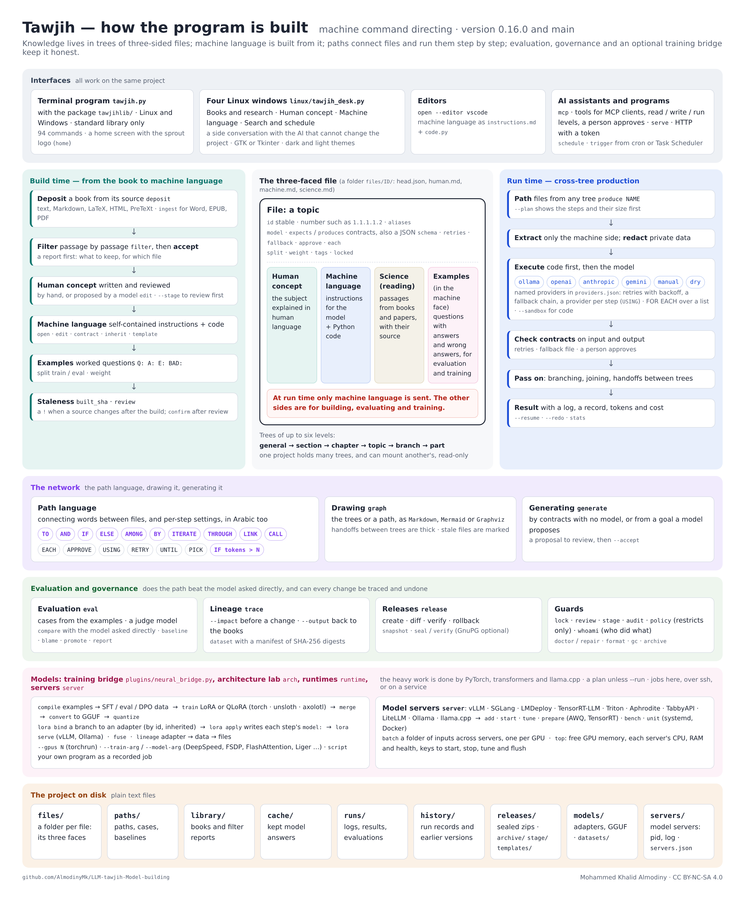
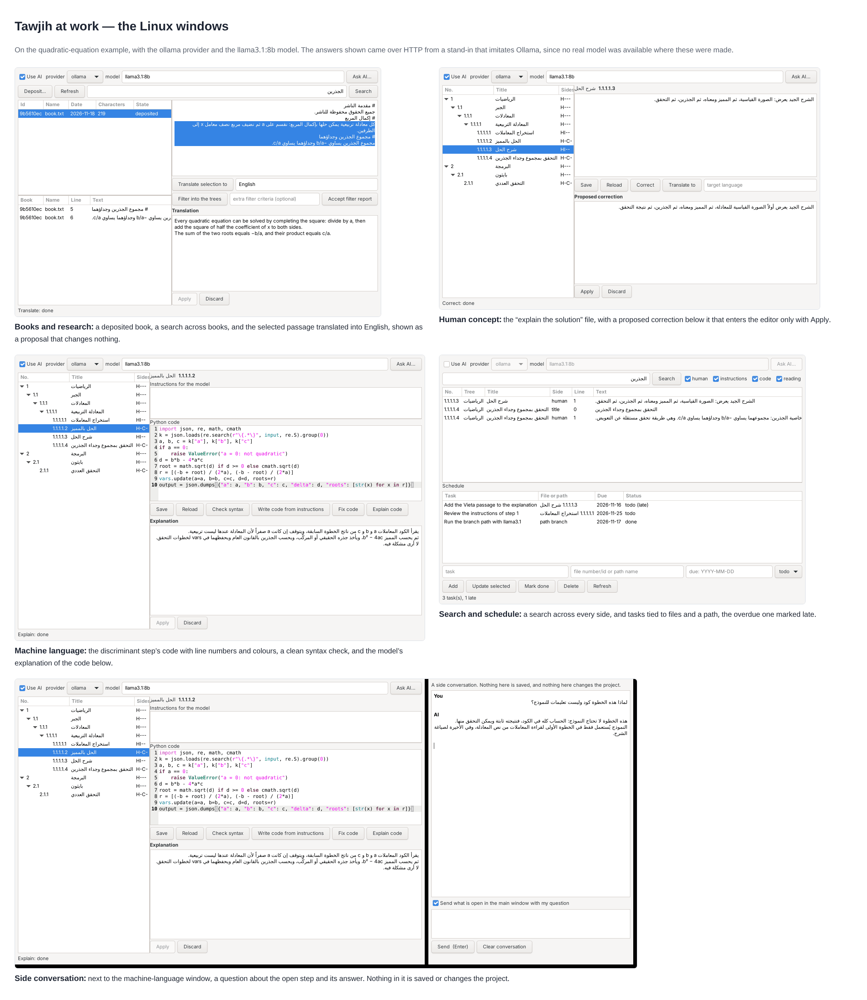
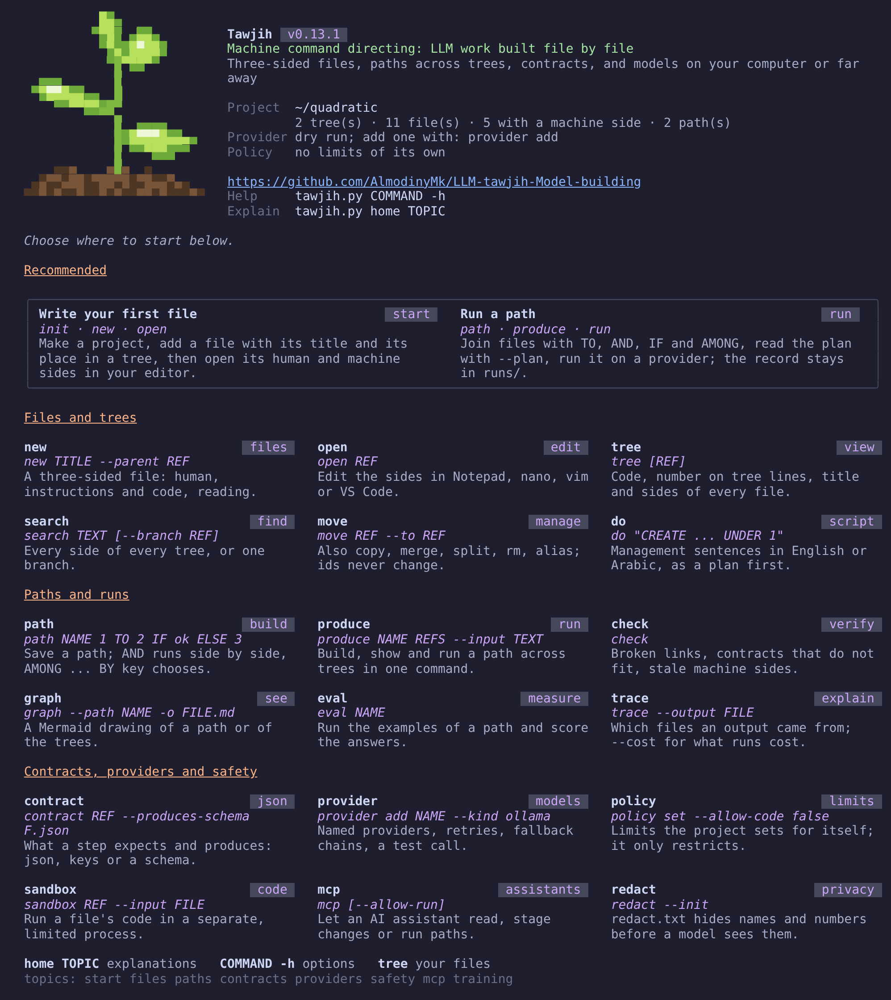

# tawjih — توجيه أوامر الآلة

[](https://github.com/AlmodinyMk/LLM-tawjih-Model-building/actions/workflows/tests.yml) [](https://pypi.org/project/tawjih/) [](https://scorecard.dev/viewer/?uri=github.com/AlmodinyMk/LLM-tawjih-Model-building)

A personal, file-based way to direct a language model. Knowledge is kept in
trees of small files; each file has three sides; a *path* strings files
together into a workflow that the model and your own code execute step by step.

Python, standard library only: `tawjih.py` and the package `tawjihlib/`
beside it. Linux and Windows, in the terminal.

[العربية](README.ar.md)

> **Status: 0.13.1, experimental.** The test suite passes on Linux and Windows.
> No real AI provider has been used with it yet, and the Linux desktop
> windows have not been used by a person; see
> [What is and is not verified](#what-is-and-is-not-verified).



## Screenshots

The example path run in the terminal, then run again with `--resume`:


The four Linux windows and a side conversation:



In these screenshots the model's answers came over HTTP from a stand-in that
imitates Ollama; everything else is the program's real output.

## The idea

Every file has three sides:

| Side | Holds | Used when |
|---|---|---|
| **human** | the expressive human concept of the subject | building the file |
| **machine** | instructions for the model, and optional Python code | building, and **running a path** |
| **reading** | passages filtered from deposited books and research, with their source | building the file |

A fifth, optional side holds worked examples, for evaluation and training
(see [Examples](#examples-training-data-and-evaluation)); it is never sent
when a path runs either.

Files form trees with up to six levels: general → section → chapter → topic →
branch → part. Every file has a stable id (`e1d13b`) and a positional number
(`1.1.1.1.1`); commands accept either.

Two phases are kept apart on purpose:

- **Build time** (`open`, `edit`): you, optionally helped by an AI provider,
  turn the reading side into the human concept and the human concept into
  machine language.
- **Run time** (`run`): only the machine side is sent. The model sees the
  step's instructions, the original request and the previous step's output,
  and nothing else. Instructions therefore have to be self-contained.

## Quick start

Install from PyPI (from version 0.13.1), which gives the command `tawjih`:

```
pip install tawjih
tawjih --version
```

or clone this repository and use `python tawjih.py`, as below; the example
project is only in the repository.


```
python tawjih.py -p examples/quadratic trees
python tawjih.py -p examples/quadratic produce branch --plan
python tawjih.py -p examples/quadratic produce branch --input "2x² − 4x = 6" --allow-code --backend manual
```

`--backend manual` prints each prompt and waits for you to paste an answer
(finish with a line containing only `.`), so the example needs no account.
For step 1 answer `{"a": 2, "b": -4, "c": -6}`.

Your own project:

```
python tawjih.py init
python tawjih.py new "Mathematics"
python tawjih.py new "Algebra" --parent 1 --open
python tawjih.py tree
python tawjih.py produce myprod 1.1 TO 2.3 AND 1.2 TO 1.4 --input "..." --backend ollama
```

Use `-p FOLDER` before the command to work on a project elsewhere.

## Cross-tree production

1. `trees` lists the available trees.
2. Pick files from any trees, by id or number.
3. Connect them with words after `produce NAME`. The path is saved under
   that name and runs again with `produce NAME`.
4. The machine side of each file is extracted (see [SPEC.md](SPEC.md)).
5. Each file runs after the files that feed it and receives their outputs.
6. The result and full log go to `runs/`; a record of the operation (trees,
   connections, the digest of each machine side used, which steps ran or
   were skipped) goes to `history/`.

| Write | Meaning |
|---|---|
| `A TO B` | A's output goes to B |
| `A TO B AND C` | ... to both B and C (branching) |
| `B AND C TO D` | D receives both outputs (joining) |
| `A TO B IF word` | when A's output is JSON with that key: only when its value is true or non-empty; otherwise only when the output contains the word. `IF NOT word` for the opposite |
| `A TO B IF key = value` | when A's output is JSON whose `key` equals `value` (`true`, `false`, `null` and numbers compare as JSON; anything else as text). No JSON, or no such key: false |
| `A AMONG B C D` | A's output names one of them; only that one runs |
| `A AMONG B C D BY key` | A's output is JSON, and the value of `key` names the one that runs, exactly (its number, id, title or alias) |
| `A TO D THROUGH B C` | A → B → C → D |
| `A TO B IF word ELSE C` | B when the word holds, otherwise C (the same as adding `A TO C IF NOT word`) |
| `A LINK B` | B runs after A but does not receive its output (it receives the original request) |
| `A PASS B` | the same as `A TO B` |
| `A TO EACH B` | B runs once per item of the JSON list it receives (as `contract --each yes`, in this path only) |
| `A TO APPROVE B` | a person approves B's input before it runs (as `approve: before`, in this path only) |
| `A TO CALL other TO B` | the saved path `other` is spliced in: A feeds its first files, its last files feed B. It is read every time, so a change to it reaches every path that calls it |
| `B USING model` | B uses that model in this path (`--model` still wins) |
| `B RETRY 3 UNTIL word` | B is run again, told why, until its output meets the word (as for `IF`), at most 3 more times; `UNTIL NOT word` for the opposite. `RETRY n` alone sets the retries for a broken contract. `UNTIL key = value` waits for that value in a JSON output |
| `A PICK key TO B` | only the value of `key` in A's JSON output is passed on |

`EACH` and `APPROVE` come before a file; `USING`, `RETRY`, `UNTIL` and
`PICK` after it, and belong to that file in that path only. Statements chain
(`A TO B AND C TO D`), and several are separated by `,` or `/` (use `/` in
PowerShell). Arabic words work too: إلى، مرر، و، إذا، ليس، وإلا، بين، عبر،
ارتبط، لكل، اعتمد، نفذ، بواسطة، أعد، حتى، انتق، حسب; and `؛` or `،` separate
statements. Files written with no connecting word are a plain sequence.
`PARALLEL` and `CACHE` are refused with a reason: branches joined by `AND`
are already independent, and every answer is already kept for `--resume`.

```
produce review 1.1 TO 1.2 IF error / 1.1 TO 1.3 IF NOT error / 1.2 AND 1.3 TO 2.1
```

`produce --plan` shows each step, its size in characters and what feeds it,
without running.

A step that returns nothing stops the production. After a failure, run the
same command with `--resume`: steps whose prompt, provider and model are
unchanged take their answer from `cache/` and the model is not called again
for them. When a kept answer is itself the cause (a model replied in prose
where the next step expected JSON), the error names the step to ask again:
`--resume --redo REF`. `--no-cache` keeps no answers, `cache` shows what is
kept and `cache --clear` empties it. `--model NAME` chooses the model for
one command.
`produce` will not start if a step has an empty machine side, or has code
and `--allow-code` is missing.

## Contracts, models and staleness

A file's header may carry three optional lines, set with
`contract REF --expects SPEC --produces SPEC --model NAME` (`none` clears
one; without options it shows them):

```
model: llama3.1:8b        the model this step uses
expects: json(a, b, c)    what its input must be
produces: json(roots)     what its output must be
```

A contract is `json`, `json(key, ...)`, `schema(NAME)` or `text`. A JSON answer is accepted
when it is wrapped in a code fence or has a sentence around it, as models
often write; the bare JSON is what goes to the next step. An answer that
breaks the contract stops the run, is not kept in the cache, and the error
names the step to ask again. `check` compares the contracts of connected
files before anything runs, and reports an unknown contract (a typo) as an
error.

`schema(NAME)` checks the JSON against `schemas/NAME.json`, a JSON Schema.
`contract REF --produces-schema FILE` (or `--expects-schema`) checks the
file, copies it to `schemas/` and sets the contract. Only part of JSON Schema
is supported: `type`, `properties`, `required`, `additionalProperties`,
`items`, `enum`, `const`, the number and length limits, `pattern`,
`uniqueItems`, and the property counts. A schema using anything else
(`oneOf`, `$ref`, `if` ...) is refused rather than half-checked. Connected
files are compared through the keys a schema requires.

The model of a step is `--model` if given, else the path's `USING`, else
the file's `model`, else `TAWJIH_MODEL`.

When you rebuild a machine side (with `open`, `edit` or the Linux windows)
the program records the state of the human and reading sides. If either
changes afterwards, the file is marked **stale**: `!` in `tree`, a warning in
`check` and `produce`, and in `graph`. If you review a stale file and its
machine side still fits, `confirm REF` records that; an `edit` asked to
rebuild a side that comes back unchanged records it too.

`IF` and JSON: when a step's output is a JSON object, `IF is_group` tests the
value of the key `is_group` (true, non-zero, non-empty; the strings
`false`, `no`, `0`, `none`, `null`, `لا` and `خطأ` count as false), not whether the
letters appear somewhere in the text. `check` and `generate` add a note when
an `IF` word is not one of the keys the source file promises in `produces`.

## The network: drawing and generating paths

`graph` draws your trees or a path:

```
python tawjih.py graph -o trees.md                       # the trees
python tawjih.py graph --path branch -o branch.md        # one path
python tawjih.py graph --path branch --format dot -o branch.dot
```

The `.md` file holds a Mermaid diagram that GitHub shows as a picture;
`--format mermaid` gives the diagram alone and `--format dot` gives Graphviz.
In a path, files are grouped by tree, `IF` conditions label the arrows,
`AMONG` choices are dashed, `LINK`s dotted, handoffs between trees are
thick, and stale files are marked.

`generate` proposes a path, and runs nothing:

```
python tawjih.py -p examples/quadratic generate solve2 --start 1.1.1.1.1 --end 1.1.1.1.2
python tawjih.py generate review --goal "check and explain a solution" --backend ollama
python tawjih.py generate review --accept
```

With `--start` and `--end` it finds the shortest chain of files whose
`produces` fits the next one's `expects`, without a model. With `--goal` a
model reads the path language, your files and their contracts, and replies
with statements. Either way the proposal goes to `paths/NAME.proposed` with
any problem listed in it (unknown file, loop, a file without a machine side,
a contract mismatch). Read it, edit it if you like, and `--accept` saves it
as a path after checking it again. `--scope REF` limits the files to one
branch.

## Books and their sources

`deposit` reads a book from its source, which keeps its structure and its
mathematics. PDF is refused: it records where letters sit on a page, so
exponents, arrows and fractions come out broken (`271³²¹` becomes `271321`).

| Source | What deposit does |
|---|---|
| `.txt` | kept as it is; `#` lines are headings |
| `.md` | `#` and underlined headings; `#` lines inside code blocks are protected |
| `.tex` | read in stages: code (`verbatim`, `lstlisting`, `minted`, `\verb`) is protected first, so an example document inside the text does not cut it short; `\input` and `\include` are read in unless commented out; the document's own `\newcommand`, `\def`, `\DeclareMathOperator` and `\newtheorem` are expanded; mathematics is protected and kept as LaTeX; then `\part` … `\subparagraph` become headings, theorem-like environments are labelled, lists become `- ` lines, footnotes stay in place, references become `[ref: …]` and `[cite: …]`, accents and special characters become text; pictures are left out |
| `.html` | `<h1>`–`<h6>` become headings; scripts, styles and navigation are left out; MathML is replaced by its TeX |
| `.xml`, `.ptx` | PreTeXt: chapters and sections become headings, `xi:include` files are read in, `<m>` and `<md>` become `$…$` and `$$…$$`, theorems, examples and figures get the book's numbers (Example 3.8) and references point to them; Sage cells, index entries and pictures are left out. Other XML: its text |

`deposit BOOK --part 3 --part 4` keeps only those chapters (by number or
title). Deposit the whole book this way rather than a single chapter file,
so the numbering is the book's own. Many open textbooks (PreTeXt, LaTeX on
arXiv) publish their source; look for it before using a PDF.

## The home screen

`tawjih.py` alone, or `tawjih.py home`, shows the sprout logo, the project
in this folder at a glance (files, paths, the default provider, the
policy) and the main commands as cards. `tawjih.py home TOPIC` explains one
topic: start, files, paths, contracts, providers, safety, mcp, training.
Colours appear on terminals that show them (Windows Terminal, most Linux
and macOS terminals); `NO_COLOR` turns them off. The screen is in English,
because terminals do not lay out right-to-left text reliably.



## Commands

| Command | Purpose |
|---|---|
| `init` | create a project in the current folder |
| `new TITLE [--parent REF] [--level L] [--open]` | create a file |
| `open REF [--editor CMD] [--reading]` | open one editor per side; save on close |
| `tree [REF]` | show the trees, or one branch, in columns: Code (the stable id), No. (the number on lines `├─ └─ │` joining it to its parent; `▾` has files under it), Title, and Sides (`H I C R` for the sides with content, `·` for an empty one); `!` marks a stale machine side. In a terminal that shows colours, each side letter has its own (`NO_COLOR` turns them off) |
| `search QUERY [--branch REF] [--side S] [--tag T] [--rank \| --semantic]` | search titles and sides; see [Managing a project](#managing-a-project) for the other commands added in 0.7 |
| `show REF` / `read REF [--all]` | print a file / print its reading side |
| `link SRC DST [--type T]` | record a link between any two files |
| `contract REF [--expects S \| --expects-schema FILE] [--produces S \| --produces-schema FILE] [--model M] [--retries N] [--fallback REF] [--approve WHEN] [--split S] [--weight W] [--each yes\|KEY]` | show or set a file's contracts, model, retries, fallback, approval, split, weight and FOR EACH |
| `redact [TEXT] [--init]` / `stats` | private data hidden before model calls / what runs cost; see [Failures, approval, privacy and cost](#failures-approval-privacy-and-cost) |
| `check [--branch REF]` | validate parents, levels, cycles, links, paths, code syntax, contracts, staleness |
| `trees` | list the available trees |
| `cache [--clear]` | show or empty the kept model answers |
| `produce NAME [WORDS ...] [--plan] --input TEXT [--backend B] [--allow-code] [--code-timeout S]` | cross-tree production: select, order, validate, run, save, document |
| `path NAME [WORDS ...]` | define a path without running it, or show a saved one |
| `run NAME --input TEXT [--backend B] [--allow-code]` | run a saved path |
| `edit REF --side S --ask TEXT [--source FILE] [--backend B]` | have a model rewrite one side; shows a diff and asks before saving |
| `deposit FILE [--part N\|TITLE]` / `library` | add a book (text, Markdown, LaTeX, HTML, XML/PreTeXt) to the library / list books |
| `confirm REF ...` | record that a machine side still fits its human and reading sides (clears the stale mark) |
| `filter BOOK [--parent REF] [--ask TEXT] [--backend B]` | have a model decide, passage by passage, what to keep and for which file; writes a report only |
| `accept BOOK` | append the kept passages to the reading side of their files |
| `import FILE --parent REF` | split a text on `#` headings into child files, without a model |
| `graph [--path NAME] [--branch REF] [--format md\|mermaid\|dot] [-o FILE]` | draw the trees or a path; the format follows the `-o` extension (`.mmd`, `.dot`, `.gv`) unless given |
| `generate NAME (--start REF --end REF \| --goal TEXT --backend B) [--scope REF]` | propose a path; `generate NAME --accept [--replace]` saves it |
| `tangle [--branch REF \| --path NAME] [-o FILE]` | export the code sides as Python functions, one per step |
| `mcp [--allow-write] [--allow-run --backend B [--model M]] [--allow-code] [--human-approval always\|run\|never]` | an MCP server for AI assistants on this project (see [AI assistants](#ai-assistants-the-mcp-server)) |
| `provider list\|add\|policy\|rm\|default\|fallback\|test [NAME] ...` | named providers, retries and fallback chains; see [AI providers](#ai-providers) |
| `policy show\|set\|reset` | the project's own limits, which only restrict; see [The project's policy](#the-projects-policy) |
| `approve [ID ...] [--yes \| --no]` | requests from the assistant waiting for a person: list, read, run or decline |
| `do STATEMENTS [--file F] [--run] [--yes]` | management statements in English or Arabic, translated into commands (see [Management statements](#management-statements-do)) |
| `lock`, `alias`, `review`, `stage`, `mount`, `sandbox`, `trace`, `release`, `snapshot`, `seal`, `verify`, `inherit`, `template`, `scaffold`, `gc`, `compact`, `format`, `archive`, `glossary`, `doctor`, `repair`, `schedule`, `trigger`, `pause`, `resume`, `cancel` | see [Governance](#governance-locks-reviews-releases-schedules) (0.10) |

## Managing a project

Since 0.7 Tawjih has commands to reorganise trees, read the saved versions
of files, see what is unfinished, and take knowledge out of a project.

**Restructuring.** Paths name files by their id, so moving files never
breaks a path; only the positional numbers change.

| Command | Does |
|---|---|
| `move REF --to REF` (`mv`) | moves a file and its branch; levels shift with it; `--root` makes a new tree; `--position`, `--before`, `--after` place it |
| `rename REF TITLE` | changes the title; a file that chooses it with `AMONG` and names it in its instructions gets the new title |
| `copy REF --to REF [--branch]` (`cp`) | copies sides, contracts, model and tags; links inside a copied branch point to the copies |
| `rm REF [--branch] [--unlink] --yes` | refuses while a saved path uses the file; without `--yes` it only lists; a copy stays in `history/` |
| `split REF --passages 3-5 --title T` | moves reading passages into a new file placed after it (without `--passages` it lists them) |
| `merge A B [--keep]` | appends B's human and reading sides to A; links to B come to A; B is removed unless `--keep` |

**Versions.** Every command that changes a file keeps the previous version
in `history/`.

| Command | Does |
|---|---|
| `log REF` | the saved versions, newest first (1), and what changed after each |
| `diff REF [--version K] [--side S]` | a unified diff of a saved version against the current file |
| `revert REF [--version K] [--side S] [--header]` | brings back sides of a version (the current one is saved first); brings back a removed file; a reverted machine side comes back with the digest of the sources it was built from |

**State.**

| Command | Does |
|---|---|
| `status [--branch REF]` | only what is unfinished: stale files, path steps without a machine side, machine sides without contracts, empty human sides, edits made outside Tawjih, edits left in `work/` |
| `tag REF WORD...` / `untag` / `tag` | labels across trees; `tag` alone lists them; `search --tag` filters by one |
| `sync [--confirm-machine] [--clean-work] [--watch S]` | finds files edited outside Tawjih (in another editor, by git) since the last sync and reports which sides; a machine side rebuilt by hand can be recorded as built |
| `refs REF` | links in and out, every path that uses the file with its neighbours, `AMONG` choices, shared tags, machine sides that mention its title |
| `clean [--runs DAYS] --yes` | removes unfinished edits in `work/` and old run records, removes broken links; reports paths and files it cannot fix |
| `audit [REF \| --path NAME]` | reads the code sides for what touches the system (running programs, deleting or writing files, the network, running text as code); `produce` and `run` print its warnings before running code. A check of what the code says, not a sandbox |

**Search, outputs and services.**

| Command | Does |
|---|---|
| `search QUERY --rank` | ranks titles, paragraphs and reading passages by relevance (BM25), any of the words |
| `index --backend ollama [--model M]` then `search QUERY --semantic` | search by meaning with an embedding model (default `nomic-embed-text`); only changed pieces are embedded again |
| `export [--branch REF] [-o book.html] [--machine] [--no-reading]` | the trees as one book in Markdown or HTML, with the reading passages and their sources; HTML shows formulas with MathJax, loaded from the web (`--no-mathjax` for an offline page) |
| `pack --branch REF \| --path NAME -o F.zip` / `unpack F.zip [--parent REF] [--new-ids]` | moves a branch with its paths to another project; clashing ids are refused unless `--new-ids` |
| `ingest FILE [--deposit]` | turns `.docx` (headings, lists, tables; formulas as plain text to check) and `.epub` into Markdown; `.pdf` through `pdftotext` when installed, with a warning |
| `serve [--port P] [--backend B] [--allow-code]` | offers saved paths over HTTP on this computer: `GET /paths`, `POST /paths/NAME` with `{"input": "..."}` and the printed token; one run at a time |
| `eval NAME [--cases F]` | runs a path on cases with known answers (`paths/NAME.cases.jsonl`: `{"input": ..., "expect": ..., "match": contains \| not-contains \| equals \| regex \| json}`) and reports how many pass; exits with 1 if any fails |
| `dataset -o F.jsonl [--source eval\|runs\|steps]` | writes question-answer pairs in the chat format (or prompt/completion) for fine-tuning tools such as Unsloth or axolotl. Tawjih does not train models; read the pairs before training |

`eval` is how the central claim of the method can be tested: write the
questions and the answers you expect, then run the same cases with a path
and with a model asked directly.

## Failures, approval, privacy and cost

**Retries.** `contract REF --retries 2` (or `--retries N` on the command
line) asks the model again, up to N times, when its answer is empty or
breaks the file's `produces` contract. The new request repeats the prompt
and says why the answer was rejected. Only an answer that passes is kept in
the cache, under the original prompt.

**Fallback.** `contract REF --fallback OTHER` names a file whose machine
side runs, on the same input, when this step fails for any reason (code,
model call, contract). Its output takes the step's place, so the rest of the
path does not change. `check` reports a fallback that is missing, has no
machine side, or produces something the step does not promise.

**Approval.** `contract REF --approve after` (or `before`, `both`) makes a
person approve the step: before it runs, after it, or both. After a step the
person may also type a replacement output (`e`). `--approve ask` asks on the
terminal (the default there), `auto` approves everything, `deny` stops at
the first step that needs approval (the default elsewhere, and always for
`eval` and `serve` unless given).

**Redaction.** `redact --init` creates `redact.txt`. From then on every
text sent to a model (by `produce`, `run`, `edit`, `filter`, `generate`,
`eval`, `serve`) has e-mail addresses, phone numbers, card numbers that
pass the Luhn check, IBANs, ten-digit national ids, IP addresses, and your
own words and names (one per line, or `re:` a regular expression) replaced
by placeholders such as `[EMAIL_1]`; the placeholders in the answer are put
back. `redact "some text"` shows what would be hidden. Patterns only catch
what they describe: a name you did not list is sent as it is.

**Cost.** Each run records, per step and in total, the tokens the provider
reports, the time spent waiting for the model, model calls, retries,
fallbacks and redacted items. `stats [--path NAME] [--days N]` adds them up
per path with the latest evaluation; with `prices.json`
(`{"MODEL": {"input": 3.0, "output": 15.0}}`, per million tokens) it gives
a cost. Tawjih has no built-in prices: they change.

**Converters.** `ingest FILE --with auto` uses the best converter installed:
for PDF Docling, then Marker, then pdftotext; for a Word file with formulas
Pandoc (formulas become LaTeX), otherwise the built-in reader; for EPUB
Pandoc, then the built-in reader. `--with` chooses one.

## Examples, training data and evaluation

A file may carry a fifth, optional side, `=== examples ===`: worked
questions with their answers. Like the human and reading sides, it is never
sent when a path runs. It feeds evaluation cases and training data.

```
=== examples ===
Q: Solve 2x + 4 = 10
A: Subtract 4 from both sides: 2x = 6, so x = 3.
E: x = 3
BAD: x = 7
```

`Q:` (or `س:`) starts an example, `A:` (`ج:`) is a correct answer, `E:` a
short text any correct answer must contain (several separated by `;`), and
`BAD:` (`خطأ:`) a typical wrong answer. A section `=== anti_examples ===`
is read into the same side. `edit --side examples` lets a model write them
from the human and reading sides; they are then marked old when those
sides change (`status`, `confirm --examples`). `check` reports unreadable
blocks, the same question in a training and an evaluation file, and the
same question with different answers.

Two header lines, set with `contract`: `split: train | eval | ignore`
(default train) decides where a file's examples go, so evaluation questions
never reach training data; `weight: 2` makes them count more, and
`weight: 0` keeps them out of training data.

| Command | Does |
|---|---|
| `dataset --source examples -o train.jsonl [--split S] [--with-rules] [--repeat-by-weight] [--dpo pairs.jsonl]` | compiles the examples of the `train` files (or another split) into chat or prompt/completion JSONL; `--with-rules` puts the file's instructions before the question; `--dpo` writes `{prompt, chosen, rejected}` pairs from `BAD:` lines. Every dataset gets `FILE.manifest.json` with the SHA-256 of each file it came from |
| `eval init NAME` | a cases file with a template |
| `eval extract NAME [--split eval]` | cases from the examples of `eval` files: `E:` becomes the expected text; without it the case is graded by a judge |
| `eval synthesize NAME --backend B [--count N]` | a model proposes hard cases from the human sides and examples (never from `eval` files) into a file to review; `--accept` adds them |
| `eval NAME [--judge MODEL] [--fail-fast]` | runs the cases; `match: judge` cases are graded by a model; `--fail-fast` stops at the first failure and shows it |
| `eval NAME --direct` | the same cases sent straight to the model, without the path |
| `eval compare NAME [A B]` | two evaluations case by case, by default the path against the model asked directly |
| `eval baseline NAME --save` / `eval diff NAME [--baseline]` | a reference result; every later `eval` reports cases that passed then and fail now (exit status 1); `diff` lists cases that changed |
| `eval blame NAME [--case C]` | for each failed case, the steps of its run: which failed, or where the expected text appeared and was lost |
| `eval promote NAME --to REF` | failed cases become examples of a training file, with the wrong output as `BAD:`; they leave the cases file, since a case trained on no longer tests |
| `eval report NAME [-o eval.md]` | accuracy, time, tokens, failed cases, and the direct model and the baseline when they exist |

`eval compare` is the test of the method: if the path does not beat the
model asked directly on cases that matter to you, the work of building it
did not pay. A handful of cases decides nothing, and a judge model has its
own biases.

## Management statements: `do`

Several file operations can be written as statements, in English or
Arabic, and run in order. `do` translates each one into the program's own
command and shows the list; nothing runs without `--run`.

```
python tawjih.py do 'أنشئ "تحليل النص" تحت 1.1 / عدّل 1.1.1 جانب آلي "اكتب تعليمات قصيرة" / مسار p 1.1 إلى 1.1.1'
python tawjih.py do --file ops.txt --run
```

| Statement | Command |
|---|---|
| `CREATE "title" [UNDER ref] [FROM template]` (أنشئ، تحت، من) | `new`, or `scaffold` from a template |
| `EDIT ref SIDE side [USING provider\|model] request...` (عدّل، جانب، بواسطة) | `edit`, staged for review unless `--yes`. Sides: HUMAN (بشري), MACHINE (آلي), CODE (كود), READING (قرائي), EXAMPLES (أمثلة) |
| `MOVE ref UNDER ref` / `COPY ref UNDER ref` (انقل، انسخ، تحت أو في) | `move` / `copy` |
| `MERGE b INTO a` (ادمج، في) | `merge a b`: b's human and reading sides go to a, and b is removed |
| `DELETE ref` (احذف) | `rm` |
| `CHECK [ref]` (افحص) | `check` |
| `GC` (نظّف) | `gc` |
| `PATH name statements` (مسار) | `path`: the rest is the path language, with `,` between its statements |

Statements are separated by a new line, `/`, `;` or `؛`; a line starting
with `#` is a comment. Every statement is checked before any runs, and the
first failure stops the rest. `DELETE`, `GC` and `MERGE` remove nothing
without `--yes`. Numbers are read when each statement runs, so after a
`MOVE` they may name other files: in scripts, use ids or aliases. These
words are not words of the path language, so في and من stay free there.

## AI assistants: the MCP server

`mcp` lets an AI assistant that speaks the Model Context Protocol (Claude
Desktop, Claude Code and others) work on one project through tools.

```
claude mcp add tawjih -- python /path/to/tawjih.py -p /path/to/project mcp --allow-write
```

or, in a client's configuration file:

```
{"mcpServers": {"tawjih": {"command": "python",
  "args": ["/path/to/tawjih.py", "-p", "/path/to/project", "mcp"]}}}
```

| Level | Tools |
|---|---|
| reading (always) | `tawjih_tree`, `tawjih_show`, `tawjih_search`, `tawjih_paths`, `tawjih_plan`, `tawjih_check`, `tawjih_status`, `tawjih_impact`, `tawjih_staged`, `tawjih_language` |
| `--allow-write` | `tawjih_new`, `tawjih_contract`, `tawjih_link`, `tawjih_move`, `tawjih_define_path` (replaces a path only with `replace=true`), and `tawjih_propose`: the new text of a side, kept in `stage/` until a person runs `stage --show` and `stage --apply` |
| `--allow-run` | `tawjih_run` and `tawjih_eval`, with the provider and model given at start (`--backend`, `--model`); code steps only with `--allow-code`, and then always in the sandbox |

**A person approves.** By default (`--human-approval always`) every write
and every run waits for a person. When the client supports MCP elicitation,
the person sees the request in the client's own dialog and answers yes or
no. Otherwise the tool answers `PENDING` with a request id, and the person
reads and decides in a terminal:

```
python tawjih.py approve                 # what is waiting
python tawjih.py approve r20261120-141744-4998          # read it
python tawjih.py approve r20261120-141744-4998 --yes    # run it (or --no)
```

The request shows what will change; for a run, also the provider and
model, how many steps and characters will be sent (roughly how many
tokens), how many model calls, and whether code runs. The assistant reads
the outcome with `tawjih_request`. A request that would fail anyway (an
unknown file, a path with code when code is not allowed) is refused at once,
without asking. Proposals for sides need no approval here, since a person
applies them. `--human-approval run` asks only for runs, `never` for
nothing (the server then warns at start).

What it does for safety:

- **Files and trees.** One project, fixed at start; no tool takes a folder
  or a file name, so nothing outside the project can be named. Files are
  named by id, number or alias, checked against a pattern (no `..`, `/`
  or leading `-`). No tool removes a file, applies a proposal, unlocks,
  rolls back, or changes `redact.txt`; locked and mounted files stay as they
  are. Sides change only through proposals that a person applies.
- **Connections.** No network port: the client starts the server and talks
  through its standard input and output. Runs reach only the provider
  chosen at start, through redaction as usual; the client cannot choose
  another provider or model, or turn on code.
- **Arguments.** Every argument is checked against its type, size and
  pattern, and unknown arguments are refused. Text from the client is
  never read as a command-line option (a title `--yes` stays a title).
  Approval steps are denied, and nothing reads the terminal.
- **Output.** The protocol has its own copy of standard output; anything
  else a library or a program prints goes to standard error. A reply is
  cut at 100,000 characters.
- **Record.** Every call goes to `history/mcp-YYYYMMDD.jsonl`: the tool,
  its arguments with free text replaced by its length, and the outcome.

What it cannot do alone:

- **Prompt injection.** Text in your files reaches the assistant, and a file
  may hold instructions written to mislead it. Three things answer it: file
  text comes with a notice that it is data; lines that look like
  instructions to an AI (in English or Arabic) are pointed out with a
  warning; and, above all, nothing the assistant is led to do changes the
  project or reaches a provider until a person approves it. The pattern
  check is a heuristic: it misses some wordings and flags harmless ones.
- **Cost and data.** A run sends project text to the provider and may cost
  money. The person approving a run sees the provider, the model and the
  size before anything is sent; still, start the server with
  `--allow-run` only for a provider whose cost and data handling you
  accept, and keep `prices.json` filled for `stats`.
- **The client's dialog.** With elicitation the question is shown by the
  client; a client that answered on its own would bypass the person. Use
  `approve` in a terminal when in doubt (a client without elicitation
  always falls back to it).

## Governance: locks, reviews, releases, schedules

Since 0.10 a project can be guarded and kept over time.

| Command | Does |
|---|---|
| `lock REF... [--branch]` (`freeze`) / `unlock` | a locked file's sides, title, contracts and links cannot change, and it cannot be removed or archived, until it is unlocked; moving it stays possible |
| `alias REF NAME...` / `unalias` / `alias` | other names for a file, usable wherever a REF is asked for (`show quad`, `path p quad TO ...`) |
| `review [REF...] [--branch]` / `review --ok REF...` | files a person has never reviewed, or that changed after their review; `--ok` records the review (a digest of the content and the date) |
| `edit ... --stage` / `stage [REF] [--show \| --apply \| --drop]` | a model's proposal is kept in `stage/` instead of being saved; `--apply` saves it as `edit` would, unless the side changed meanwhile |
| `mount FOLDER [--name N]` / `unmount N` | the files of another project, read-only, usable in this project's paths; their trees are numbered after this project's own. A mount used by a path cannot be removed |
| `sandbox REF --input TEXT [--memory MB]` | run one file's code side in the sandbox (see [Code steps](#code-steps)) |
| `contract REF --each yes\|KEY` | FOR EACH: the step runs once per item of a JSON list (the input itself, or the list under KEY), and passes on `{"items": [...]}` |
| `trace --impact REF` | what a change would reach: files under it, links into it, the paths and the steps after it in each, evaluation cases, baselines, `AMONG` deciders, fallbacks, datasets and releases that hold it |
| `trace --output FILE` | where a run's record, log or result, or a dataset manifest, came from: the steps, whether their machine sides changed since, and the books in their reading sides |
| `trace --cost [--path P]` | the same table as `stats` |
| `release create NAME [--note T]` / `list` / `verify NAME` / `diff A [B]` / `rollback NAME --yes` | a zip of `files/`, `paths/` (with cases and baselines), `redact.txt`, `prices.json` and `mounts.json`, with the SHA-256 of each file and of the whole. `diff` compares two releases, or one with the project; `rollback` first saves the current state as a release, and refuses to change locked files without `--force` |
| `snapshot [--note T]` | a release named by the time |
| `seal [--sign]` / `verify` | `seal.json` holds the digest of every file; `verify` lists what changed (exit status 1). `--sign` also signs it with GnuPG when `gpg` is installed, and `verify` then checks the signature |
| `inherit REF [--fields model,tags,...] [--overwrite]` | give the files under REF its model, tags, split, weight, contracts, retries or approval; only where they have none, unless `--overwrite`; tags are added |
| `template save NAME REF [--branch]` / `list` / `rm NAME`; `scaffold NAME [--parent REF] [--title T]` | keep a file or branch as a template in `templates/`, and make new files from it |
| `gc [--keep N] [--days D] [--cache-days D] [--yes]` | remove old versions from `history/` (the newest N per file are kept, and the last version of a removed file always) and old cached answers; without `--yes` it only counts |
| `compact` | siblings numbered 1, 2, ... and every file rewritten in the standard form |
| `format [--check] [--branch REF]` (`lint`) | trailing spaces, runs of blank lines, repeated tags; `--check` only reports (exit status 1) |
| `archive REF --yes` / `archive --list` / `archive --restore ID` | move a branch out of the trees into `archive/`, where nothing reads it, and back. A branch used by a path or linked from outside cannot be archived |
| `glossary [--conflicts] [-o FILE]` | terms the human sides define, as `**term**` or a line `term: definition`; `--conflicts` lists terms defined differently in several files. It is a heuristic: a short line with a colon is taken for a definition |
| `doctor` / `repair` | checks the project without trusting it: unreadable files, ids that do not match file names, missing parents, cycles, broken links, paths naming missing files, unreadable `state.json`, index or cache. `repair` moves unreadable files to `quarantine/`, removes broken links and cached answers, and makes orphans the roots of trees |
| `schedule NAME --path P --every 6h\|--at HH:MM [--input T] [--backend B]` / `schedule` | a path run at set times |
| `trigger NAME --path P --on-change REF,REF` | a path run when those files change |
| `pause` / `resume` / `cancel NAME` | stop, restart or remove a schedule or trigger |
| `schedule --run-due` | runs what is due. Tawjih is not a service: call this from cron or the Windows Task Scheduler every few minutes (`schedule` prints the line). Scheduled runs deny approval steps |

## Training adapters: the neural bridge

Tawjih trains nothing itself. `plugins/neural_bridge.py`, a separate
program with the same standard-library rule, carries a project to the
training tools and back. The heavy work is done by the Python you name with
`--python` (PyTorch, transformers, PEFT, TRL; or Unsloth; or axolotl) and by
llama.cpp. Every command that would start such a program only shows its
plan, unless `--run` is given.

```
B="python plugins/neural_bridge.py -p myproject"
$B env                                   # engines, GPU, llama.cpp tools
$B compile -o datasets --with-rules      # sft_train, sft_eval, dpo_train
$B train algebra --base-model Qwen/Qwen2.5-1.5B-Instruct \
   --dataset datasets/sft_train.jsonl --eval datasets/sft_eval.jsonl \
   --qlora --run                         # --engine torch|unsloth|axolotl
$B train algebra-dpo --method dpo --dataset datasets/dpo_train.jsonl ...
$B merge algebra --run                   # adapter merged into the base
$B --llama-cpp ~/llama.cpp convert algebra --run      # merged model to GGUF
$B --llama-cpp ~/llama.cpp quantize models/gguf/algebra-f16.gguf --type Q4_K_M --run
$B --llama-cpp ~/llama.cpp convert algebra --lora --run   # a GGUF adapter
```

| Command | Does |
|---|---|
| `compile` | through Tawjih's own `dataset`: `sft_train.jsonl` (files of split `train`), `sft_eval.jsonl` (split `eval`), `dpo_train.jsonl` (a pair for each `BAD:` line), each with its manifest; exit status 1 when a question is in both training and evaluation data |
| `env` | the versions of torch, transformers, peft, trl, datasets, bitsandbytes, unsloth and axolotl in the training Python, its GPU, and where llama.cpp's tools are |
| `train NAME` | writes `models/adapters/NAME/` with `train_config.json`, the dataset's manifest, and `train.py` (engine `torch`: transformers + PEFT + TRL, QLoRA through bitsandbytes; engine `unsloth`) or `axolotl.yml` (SFT on chat data only). SFT takes chat or prompt/completion rows, DPO takes prompt/chosen/rejected rows; the data is checked first |
| `merge NAME` | the adapter merged into its base in 16-bit (PEFT `merge_and_unload`), for conversion |
| `convert SOURCE [--lora]` | a merged model to GGUF, or an adapter to a GGUF adapter (`convert_lora_to_gguf.py`) |
| `quantize FILE.gguf [--type Q4_K_M]` | with `llama-quantize`, looked for in `--llama-cpp`, its `build/bin`, then PATH |
| `lora add NAME FOLDER [--served-as M]` / `rm` / `list` | the project's adapters, in `models/registry.json` |
| `lora bind REF NAME` / `unbind REF` / `route REF` | an adapter for a file and the files under it, kept by stable id: moving files keeps their adapter; `route` shows which adapter a file gets and from where |
| `lora apply [--yes] [--overwrite]` | writes each step's `model:` line from the bindings: this is what routes a path's steps to adapters. A file's own model is kept unless `--overwrite`; locked files are not changed |
| `lora serve [--server vllm\|ollama\|llama]` | how to offer the adapters under their names: the `vllm serve ... --enable-lora --lora-modules` command, or one Ollama model per adapter (Modelfiles with `ADAPTER`) |
| `lora fuse NEW A:0.7 B:0.3 [--how linear\|cat\|svd\|ties\|...]` | a weighted combination with PEFT's `add_weighted_adapter`; refuses adapters of different bases, and `linear` with different ranks |
| `lora lineage NAME` | what an adapter was trained on: the dataset, and each source file, marked when it has changed since |

How a path then uses the adapters: run vLLM with `lora serve`'s command,
set `TAWJIH_BASE_URL=http://localhost:8000/v1`, and run the path with
`--backend openai`; each step asks for the model its `model:` line names,
and vLLM answers with that adapter. With Ollama, `--backend ollama` does
the same. `llama-server` applies its adapters to every request, so it
cannot route by file.

What is verified: the test suite checks the data, the configurations, the
commands and the registry without any training library; the generated
`torch` scripts were run on a CPU with a tiny random model made on the spot
(SFT, DPO, merge and fuse). Not verified: a real model, a GPU, QLoRA,
Unsloth, axolotl, vLLM, Ollama adapters and llama.cpp. The training
libraries change their arguments often; the scripts pass only the ones the
installed TRL knows, and say what they left out.

## Desktop windows, for Linux users

**For Linux users only.** `linux/tawjih_desk.py` opens four independent
windows over a project: books and research, the human concept, machine
language, and search with a task schedule. Each window has a side
conversation with the AI that cannot change the project. It runs on GTK 3 or
Tkinter, in English, with optional AI help, in dark colours by default
(`--theme light` or `--theme system` for others). Everything else in this
repository works on Linux and Windows. See
[linux/README.md](linux/README.md).

## Editors

`open` writes each side to a scratch file and starts an editor:

- Windows: Notepad, one window per side.
- Linux: nano, else vim, inside the terminal. With vim the sides appear side
  by side.
- VS Code: `--editor vscode`. The machine side opens as two files,
  `instructions.md` and `code.py`, next to `human.md`, so Python and
  Markdown support apply; close the window to save. `--split` does the same
  with any editor.
- Anything else: `--editor "COMMAND"` or the `TAWJIH_EDITOR` variable.

If an edit is interrupted, its text stays in `work/` and the next `open` of
that file refuses to overwrite it until you pass `--discard`.

The machine side is one document with two parts, instructions above the
`=== code ===` line and Python below it. The reading editor opens only when
the file already has passages, or with `--reading`.

## AI providers

The built-in kinds:

| `--backend` | Talks to | Environment |
|---|---|---|
| `dry` (default) | nothing; shows what would be sent | — |
| `manual` | you paste the answer | — |
| `ollama` | a local Ollama server | `OLLAMA_HOST` (optional) |
| `openai` | any OpenAI-compatible `/chat/completions` endpoint | `TAWJIH_BASE_URL`, `TAWJIH_API_KEY` |
| `anthropic` | Anthropic Messages API | `ANTHROPIC_API_KEY` |

Name the model with `--model NAME` or the `TAWJIH_MODEL` variable, for all
three network backends. Keys are
read from the environment and never written to disk.

**Named providers.** `providers.json` in the project gives providers names,
each with a kind, an address, a model, the *name* of the environment
variable holding its key (never the key), and what to do when a call fails:

```
tawjih.py provider add local --kind ollama --base-url http://localhost:11434 --model llama3.2
tawjih.py provider add cloud --kind openai --base-url https://api.example.com/v1 \
    --api-key-env EXAMPLE_KEY --model some-model --retries 3 --backoff exponential
tawjih.py provider default local
tawjih.py provider fallback local cloud      # if local fails, try cloud
tawjih.py provider list                      # says whether each key variable is set
tawjih.py provider test local                # a real call; also: provider test all
```

`--backend NAME` then takes a provider's name as well as a kind; without it
the project's default is used (`dry` when there is none). A lost connection,
a timeout, or a status in `--retry-status` (429, 500, 502, 503 and 504 by
default) is tried again `--retries` times (2 by default), waiting
`--backoff-seconds` (2), doubled each time with `exponential`, or as long as
the server's `Retry-After` asks, at most 60 seconds. Other errors are not
tried again. When a provider still fails, the next one in its fallback chain
is called with that provider's own model; the run's usage records which
provider answered and after how many attempts. A step's `fallback:` file
still runs when every provider failed. `provider policy NAME --retries ...`
changes these settings, `provider rm` removes one, and `provider test`
writes each result to `runs/provider-tests.jsonl`. Live tests:
`TAWJIH_LIVE_TESTS=1 TAWJIH_LIVE_PROJECT=folder python -m unittest
tests.test_live`.

## The project's policy

`tawjih.policy.json` holds limits a project sets for itself. It can only
restrict: what it allows still needs the usual options, because a file in
the project could be changed by an assistant that was misled, and must not
be able to turn anything on.

```
tawjih.py policy set --allow-code false        # refuse --allow-code and sandbox runs
tawjih.py policy set --allow-network local     # only providers on this computer
tawjih.py policy set --sandbox true            # code always runs in the sandbox
tawjih.py policy set --human-approval run      # the least an MCP server may use
tawjih.py policy show
tawjih.py policy reset --yes
```

`--allow-network false` allows only `dry` and `manual`; `local` allows
providers whose address is `localhost`, `127.0.0.1` or `::1`, fallbacks
included. Setting a limit back to a looser value, and `reset`, need
`--yes`.

## Code steps

Code on the machine side runs as one step of a path. It sees `input` (the
previous step's output), `origin` (the original request), `vars` (a dict
shared by all steps), `steps` (the outputs of the files upstream of it in the
path, by id or number), `meta` (this file's id, title, number and tree) and
`linked(type="")` (the files it links to, with their output when they are
upstream), and sets `output`. Reading `steps` for a file that is not
upstream is an error: its output might not exist yet.

**Code is executed with `exec`, with your user's full permissions.** It runs
only when you pass `--allow-code`. With `--sandbox` (on `run`, `produce`,
`eval` and `serve`) each code step runs instead in a separate Python process
with a temporary working folder, an empty environment, and, on Linux and
macOS, limits on memory (512 MB), processor time and file size. That keeps a
mistake from filling the memory or the disk, but it does not cut off the
network or the files outside that folder: it is a fence, not a jail. Do not run paths
whose code you have not read, including code a model wrote through `edit`.
A code step that runs longer than 60 seconds is stopped
(`--code-timeout SECONDS`, `0` for no limit). The limit is checked between
Python lines, so it stops a loop that never ends but not one long call into
C code, and it makes pure-Python loops several times slower while it is on.
The time limit is a safeguard against mistakes, not a sandbox.

## Project layout

```
files/    one .md file per tree file (header + four marked sections,
          and examples when there are any)
paths/    one .path file per path, and .proposed files from generate
library/  deposited books and filter reports   (git-ignored)
runs/     log, result and state of every run   (git-ignored)
cache/    kept model answers, for --resume     (git-ignored)
history/  production records, and previous
          versions of edited files             (git-ignored)
index/    the semantic search index            (git-ignored)
state.json  digests of the files as Tawjih last
          wrote them, for sync and status      (git-ignored)
redact.txt  what to hide before model calls  (optional)
providers.json  named providers, default, fallbacks (optional)
tawjih.policy.json  the project's own limits      (optional)
schemas/  JSON Schemas used by schema(NAME) contracts
prices.json price per million tokens, for stats (optional)
releases/ releases and snapshots (zip files)
archive/  archived branches
templates/ saved templates
stage/    proposals waiting for review           (git-ignored)
requests/ an assistant's requests waiting for approval (git-ignored)
quarantine/ files repair could not read        (git-ignored)
mounts.json, schedules.json, seal.json   (optional)
models/   adapters, merged models, GGUF files, registry.json
          (neural bridge; git-ignored)
datasets/ compiled training data (neural bridge; git-ignored)
```

The program itself is `tawjih.py`, which runs and imports the package
`tawjihlib/`: `core` (file model, store, path language), `providers`,
`engine` (code and path execution), `commands`, `library`, `manage`,
`outputs`, `evaluate`, `governance`, `script`, `mcpserver` and `cli`. Each module imports only from
the ones before it, and everything is reachable as `tawjih.NAME`. Keep the
two together when you copy the program.

## Limitations

- Branches run one after another, not in parallel. There are no loops;
  FOR EACH (`EACH` or `contract --each`) runs one step over the items of a
  list, one after another.
  Retries ask the model again when the answer breaks the contract, or, with
  `RETRY n UNTIL word`, while the output does not meet the word; a failed
  production is run again with `--resume`.
- A path that `CALL`s another breaks if that one is removed or renamed;
  `check` reports it. Statements of `do` read numbers when they run.
- Redaction catches only what its patterns and your list describe.
- `schedule` runs nothing by itself: it needs the system's scheduler to call
  `schedule --run-due`. A lock, a seal or a review guards against mistakes
  made through Tawjih, not against someone who edits the files by hand
  (`verify` and `sync` show such edits afterwards).
- A kept answer is reused as it is. Models answer differently each time, so
  `--resume` freezes the first answer until the prompt changes.
- `IF` and `UNTIL` only test a key of a JSON output (its truth, or
  `key = value`) or whether a word appears in the text, and `AMONG` only
  finds a candidate's number, id or title in it, or in one key with `BY`. Both depend on the model
  wording its answer as the instructions ask.
- A JSON contract tolerates a code fence and sentences around the JSON, but
  a step still fails when the model gives no JSON at all.
- Links matter only to code that calls `linked()`.
- `generate --start/--end` finds only straight chains, and only through
  files that declare both contracts. A model's proposal is only as good as
  the model; it is checked, not trusted.
- `tangle` exports code only: instructions need a model, and the exported
  module does not run the path.
- Books are read from text, Markdown, LaTeX, HTML or XML (PreTeXt); `ingest`
  turns Word, EPUB and (through `pdftotext`) PDF into Markdown first. The
  LaTeX and HTML readers handle common markup, not every package or page
  layout; Word formulas come out as plain text.
- `search --semantic` is only as good as the embedding model; `--rank`
  matches words, not meanings.
- `serve` runs one path at a time and keeps no accounts: anyone with the
  token can run the offered paths with your provider and, with
  `--allow-code`, their code.
- Filtering makes one model call per passage, and copies kept passages
  verbatim; it does not summarise.
- Staleness is recorded when a machine side is written through `open`,
  `edit` or the Linux windows. After editing files by hand, run `sync`.
- A line consisting only of `=== human ===` (or another section marker)
  inside your text will be read as a section boundary.
- External providers receive whatever you send them: with `edit`, the file's
  sides and its ancestors' human sides; with `filter`, book passages and the
  tree's titles.

## What is and is not verified

Verified by the test suite (`python -m unittest discover -s tests -v`), on
Linux with Python 3.11, 3.12 and 3.13: file format, trees and numbering, structural checks,
running paths and cross-tree productions with branching, joining, `IF`,
`AMONG` and `THROUGH` (including that the human and reading sides never reach the
model), `edit`, the deposit → filter → accept pipeline, `open` with a
scripted stand-in editor, contracts, model choice, staleness, `steps` and
`linked`, `tangle`, `graph` and `generate`; and since 0.7 every command in
[Managing a project](#managing-a-project), with `serve` called over HTTP
and the embedding provider replaced by a stand-in; and since 0.8 retries,
fallbacks, approval, redaction (including on the Linux windows' calls),
usage and `stats`, with Docling, Marker and Pandoc replaced by stand-in
scripts; and since 0.10 every command in
[Governance](#governance-locks-reviews-releases-schedules), with the sandbox
tested on Linux only and GnuPG signing not tested; since 0.11 every word of
the path language, since 0.12 the statements of `do`, and since 0.13 the
MCP server, also with the official MCP Python SDK as the client. The neural bridge
has its own section above.
Pandoc itself was tried on a real Word file with formulas. The diagrams from `graph` were
rendered with the Mermaid command-line tool and with Graphviz.

The same tests pass on Windows and Linux, on Python 3.11 and 3.13, in the
GitHub Actions workflow that runs at every push. The Linux desktop windows
were driven by a script on a virtual display; see
[linux/README.md](linux/README.md).

Not yet verified: real editors and the desktop windows used by a person, and
real providers. The three network backends, and the retries and fallback
chains of named providers, were checked only against a local mock server
that imitates the response formats and the busy statuses.

## License

Copyright (c) 2026 Mohammed Khalid Almodiny

Licensed under [Creative Commons Attribution-NonCommercial-ShareAlike 4.0
International](LICENSE) (CC BY-NC-SA 4.0): you may use, share and adapt this
work for noncommercial purposes, provided you give credit and release your
adaptations under the same license. Commercial use needs separate permission
from the copyright holder.
