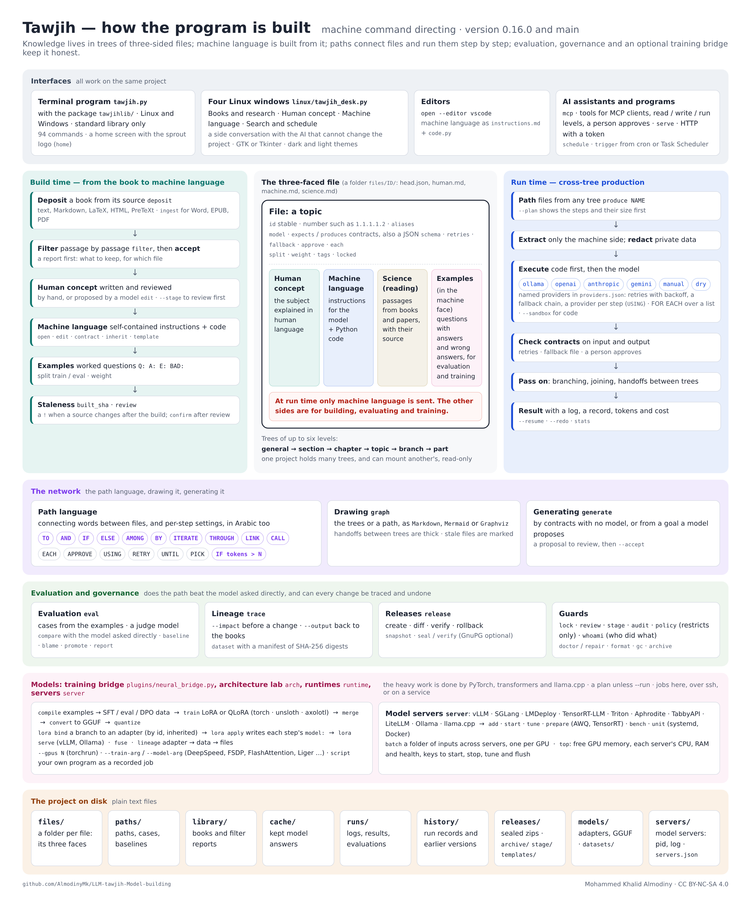
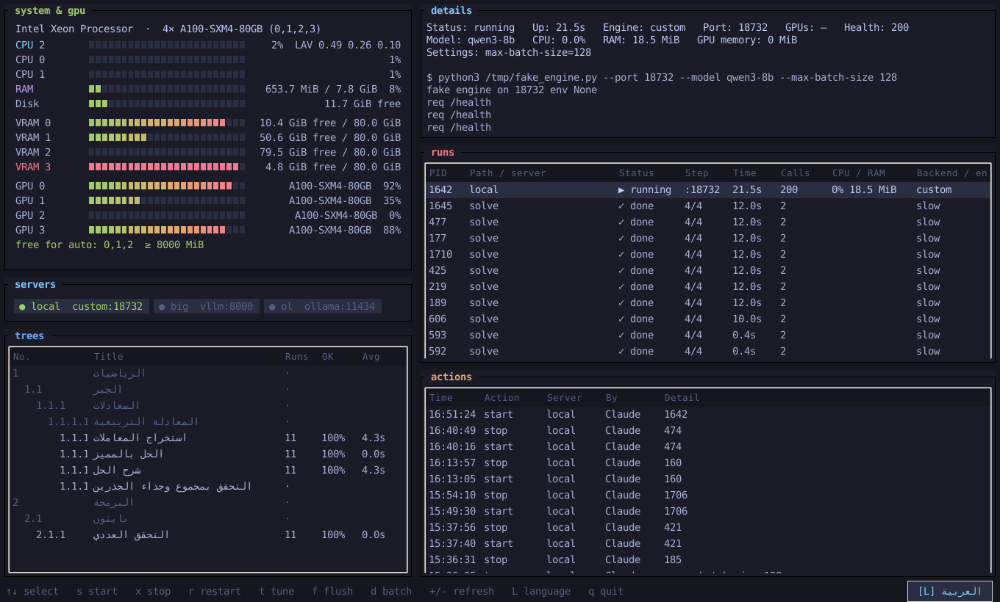

# tawjih — توجيه أوامر الآلة

**Direct a language model through small text files that you write and
review yourself, join them into paths, and know where every answer came
from.** Knowledge is kept in trees of small files; each file has a human
side, a machine side (instructions for a model and optional Python code), a
reading side with its sources, and optional worked examples. When a path
runs, only the machine side is sent; every run is saved and can be traced.

Python 3.11 or later, standard library only, Linux and Windows.
**Experimental:** the test suite passes, but no real AI provider has been
used with it yet.

The first command on a terminal asks who you are (your name, and if you
like an email or an ORCID); runs, approvals and reviews are recorded under
that permanent id. It stays on your computer.

```
pip install tawjih
tawjih                 # who you are (the first time), then the home screen
tawjih home start      # your first project, step by step
tawjih init
tawjih new "Mathematics"
tawjih new "Algebra" --parent 1
tawjih tree
```

- A path language in English and Arabic: `TO`, `AND`, `IF … ELSE` (also
  `IF key = value`, and `IF tokens > N` on the size of a step's output),
  `AMONG … BY key`, `THROUGH`, `LINK`, `CALL`, with per-step `EACH`,
  `APPROVE`, `USING` (a provider for one step), `RETRY … UNTIL`, `PICK`.
- Contracts between steps (keys or a JSON Schema), staleness when sources
  change, a cache to resume.
- Named providers (`providers.json`): Ollama (with `num_ctx`), any
  OpenAI-compatible server, Anthropic and Google Gemini, with options sent
  as given, retries, backoff and fallback chains; keys stay in environment
  variables.
- Model servers (`tawjih server`): vLLM, SGLang, LMDeploy, TensorRT-LLM,
  Triton, Aphrodite, TabbyAPI, LiteLLM, Ollama, llama.cpp or any command;
  start, stop, health, logs, metrics, tuning, GPUs by free memory
  (`--gpus auto`), AWQ and TensorRT-LLM builds, benchmarks, systemd and
  Docker units. `tawjih batch` shares a folder of inputs among servers.
- Each file is a folder of three faces under one code, number and title:
  human, machine and science (`show REF --type machine`).
- Steps at the same time (`--max-workers`), going on past a failed branch,
  and `ITERATE` to run a whole path again on its result.
- An architecture lab (`tawjih arch`): model architectures as files, exact
  parameter counts, variants, mixture-of-experts routers (load-balancing
  loss, jitter, expert shares), a Hugging Face configuration, and a build
  check with transformers; runtimes (`tawjih runtime`) for long jobs here,
  over ssh, or on a service you drive.
- A home screen in the terminal (`tawjih` alone): the project at a glance,
  the commands as cards, and `tawjih home TOPIC` explanations.
- `tawjih top`: a live board like btop, the runs of paths and the files of
  the trees beside every counter of the computer: each core, memory, disk,
  network, each GPU's use and memory (VRAM), and the processor and GPU
  models; model servers with their health, CPU, RAM and GPU memory, and
  keys to start, stop, restart, tune and flush them. Arabic or English.
- `tawjih dashboard`: the same board in a window on this computer
  (Tkinter), with no browser, web server or network; Arabic (right to left,
  letters joined on Linux) or English.
- `run --trace`: each run as a trace in Langfuse or any OpenTelemetry
  collector (OTLP/JSON, no extra library), texts after redaction.
- A project policy that can only restrict: no code, local providers only,
  always sandboxed, a least level of human approval.
- Evaluation: cases from the examples, a path compared with the model asked
  directly, `--repeat N --min-pass K` for a model that does not always
  answer the same, baselines, datasets with SHA-256 manifests, lineage with
  `trace`; records keep the model version the provider reports.
- Governance: locks, review, staged proposals, sealed releases, schedules.
- `tawjih mcp`: an MCP server for AI assistants, where a person approves
  every write and every run; with a key, a run is durable (it survives a
  disconnect, can be cancelled, and is never started twice).
- `tawjih whoami`: everyone has a permanent id, and records say who ran,
  approved and reviewed.
- Checked on every change with CodeQL, fuzzed with ClusterFuzzLite, and
  released with Sigstore signatures.
- `tawjih do`: management statements in English or Arabic.

Full documentation, the example project, the Linux windows and the optional
training bridge are in the repository. The bridge (`plugins/neural_bridge.py`:
SFT and DPO with LoRA, QLoRA, DoRA, PiSSA, LoHa, IA3, VeRA, OFT, prompt
tuning and other PEFT methods, here or on a rented GPU over ssh) is one
file that works beside this package; it takes any TRL or `TrainingArguments`
setting (`--train-arg`), `from_pretrained` settings (`--model-arg`) and
several GPUs (`--gpus N`):
<https://github.com/AlmodinyMk/LLM-tawjih-Model-building>
([العربية](https://github.com/AlmodinyMk/LLM-tawjih-Model-building/blob/main/README.ar.md)).





Licensed CC BY-NC-SA 4.0: noncommercial use with credit and the same
license for adaptations; commercial use needs permission from the author.
