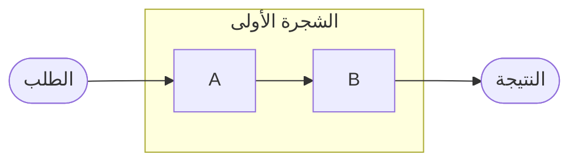
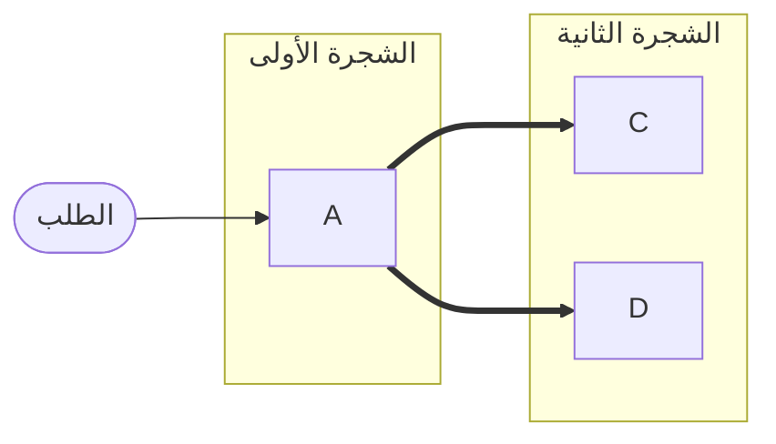
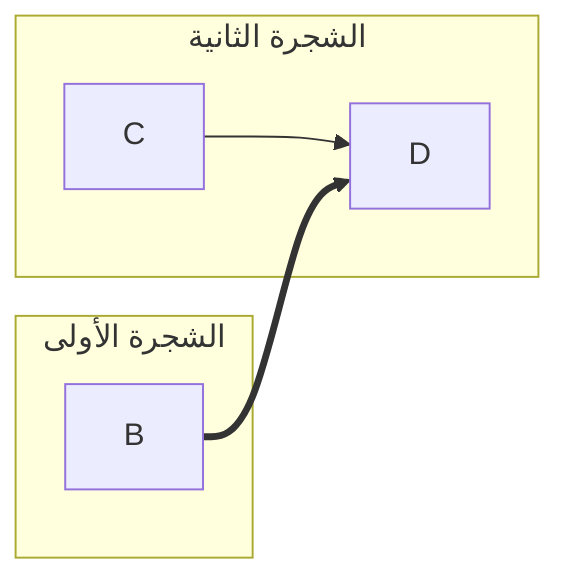
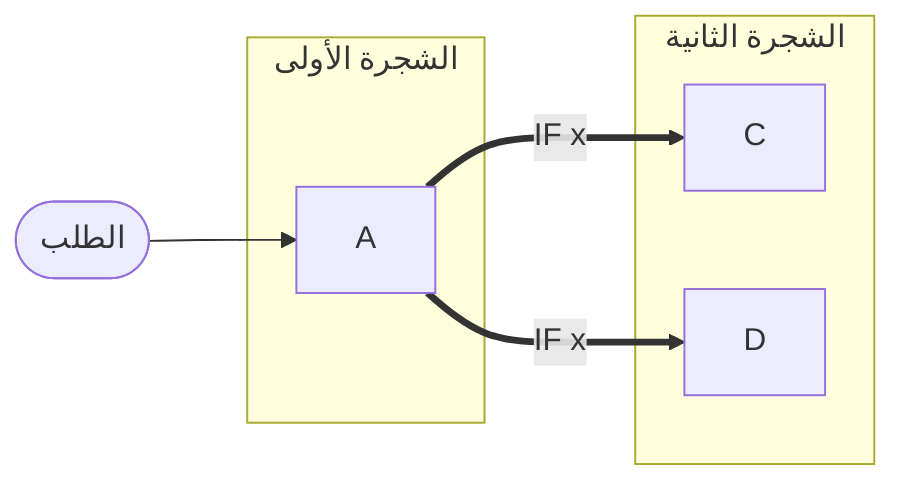
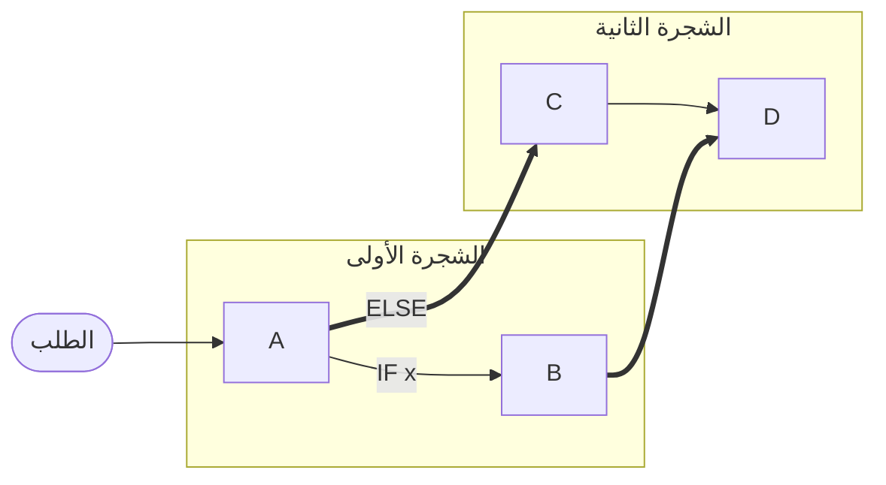
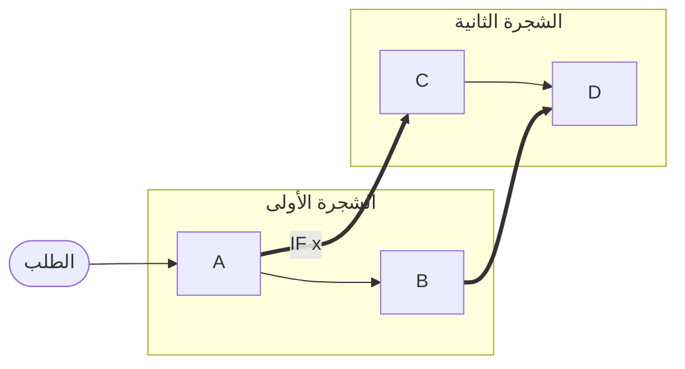
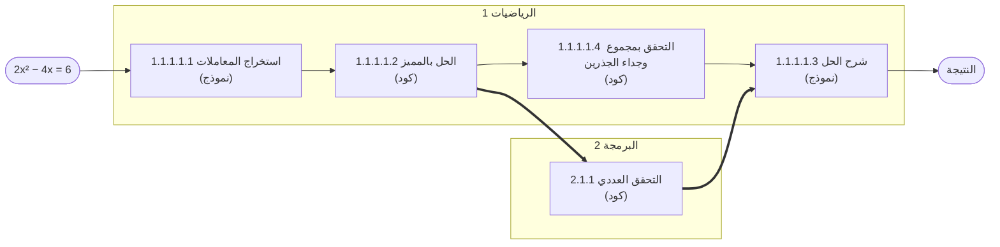

# حركة المسار عبر الأشجار

توجيه · [English](path-movement.md)

المسار لا ينقل الأشجار ولا يغيّرها. تبقى الملفات في أماكنها من أشجارها،
والمسار يرسم طريقاً فوقها يتحرك عليه العمل: من الطلب، عبر وجه لغة الآلة في
كل ملف، إلى النتيجة. في الأمثلة التالية A وB في شجرة، وC وD في شجرة أخرى:

```
1    الشجرة الأولى       2    الشجرة الثانية
├─ 1.1  A              ├─ 2.1  C
└─ 1.2  B              └─ 2.2  D
```

الرسوم بصيغة Mermaid التي يعرضها GitHub. كل إطار شجرة، وكل سهم رابط،
والكتابة على السهم شرطه، والسهم الذي يخرج من إطار إلى آخر تسليم بين شجرتين.
كل مثال مكتوب بالكلمات الإنجليزية، ومقابله العربي بجانب العنوان.

## ١. `A TO B` (أ إلى ب): تسلسل



يعمل A على الطلب، ويستلم B ناتج A، وناتج B هو النتيجة.

## ٢. `A TO C AND D` (إلى … و …): تفرّع بين شجرتين



يستلم C وD ناتج A، ولا ينتظر أحدهما الآخر (ومع `--max-workers 2` يعملان في
الوقت نفسه). لا شيء بعدهما، فالنتيجة تجمع الناتجين، كلٌّ تحت عنوانه.

## ٣. `B AND C TO D` (… و … إلى): دمج



يعمل D بعد الاثنين ويستلم ناتجيهما معاً، كلٌّ تحت سطر
`## from: العنوان [id]`.

## ٤. `A TO C AND D IF x` (إلى … و … إذا): شرط على التفرّع



`IF` يخص كل روابط `TO` التي قبله مباشرة، فهو هنا شرط على C وD معاً، وناتج A
هو الذي يقرر:

| ناتج A | A | C | D | النتيجة |
|---|---|---|---|---|
| `{"x": true}` | يعمل | يعمل | يعمل | ناتجا C وD |
| `{"x": false}` | يعمل | يُتخطّى | يُتخطّى | فارغة |

الملف المتخطّى لا يمرر شيئاً. وإذا لم يكن `x` مفتاحاً في ناتج JSON، فالشرط
هو ظهور الكلمة `x` في النص.

لوضع الشرط على فرع واحد فقط، اكتب جملتين:

```
A TO C / A TO D IF x
```

أما `A TO C IF x AND D` فمرفوضة: بعد `IF` لا تستمر الجملة بـ `AND`.

## ٥. `A TO B IF x ELSE C TO D` (إذا … وإلا): أحد الطريقين ثم يلتقيان



`TO D` في آخر الجملة يكمل من B ومن C معاً. يعمل واحد منهما فقط، ويستلم D
ناتج الذي عمل:

| ناتج A | B | C | يستلم D |
|---|---|---|---|
| `{"x": true}` | يعمل | يُتخطّى | ناتج B |
| `{"x": false}` | يُتخطّى | يعمل | ناتج C |

## ٦. عدة جمل: فرع قد يسقط

```
A TO B / A TO C IF x / B AND C TO D
```



| ناتج A | B | C | يستلم D |
|---|---|---|---|
| `{"x": true}` | يعمل | يعمل | ناتجا B وC |
| `{"x": false}` | يعمل | يُتخطّى | ناتج B وحده |

يعمل الملف إذا كان واحد على الأقل من روابطه فعّالاً، ولا يستلم إلا نواتج
الملفات التي عملت.

## مشروع المثال

المسار `branch` في [examples/quadratic](../examples/quadratic) يعبر شجرتي
الرياضيات والبرمجة:

```
e1d13b TO 51c684 TO de5595 AND 1f84db TO edc949
```



| الخطوة | الملف | يستلم | يمرر |
|---|---|---|---|
| 1 | 1.1.1.1.1 | الطلب | `{"a": 2, "b": -4, "c": -6}` |
| 2 | 1.1.1.1.2 | الخطوة 1 | المعاملات، والمميز 64، والجذرين 3 و−1 |
| 3 | 2.1.1 (تسليم إلى البرمجة) | الخطوة 2 | التحقق بالتعويض: PASS |
| 4 | 1.1.1.1.4 | الخطوة 2 | التحقق بالمجموع والجداء: PASS |
| 5 | 1.1.1.1.3 (عودة إلى الرياضيات) | الخطوتين 3 و4، كلٌّ تحت `## from:` | الشرح، وهو النتيجة |

الخطوتان 3 و4 فرعا `AND`، والخطوة 5 تدمجهما. والأمر `produce branch --plan`
يطبع الجدول نفسه من البرنامج، و`graph --path branch` يرسم المسار.
