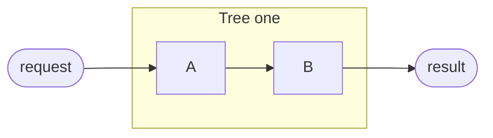
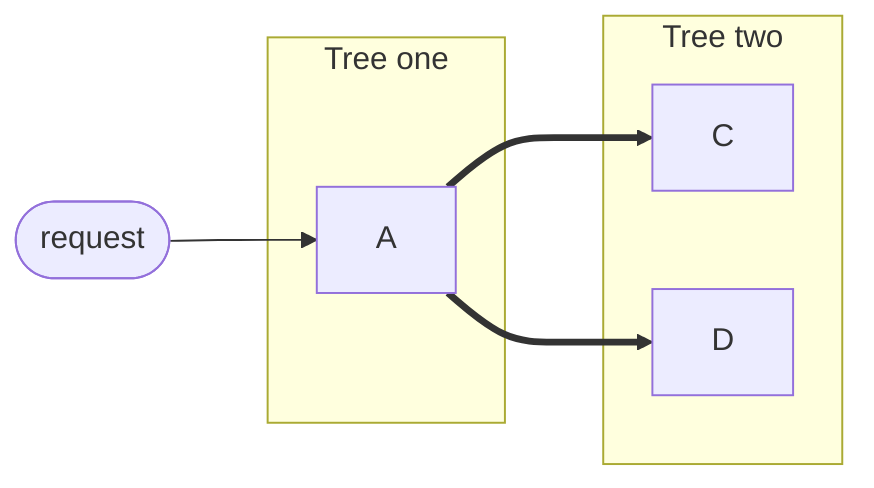
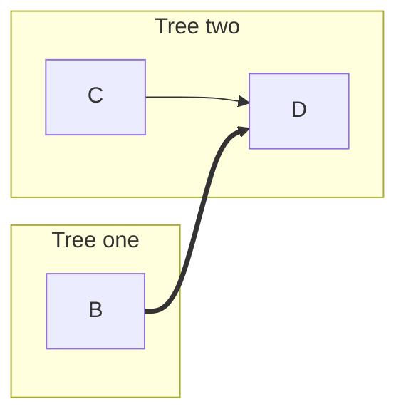
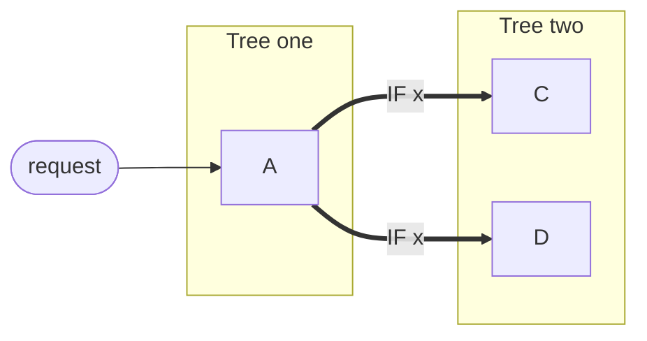
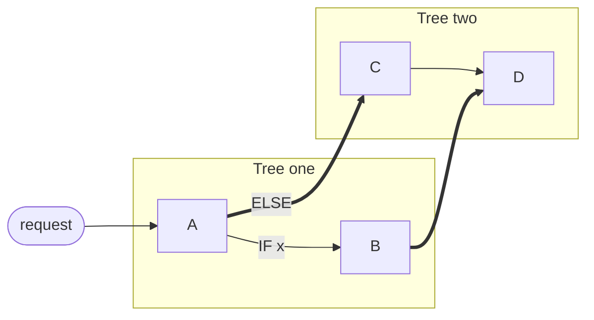
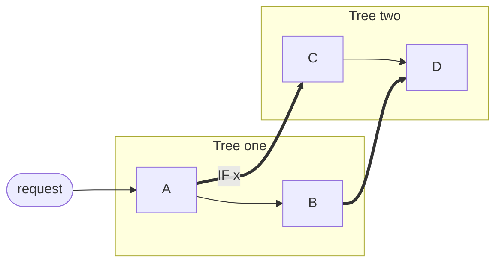
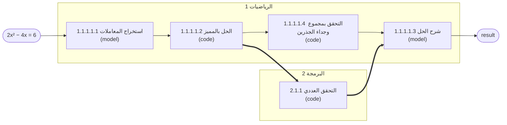

# How a path moves through the trees

Tawjih · [العربية](path-movement.ar.md)

A path never moves or changes the trees. The files stay where they are in
their trees; the path draws a route over them, and the work moves along
that route: from the request, through each file's machine side, to the
result. In the examples below, A and B sit in one tree and C and D in
another:

```
1    Tree one          2    Tree two
├─ 1.1  A              ├─ 2.1  C
└─ 1.2  B              └─ 2.2  D
```

The diagrams use GitHub's Mermaid. Each box is a tree, an arrow is a
connection, a label on an arrow is its condition, and an arrow that leaves
a box is a handoff between trees.

## 1. `A TO B`: a sequence



A works on the request; B receives A's output. B's output is the result.

## 2. `A TO C AND D`: branching across trees



C and D both receive A's output and do not wait for each other (with
`--max-workers 2` they run at the same time). Nothing follows them, so
the result holds both outputs, each under its title.

## 3. `B AND C TO D`: joining



D runs after both and receives both outputs together, each under a line
`## from: TITLE [id]`.

## 4. `A TO C AND D IF x`: a condition on a branch



`IF` belongs to every connection of the `TO` just before it, so here it
holds for both C and D. A's output decides:

| A's output | A | C | D | Result |
|---|---|---|---|---|
| `{"x": true}` | runs | runs | runs | C's and D's outputs |
| `{"x": false}` | runs | skipped | skipped | empty |

A skipped file passes nothing on. When `x` is not a key of a JSON output,
the condition is whether the word `x` appears in the text.

To put the condition on one branch only, write two statements:

```
A TO C / A TO D IF x
```

`A TO C IF x AND D` is refused: after `IF`, a statement cannot go on
with `AND`.

## 5. `A TO B IF x ELSE C TO D`: one way or the other, then together



The `TO D` at the end continues from both B and C. Only one of them runs,
and D receives the output of the one that ran:

| A's output | B | C | D receives |
|---|---|---|---|
| `{"x": true}` | runs | skipped | B's output |
| `{"x": false}` | skipped | runs | C's output |

## 6. Several statements: a branch that may drop out

```
A TO B / A TO C IF x / B AND C TO D
```



| A's output | B | C | D receives |
|---|---|---|---|
| `{"x": true}` | runs | runs | B's and C's outputs |
| `{"x": false}` | runs | skipped | B's output only |

A file runs when at least one of its connections is active, and receives
only the outputs of the files that ran.

## The example project

The path `branch` of [examples/quadratic](../examples/quadratic) crosses the
trees الرياضيات (mathematics) and البرمجة (programming):

```
e1d13b TO 51c684 TO de5595 AND 1f84db TO edc949
```



| Step | File | Receives | Passes on |
|---|---|---|---|
| 1 | 1.1.1.1.1 | the request | `{"a": 2, "b": -4, "c": -6}` |
| 2 | 1.1.1.1.2 | step 1 | the coefficients, Δ = 64 and the roots 3 and −1 |
| 3 | 2.1.1 (handoff to البرمجة) | step 2 | the check by substitution: PASS |
| 4 | 1.1.1.1.4 | step 2 | the check by sum and product: PASS |
| 5 | 1.1.1.1.3 (handoff back) | steps 3 and 4, each under `## from:` | the explanation: the result |

Steps 3 and 4 are the two branches of `AND`; step 5 joins them. `produce
branch --plan` prints the same table from the program itself, and `graph
--path branch` draws the path.
